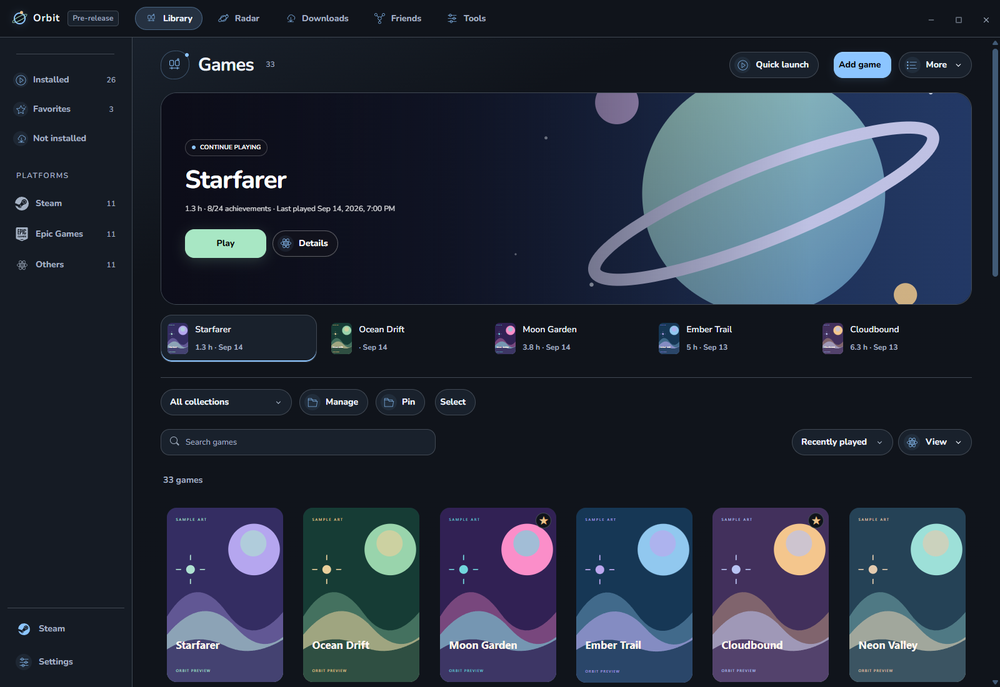
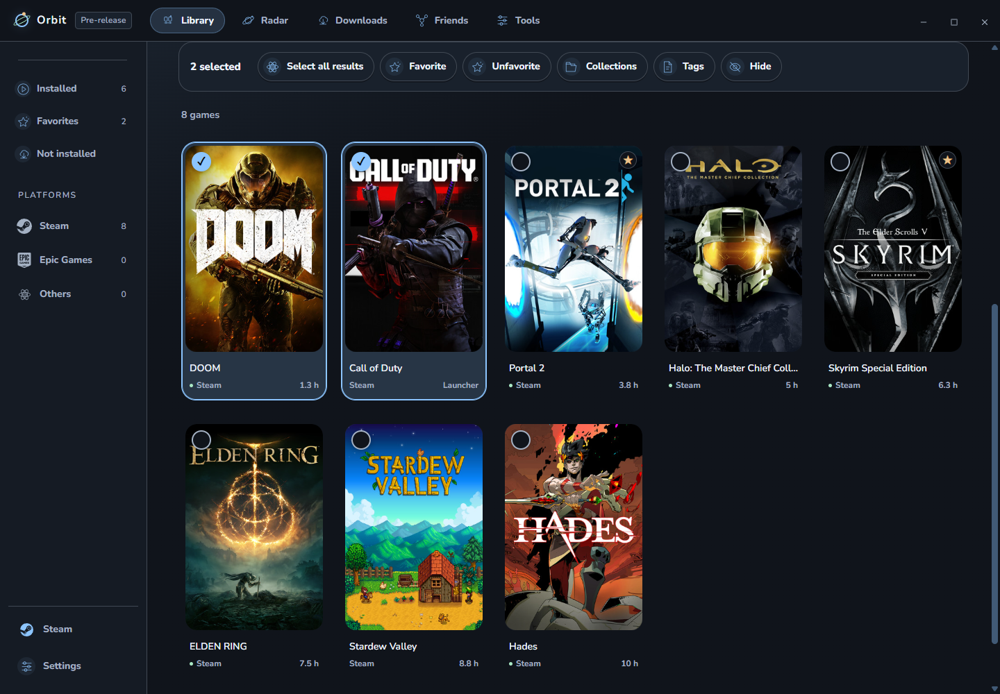
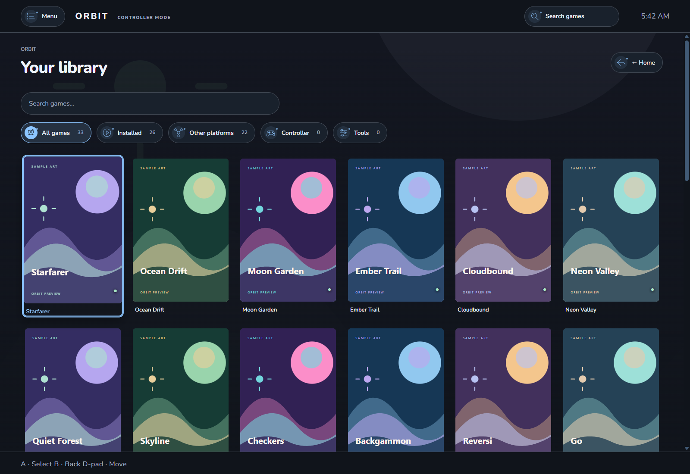
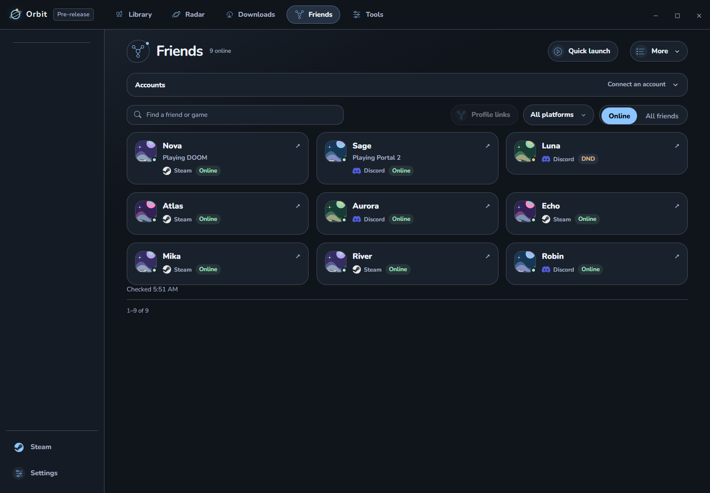
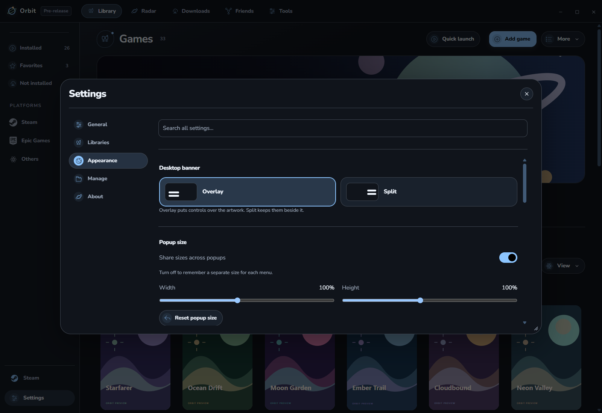

# Orbit

**An all-connected, elegant Windows launcher for your game libraries, local games, and emulators.**

Find something to play, organize your collection, and launch your titles seamlessly from one unified place.



---

## Highlights

* 🎮 **Unified Library:** Automatically discovers and aggregates games from Steam, Epic, Ubisoft, Roblox, and custom executables into one clean, consolidated library.
* 🕹️ **Controller Mode:** Fullscreen gamepad navigation with customizable bindings, on-screen keyboard, and console-style game pages designed for TV gaming.
* 🎨 **Deep Customization:** Built-in and custom color palettes, custom background images, animated startup scenes, custom fonts, and matching Windows taskbar icons.
* 📐 **Flexible Desktop Layouts:** Choose between Gallery, Workspace, and Shelf layout presets, with custom section ordering, collapsible sidebars, and resizable modals.
* 👥 **Friends & Rich Presence:** Connect Steam and Discord friends into a unified list, link matching profiles, and broadcast granular Discord Rich Presence.
* ⏱️ **Activity & Playtime:** Track local session times and streaks with built-in tools to edit times, merge split sessions, and recover edits.
* 🚀 **Downloads & Storage:** Monitor active downloads, manage multi-drive storage, and control Steam queues directly within Orbit.
* ⚡ **Experimental Capabilities:** Optional SteamVR overlay dashboard with wrist controls, game graphics configuration presets, and hardware FPS estimates.

---

## Gallery

| Organizing Collections | Controller Mode |
| :---: | :---: |
|  |  |

| Friends & Profiles | Themes & Appearance |
| :---: | :---: |
|  |  |

---

## Installation

Download the latest version from [GitHub Releases](https://github.com/tkokero/Orbit/releases):

* **Installer:** Download and run `Orbit-Setup.exe` for automatic installation and background updates.
* **Portable:** Download `Orbit-Windows.zip`, extract to any folder, and run `Orbit.exe`.

---

## Quick Start

1. **Launch Orbit:** Orbit runs a quick initial scan to detect installed games and launchers.
2. **Keyboard Shortcuts:**
   * `Ctrl+K`: Global search for games, collections, settings, and actions.
   * `Ctrl+Shift+P`: Quick Launch menu.
3. **Customize:** Open **Settings → Appearance** to select your favorite theme, layout preset, and startup animation.

---

## Building from Source

Ensure you have **Node.js 22.12+** installed:

```powershell
# Clone the repository
git clone https://github.com/tkokero/Orbit.git
cd Orbit

# Install dependencies and run tests
npm ci
npm test

# Launch Orbit in development mode
npm start
```

For complete development and architecture details, see [Contributing](CONTRIBUTING.md).

---

## Documentation

* 📖 [**User Guide**](docs/GUIDE.md): Library management, layout presets, activity tracking, and friends.
* 🎮 [**Controller Mode Guide**](docs/CONTROLLER.md): Gamepad controls, shortcuts, and TV mode settings.
* 🧪 [**Experimental Features**](docs/EXPERIMENTS.md): SteamVR companion, graphics presets, and FPS estimates.
* 🗺️ [**Roadmap**](ROADMAP.md): Milestones leading to Orbit 1.0.
* 📝 [**Changelog**](CHANGELOG.md): History of updates and improvements.
* 🔒 [**Privacy Policy**](PRIVACY.md): Data handling and local-first storage.

---

## License

Orbit is licensed under the [MIT License](LICENSE).
