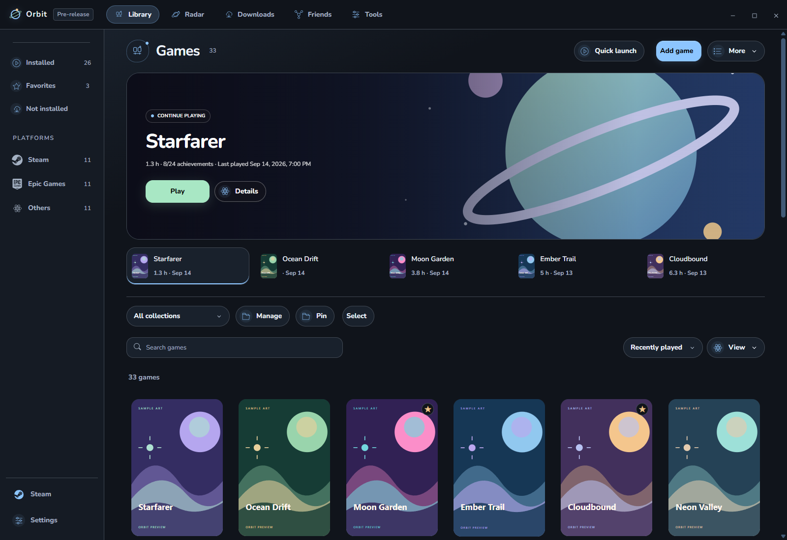
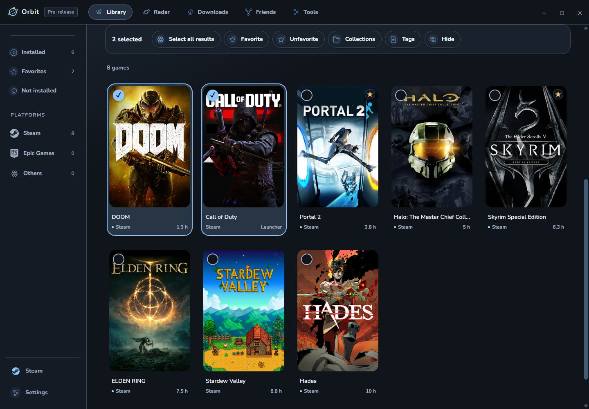
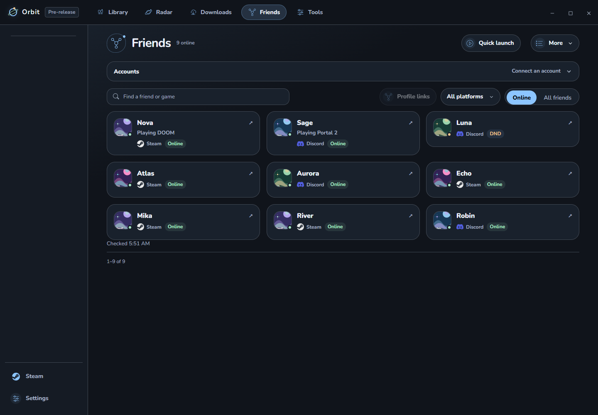
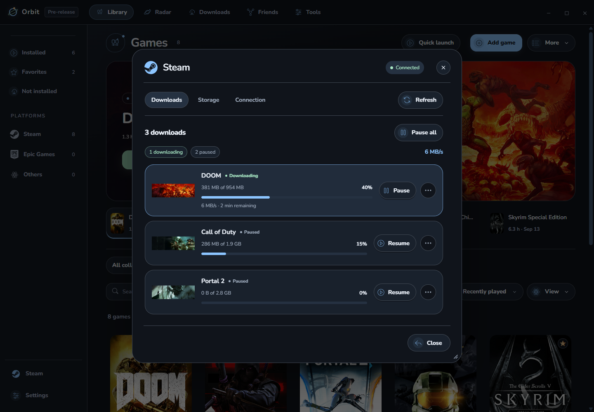
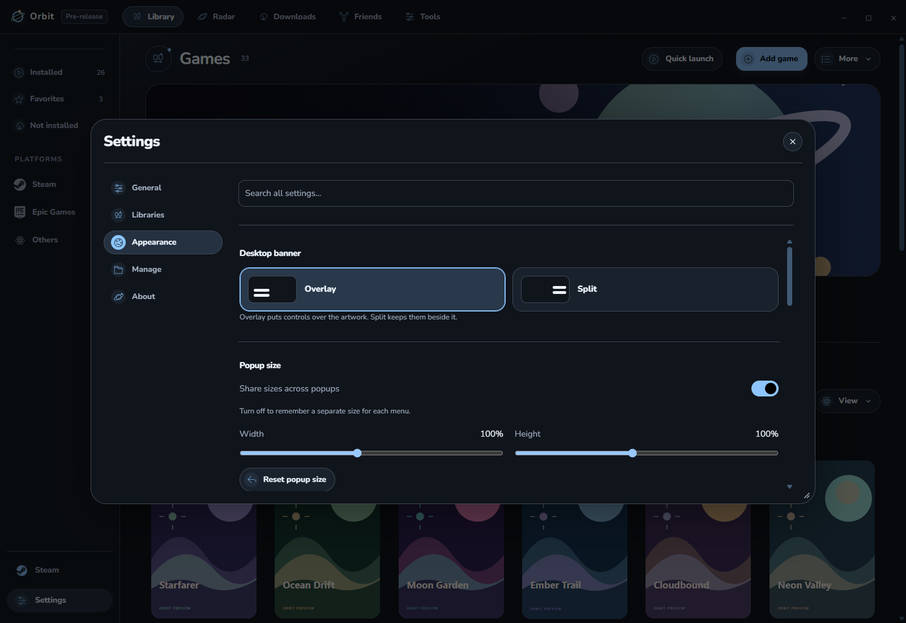
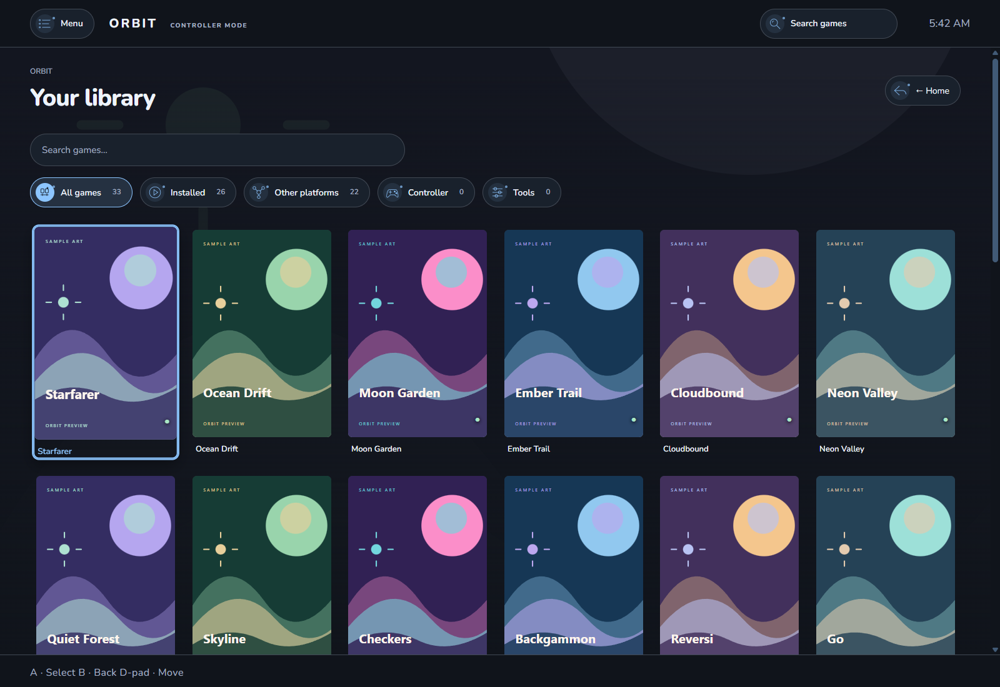

# Orbit

A Windows launcher for your game libraries, local games, and tools. Find something to play, organize your collection, and launch it from one place.

*Example library with real games and publisher artwork. Profiles, playtime, and downloads are sample data. Screenshots show the development build; published builds may differ.*

## Get started

Download **Orbit-Setup.exe** from [Releases](https://github.com/tkokero/Orbit/releases). For portable use, extract the entire Windows ZIP before opening Orbit. Windows builds are unsigned.

Use Quick start to find games and choose optional connections. **Take a tour** shows the main controls; reopen it from **Settings → General**. Keep any original clients your games require.

## Your library

- Browse covers, landscape banners, or a list. Adjust card size and spacing.
- Search, filter, favorite, and pin collections in the sidebar.
- Use Ctrl/Shift selection to organize several games together, with Undo for bulk changes.
- Open Details for game copies, launch settings, artwork, notes, and available statistics. Right-click for related actions.
- Press **Ctrl+K** for Quick launch or **Ctrl+F** to search your library.

Orbit combines detected copies and lets you choose a preferred launch. Add executables or import supported libraries. Detection and statistics depend on the provider; finding a launcher or old play history does not prove ownership.

## Friends

See supported Steam and Discord friends, search by name, and review suggested profile links. Linking requires your confirmation. Online puts playing friends first, followed by Do Not Disturb and plain online; other states remain in All friends.

Discord friends requests basic identity and read-only relationships access and needs the Discord desktop client. Epic is client-only. Optional **Discord Rich Presence** has separate controls in **Settings → Privacy**. Hidden game names show **Playing a game**.

## Downloads and Steam

Follow supported downloads with artwork, progress, and available speed estimates. Steam controls group **Downloads**, **Storage**, and **Connection**, including folder space and supported queue actions.

The optional experimental Steam connection restarts Steam and opens a local debugging channel. Use it only on a trusted computer. Steam updates can break compatibility; sign-in, agreements, and some operations still need the original client. Restart Steam normally to disable the channel.

**Radar** brings together upcoming releases, your wishlist, and Steam deals. Game news opens inside Orbit with photos and working links. Dates and prices can change; check the original store before purchasing.

## Make it yours

Choose themes, custom colors, backgrounds, fonts, and startup scenes. Switch between Overlay and Split banners. Resize Desktop popups from their corners and remember shared or separate sizes. Accessibility includes text scaling, stronger focus, contrast, and reduced motion.

Settings and themes stay in your local profile. **Settings → Manage** includes preference backups, recovery tools, exports, and updates.

## Controller mode

Use larger controls, gamepad navigation, configurable bindings, and artwork-led game pages. Orbit handles supported game launch and return transitions. See [Controller Mode](CONTROLLER.md) for controls and limitations.

## Sessions and backups

Orbit tracks supported running games, including launches outside Orbit. Activity shows local sessions; platform-reported hours stay separate. Storage shows installations and drive space.

Choose a save folder to make local snapshots. Restore previews changes and keeps a recovery copy. Close the game before restoring, and keep another backup elsewhere.

Closing Orbit normally leaves tracking and essential services in the tray. The interface targets low-maintenance mode after two seconds when no dialog or protected operation is active. Use the tray menu to quit.

Installed builds receive published updates. Draft releases are excluded. Offline mode uses cached information; games keep their own sign-in requirements.

## Help and source

Report problems from **Settings → About**, including steps to reproduce them. Leave private account information out of reports.

Orbit is [MIT licensed](LICENSE). See [CONTRIBUTING.md](CONTRIBUTING.md) for building from source, [PRIVACY.md](PRIVACY.md) for data handling, and [THIRD_PARTY.md](THIRD_PARTY.md) for notices. Hardware performance estimates are approximate, not measured benchmarks.
