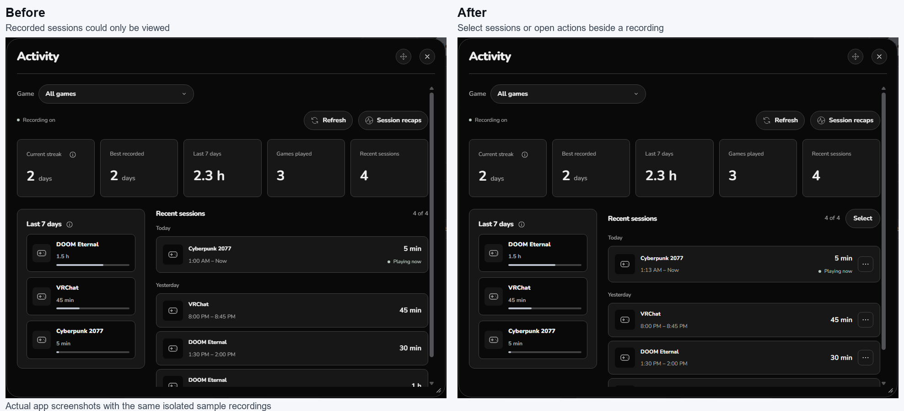

# Activity

Open **Activity** in the sidebar for all recorded games, or **Details → Activity** for one game. If Activity is hidden, enable it in **Settings → Appearance → Layout**.

## Browse recordings

- Use the game selector to choose one game or **All games**. A selected game in the summary can be clicked again to clear its filter.
- The summary shows Orbit's recorded plays, streaks and recent time. These are local recordings; platform-reported hours remain separate.
- Recording requires Orbit's tracking service and **Record session history** in Privacy. Turning recording off does not manufacture or recover sessions Orbit never observed.

## Correct a completed session

1. Open the menu beside a completed session and choose its edit action.
2. Enter the correct start and end times.
3. Review the duration and affected totals before saving.

Running sessions cannot be edited. If a review becomes stale, refresh and review the current recording again.

## Merge or remove recordings

Use **Select**, Ctrl/Shift or the checkboxes to select completed recordings. Merge recordings of the same game, or review removal of the selected recordings.

Example: two 45-minute recordings become one 90-minute recording. A gap between them is excluded. Orbit updates its recorded play count and streak calculations; Steam hours and achievements are unchanged.

## Undo a correction

Use **Undo** after a correction. Recovery for the latest correction lasts seven days and survives restarting Orbit; another correction replaces that recovery point. Orbit stops a recovery that would overwrite newer affected history or an active session.

History retention is currently limited to 180 days and 1,000 source recordings. Activity displays up to 100 combined sessions; older accumulated play totals are retained separately.

[Library](LIBRARY.md) · [Privacy](../PRIVACY.md)
