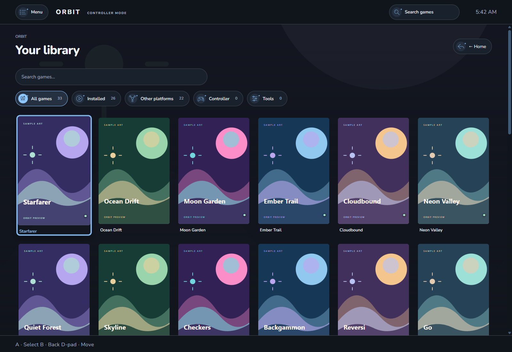

# Controller Mode

Open **More → Controller mode** to enter Orbit's fullscreen couch interface. Use the onscreen menu or press Escape on a keyboard to return to Desktop view.

---

## Gamepad Controls

| Action | Xbox / Standard | PlayStation | Nintendo Switch |
| --- | --- | --- | --- |
| **Navigate** | D-pad / Left Stick | D-pad / Left Stick | D-pad / Left Stick |
| **Select / Confirm** | A | Cross | A |
| **Back / Cancel** | B | Circle | B |
| **Main Navigation Menu** | Menu (Start) | Options | + |
| **Quick Actions** | Hold Menu | Hold Options | Hold + |
| **Change Tabs** | LB / RB | L1 / R1 | L / R |
| **Scroll View** | Right Stick | Right Stick | Right Stick |
| **Quick Wheel** | Hold View (Back) | Hold Share | Hold - |

Customize bindings, stick deadzones, and repeat timing in **Settings → General → Controller navigation**.

---

## Playing Games

* **Browsing:** Navigate your library with cover-led artwork cards, search, and category filters.
* **Game Pages:** Dedicated game hubs with artwork, details, stats, launch options, and play controls.
* **Launch Transitions:** Orbit tracks game launches, steps aside when the game window is ready, and automatically returns to the controller interface when you exit the game.
* **On-Screen Keyboard:** Built-in virtual keyboard supports text entry for search and settings using gamepad sticks and face buttons.
* **Sound Effects:** Dedicated controller navigation sound effects with separate volume and mute controls in **Controller Settings → Sound**.
