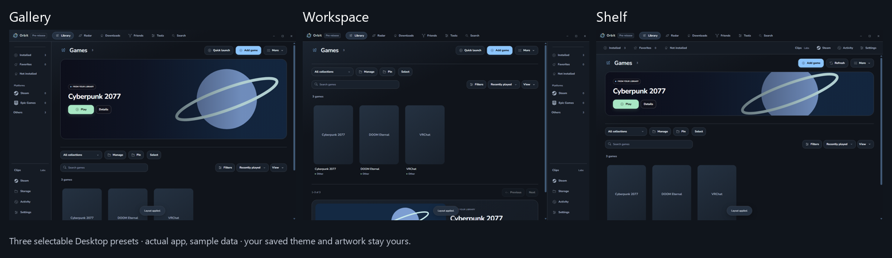

# Desktop layouts

Open **Settings → Appearance → Layout**, or **More → Customize menus**. Changes appear in the live preview; narrow windows can hide the preview to leave more room for controls.

## Choose a starting layout

| Preset | Appearance |
| --- | --- |
| Gallery | Large artwork, left navigation and a wide library. |
| Workspace | Games first, right navigation and centered content. |
| Shelf | Navigation across the top and a wide library. |

Choose a preset, then adjust **Navigation** and **Content width** independently. **Transparent top bar** shows the selected theme background behind Orbit's bar; it does not reveal the Windows desktop. High contrast keeps the bar solid.

## Choose what appears

1. In **Desktop menus**, turn the featured banner, Recents or What's new on/off. Sidebar switches control Platforms, Activity and Storage.
2. Open **Section order** and drag sections, or use the arrows. Put Games first for quicker library access.
3. In **Recents**, choose the count and excluded games. Right-click a recent game to remove it only from Recents.
4. In **News sources**, choose muted/followed games. Muting news does not remove a library entry.
5. Choose up to three header actions and a banner height. Remaining actions stay in More; narrow windows move secondary actions there.

Hiding a section keeps its games, history and preferences saved. **Show all** restores these sections without resetting the rest of your layout.

## Save and recover

Save a named layout to reuse it later. **Previous layout** returns to the layout from before your last preset choice. Saved layouts keep presentation choices; exclusions and news-source choices remain independent. Themes and Controller layouts are unchanged.

Example: save Games first with compact Recents as Daily, then save Gallery with a large banner as Browse.

For cover/banner/list views and card density per collection, use [Library → Change the view](LIBRARY.md#change-the-view).

## Resize a popup

Drag its corner to resize it, or drag its header to move it. Choose shared or separate popup sizes in Appearance's popup controls. Restored sizes are constrained to the current display; opening Game options scrolls inside the popup instead of moving its outer frame.
