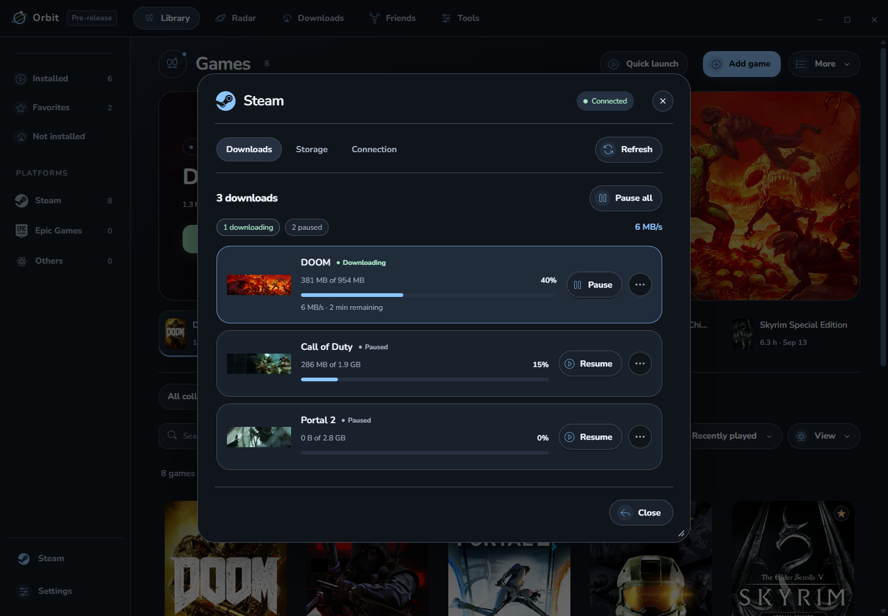

# Downloads and Steam

## Follow a download

Open **Downloads** in the top bar. Search by game or filter by platform/status. Each supported transfer shows its artwork, progress and available controls. Missing speed or size data is shown as unavailable rather than estimated as a fact.

Some launchers still require their own window for sign-in, agreements or installation choices. Opening Steam controls should leave the Downloads page and its current queue intact.

## Open Steam controls

Choose **Steam** near the bottom of the sidebar. Use the three tabs:

| Tab | Use it for |
| --- | --- |
| Downloads | Review Steam's queue and use available Pause/Resume controls. |
| Storage | See library folders and free space, add a folder, review a game move or set a download limit. |
| Connection | Review the optional experimental local connection and its setup requirements. |

## Connect queue controls

1. Open **Connection** and read the explanation.
2. Close running Steam games before the required Steam restart.
3. Enable the optional connection only if you want Orbit to manage supported Steam operations.
4. After Steam restarts and signs in, use **Refresh** and return to Downloads or Storage.

The connection opens Steam's local debugging interface. Use it only on a trusted computer. It can break after a Steam update; restart Steam normally to disable the channel. Orbit does not bypass account sign-in or game agreements.

## Storage actions

In **Storage**, choose a game and a destination, then **Review move** before confirming. For download limits, enter the requested Kbps value; **0** means unlimited. These controls apply to Steam, not every launcher.

If controls are unavailable, check Connection and use **Open Steam** for operations the client must finish. Avoid repeatedly refreshing a transfer that Steam is still preparing.

[Library](LIBRARY.md) · [Experimental features](EXPERIMENTS.md)
