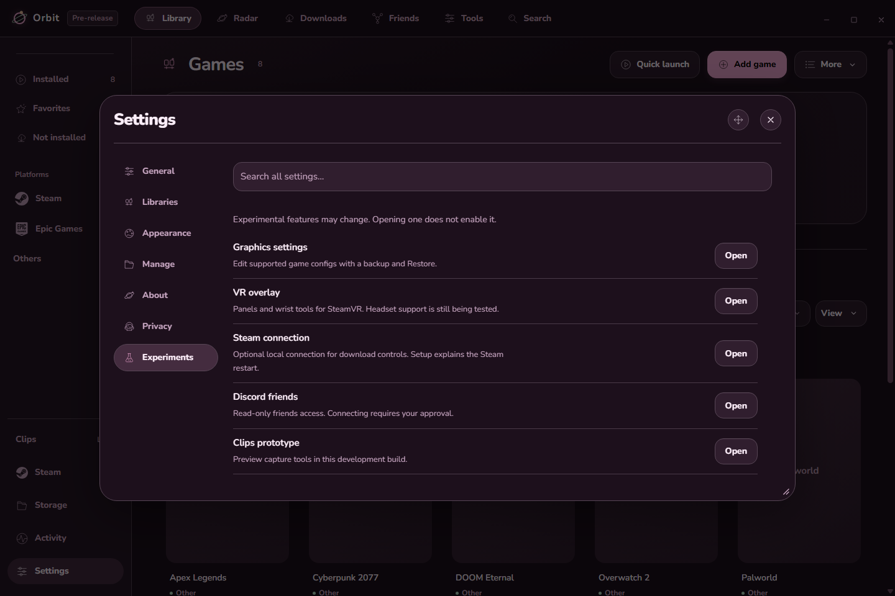

# Experimental Features

Orbit includes opt-in experimental features that explore extended capabilities beyond standard launcher functions. Access them under **More → Experiments**.

---

## 1. Game Graphics Settings

Orbit can locate and adjust recognized local game configuration files to apply performance or visual presets before you launch.

### Supported Games & Configs
* **Overwatch:** Overall quality, texture quality, and anti-aliasing methods.
* **Apex Legends & Source Engine:** VideoConfig files (ambient occlusion, texture streaming budget, shadow detail).
* **VRChat:** Avatar particle limiter and budget controls.
* **Unreal Engine User Settings:** Recognized scalability presets.

### Safe Config Workflow
1. Select a game and choose **Graphics settings** (or **Find config files**).
2. Choose **Custom** or select a **Performance / Super** preset.
3. Review changes in the diff view before applying.
4. Orbit automatically creates verified backups before writing. Use **Restore original settings** at any time to revert changes.

---

## 2. Orbit in VR (SteamVR Overlay)

An optional overlay dashboard for SteamVR headsets that brings your launcher and Windows desktop into virtual reality.

### Setup
1. Launch SteamVR and ensure your headset is tracked.
2. In Orbit, select **More → VR** (or **More → Experiments → VR overlay**), then click **Open Orbit in VR**.
3. Pin VR to the sidebar for one-click access.

### Features
* **Wrist Dashboard:** Glance at your wrist to check the time, GPU/FPS performance counters, media playback controls, and floating desktop previews.
* **Spatial Windows:** Spawn up to four desktop windows or physical monitors in 3D space with move, resize, and hide controls.
* **Safe Controls:** Input forwarding is explicitly gated per window; close the companion overlay anytime without interrupting your running VR title.

---

## 3. Hardware FPS Estimates

Select **Estimate FPS** in a game's details view to see projected performance targets calculated locally from your detected CPU, GPU, and RAM.

* **Publisher-Reference Models:** Supported titles (such as Cyberpunk 2077, Ghost of Tsushima, and Assassin's Creed Mirage) use published hardware baselines to project realistic resolution and preset performance ranges.
* **Generic Fallbacks:** Other games use broader workload heuristics.
* **Privacy:** All calculations are performed entirely on your PC; Orbit does not run background benchmarks or upload system telemetry.
