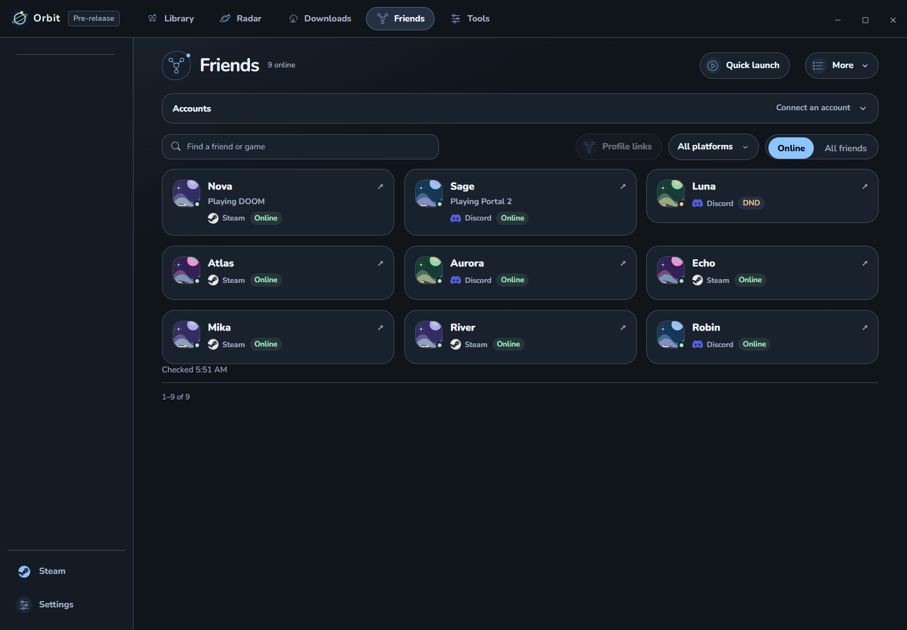

# Friends

Friends brings supported Steam and Discord profiles into Orbit. Connections are optional and separate from game libraries. Provider availability can differ between development and published builds.

## Connect

| Provider | What Orbit supports |
| --- | --- |
| Steam | Friends and available presence through Steam's Web API; requires your Steam ID and API key |
| Discord | Accepted friends and presence through an optional read-only connection; Discord must be open on the same account |
| Epic Games | Opens the official client; native friends access is not connected |

Orbit labels unavailable connections. Change your provider status in its official client.

## Connect an account

1. Open **Friends** in the top bar. Expand the account controls if they are folded.
2. Choose **Connect** for Steam or Discord. Follow that provider's sign-in/connection steps. Keep Discord's desktop client open on the intended account.
3. Approve only the access described by Orbit. After connecting, return to Friends and refresh if the list is not yet visible.

For Steam's API-key connection, use your own key in Orbit's connection form. Never put it in source files, shared presets, screenshots or bug reports. Disconnect from the provider's account menu.

## Browse and link profiles

**Online** shows fresh playing friends first, then Do Not Disturb, then plain online. Away, offline, and stale entries stay in **All friends**. Search by name or game. Right-click for related profile actions.

Similar Steam/Discord names can suggest a match. Confirm **Link** or **Keep separate**; Orbit never merges people from names alone. Linked cards retain each provider's identity and status. Change links through **Profile links**.

## Choose a main profile

1. Connect both Steam and Discord, then open **Profile links**.
2. Review a suggested match or choose the two profiles manually. Select **Link** only when they are the same person; **Keep separate** rejects a suggestion.
3. Choose **Default main profile**: Discord or Steam.
4. For an individual linked friend, choose their **Main profile**, or Default to follow the global choice.

Example: keep Discord as the default, but choose Steam for one friend whose Steam name you recognize. The card uses the main name/profile and preferred avatar; both identities and their own presence remain available under Profiles. Unlinking changes only Orbit's local grouping.

## If someone is missing

Switch from Online to **All friends**, clear the search/platform filter and refresh. Check the provider's privacy settings and whether its desktop client is open. Away, offline and stale entries are intentionally excluded from Online. An unavailable provider is not shown as connected.

## Privacy

Discord friends requests basic identity and read-only relationships access. Orbit displays accepted friends and does not request messages, voice, invitations, activity updates, or friend management for this connection.

Remembered connections use protected local storage. Disconnect from account controls. Stale data stays marked stale; recent games never substitute for current activity. Offline and invisible can look the same.

**Discord Rich Presence** is separate, under **Settings → Privacy**. Share a game name or show only **Playing a game**, and control elapsed time and background sharing. Guest mode and turning sharing off clear the activity.

See [Privacy](../PRIVACY.md) for data handling.
