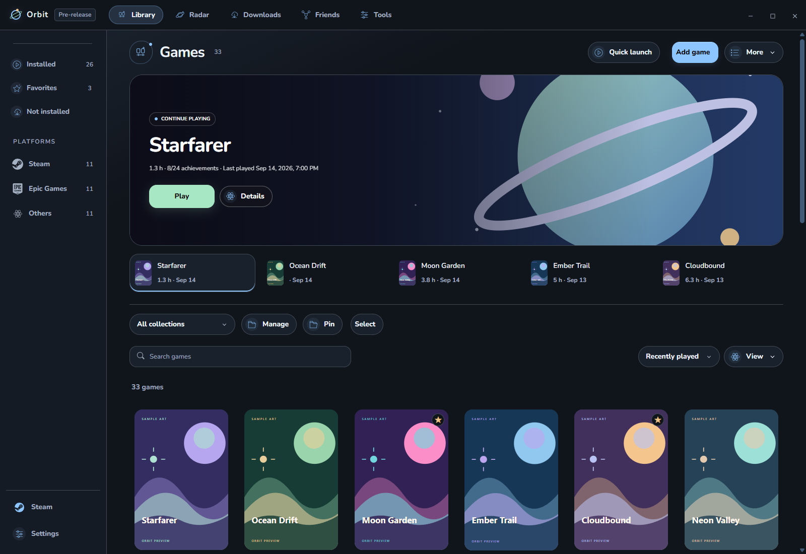
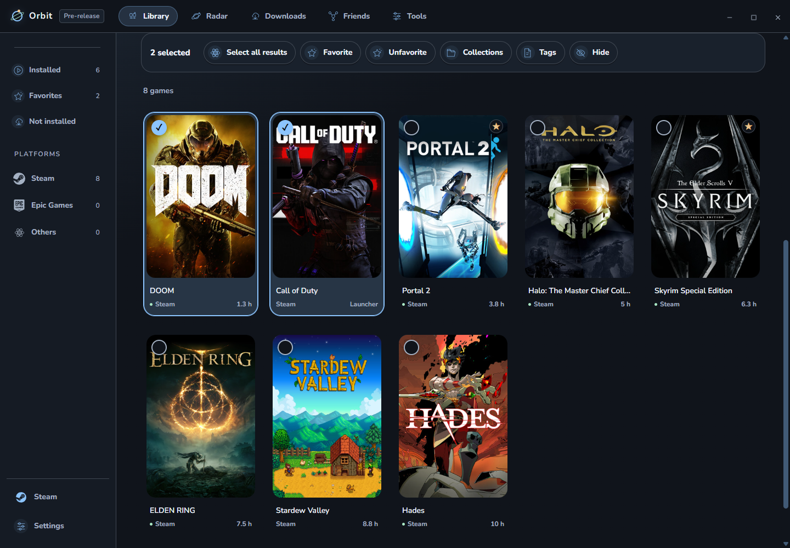
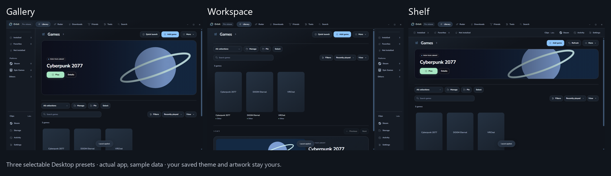
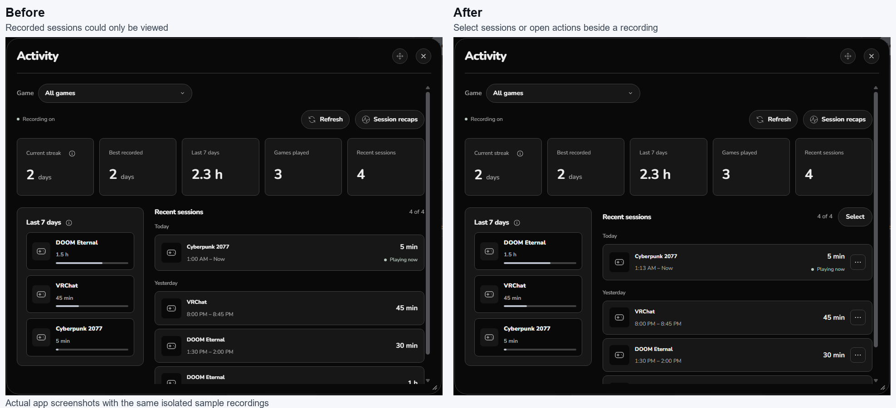
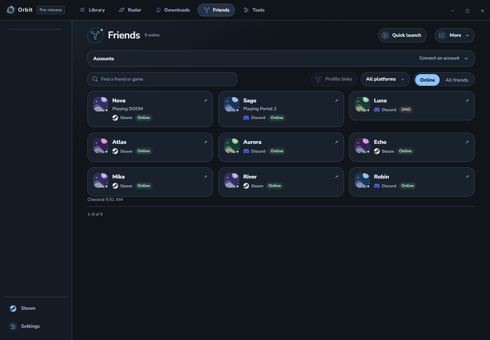
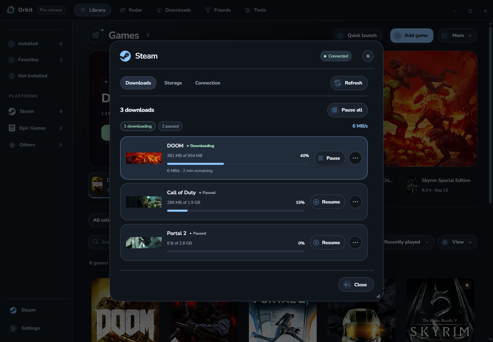
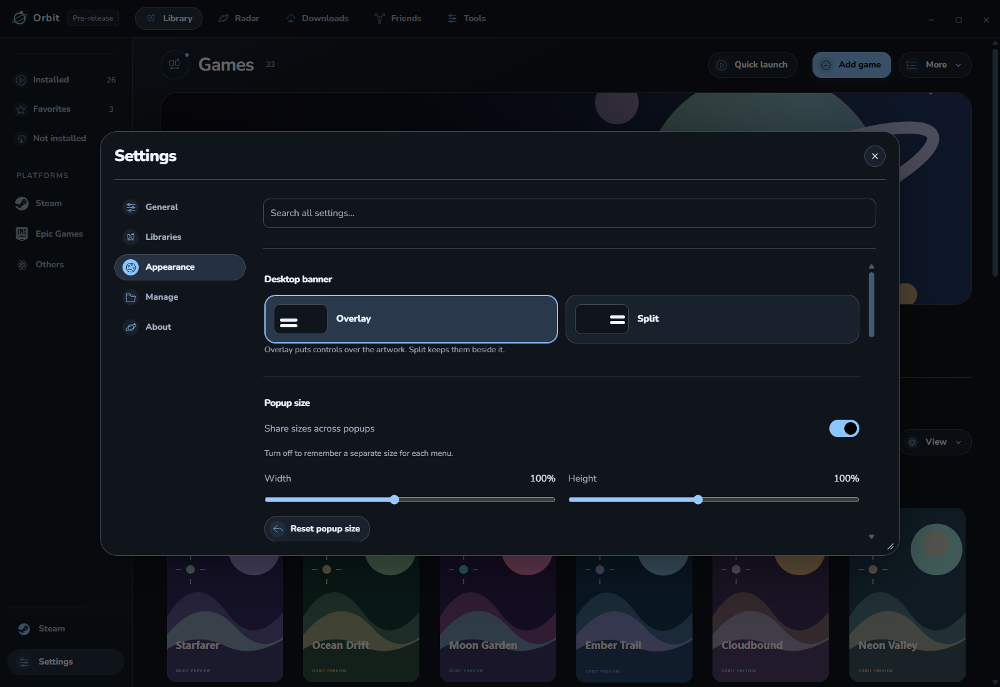

# Orbit User Guide

This guide covers everyday features in Orbit: library organization, layouts, session activity, friends, Steam downloads, and themes.

---

## 1. Library & Game Organization

### Find and Launch
1. Open **Library** and search by title, or use filters (**Installed**, platform, or collection) to narrow results.
2. Select any game to open **Details**, then choose **Play**, **Install**, or **Open launcher**.
3. Press **Ctrl+K** to search games, collections, settings, and actions. Press **Ctrl+Shift+P** for Quick Launch. (Shortcuts can be customized in **Settings → General → Keyboard shortcuts**).

### Layout Views
Above your games, toggle **Covers**, **Banners**, or **List** view, and adjust card sizing and spacing sliders.
* Orbit remembers layout preferences independently for each collection, as well as for Games and Tools.

### Organizing Games
* **Multi-Selection:** Hold `Ctrl` or `Shift` while clicking cards (or use checkboxes) to select multiple games at once.
* **Collections:** Drag games directly into pinned sidebar collections.
* **Undo Support:** Bulk moves and removals can be undone immediately with `Ctrl+Z` or the onscreen Undo toast.
* **Hiding Entries:** Right-click a title and choose **Remove from library** to hide it without uninstalling. Restore hidden games anytime via **Hidden games**.

---

## 2. Desktop Customization & Layouts

Open **Settings → Appearance → Layout** or **More → Customize menus**.

### Presets
* **Gallery:** Large artwork banner, left-hand navigation, and wide library grid.
* **Workspace:** Clean right-hand navigation with centered content and immediate library access.
* **Shelf:** Compact top-bar navigation bar with maximized library display area.

### Section Controls
* **Toggle Sections:** Show or hide the Hero banner, Recents, and News shelf, as well as sidebar categories.
* **Section Order:** Drag sections up or down to prioritize what appears first.
* **Transparent Top Bar:** Optionally blends theme artwork into the application header.
* **Resizable Popups:** Drag any modal corner to resize, or drag its header to reposition. Saved popup sizes can be shared or configured per menu.

---

## 3. Activity History & Session Corrections

Open **Activity** in the sidebar (or **Details → Activity** for a specific game) to view local playtime and streaks.

### Editing Recorded Sessions
1. Click the menu icon (`...`) next to any completed session and choose **Edit times**.
2. Adjust start and end times, review the updated duration, and save.

### Merging & Removing Sessions
* Select multiple completed sessions using checkboxes or Shift-click.
* Choose **Merge** to union overlapping recordings while excluding idle gaps.
* Select **Remove** to safely prune false observations.
* **7-Day Recovery:** Accidentally modified sessions can be restored within 7 days using **Undo correction** or the Recovery menu.

---

## 4. Friends & Online Presence

Orbit aggregates Steam and Discord friends into one unified list without requiring you to share passwords.

* **Steam:** Connect your Steam ID and API Key to display friends and current game status.
* **Discord:** Connect to the local Discord desktop client (read-only) for friends and presence.
* **Profile Linking:** Orbit suggests links when Steam and Discord friends share similar names. Confirm the link to view both identities on a single friend card, or choose **Keep separate**.
* **Presence Status:** Filter friends by **Online** (playing friends surfaced first) or browse **All friends**.

---

## 5. Steam Controls & Downloads

Open **Downloads** from the top bar to monitor active game transfers, speeds, and queue progress.

Under **Steam** in the sidebar:
* **Downloads:** Pause, resume, and reorder queued Steam downloads.
* **Storage:** View installed games across all storage drives and manage Steam library folders.
* **Local Connection:** Orbit features an optional local debugging channel that allows controlling Steam queues directly.

---

## 6. Appearance, Themes & Startups

Open **Settings → Appearance** to customize Orbit's look and feel.

* **Color Themes:** Choose built-in palettes or design your own with custom accents and background colors.
* **Custom Backgrounds:** Import PNG, JPEG, or WebP images with adjustable opacity and blur.
* **Startup Scenes:** Choose an intro scene or your own video, with optional sound and volume controls. Secret scenes appear after unlocking them.
* **App Icons:** Match the app icon to your theme or choose a separate style. Fully restart Orbit to apply the taskbar and tray icons together.
* **Typography & Accessibility:** Adjust font sizing, contrast enhancement, reduced motion, or supply a custom local font.
