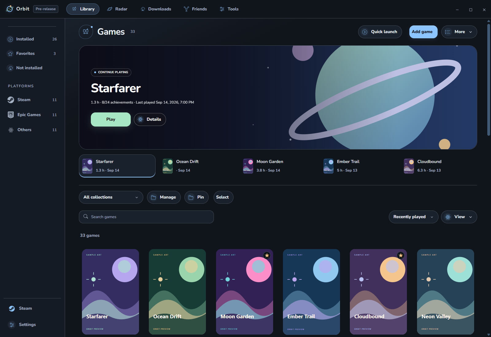
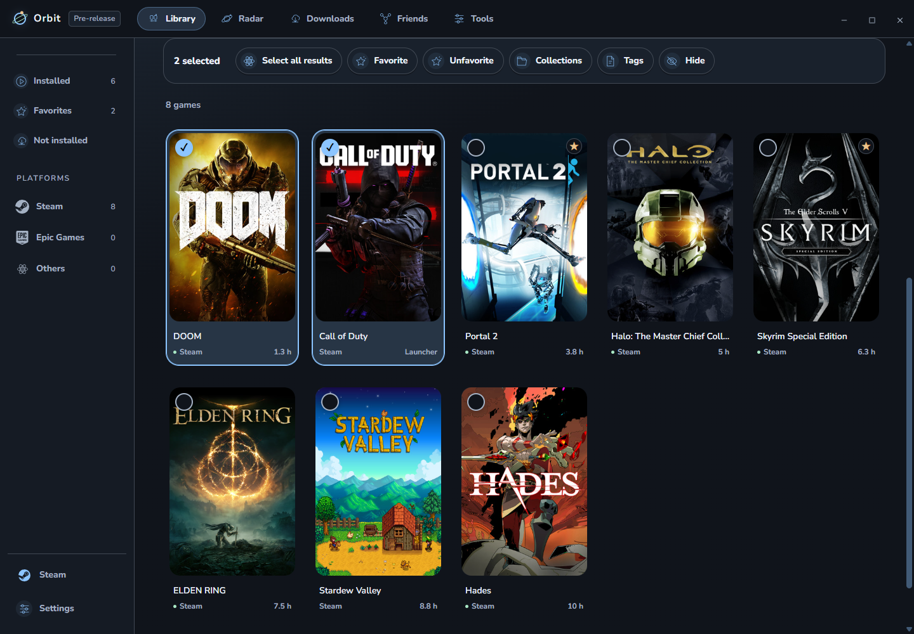

# Library

## Find and launch a game

1. Open **Library** and search by name. Use **Installed**, a platform or a collection to narrow the list.
2. Open the game for Details, then choose **Play**, **Install** or **Open launcher**, depending on what Orbit detected.
3. If a launch fails, read the error and use its relevant recovery action. Keep the original launcher installed when the game needs it.

**Ctrl+K** searches games, collections, settings and actions. **Ctrl+Shift+P** opens Quick launch. Change shortcuts in **Settings → General → Keyboard shortcuts**.

## Change the view

Open **View** above the games. Choose **Covers**, **Banners** or **List**, then adjust card size and spacing. Each collection can remember its own view; Games and Tools have separate choices.

Example: use larger banners for Co-op and compact covers for All collections.

## Organize several games

1. Use **Select**, Ctrl-click for individual games, or Shift-click for a range.
2. Use the bulk actions for favorites, tags, collections or hiding.
3. To add games to a manual collection, drag the selection onto its sidebar entry. Other manual collections appear during the drag.
4. Use **Undo** to reverse the latest supported bulk change.

Smart collections follow their saved rules; dragging does not change those rules. Use **Manage** beside the collection selector to create, rename or edit collections, and **Pin** to choose sidebar entries.

## Remove an entry without uninstalling

Right-click the game → **Remove from library**. **Undo** brings it back immediately. Later, open **Settings → Manage → Library → Hidden** and choose **Restore to library**. Removing an entry does not uninstall the game or delete its saves.

## Choose how a game launches

In **Details → All copies**, choose the preferred detected copy. For an alternate executable or arguments, use **Game options → Launch options**. The picker beside Play appears after adding an option. Keep the default option available while testing another route.

Use Game options for notes, artwork and detection controls. Supported graphics-file editing has its own [experimental guide](GAME-OPTIMIZATION.md).

Detection depends on the provider. A cached image, launcher or old play history does not establish ownership. [Desktop customization](DESKTOP-LAYOUTS.md) · [Activity](ACTIVITY.md)
