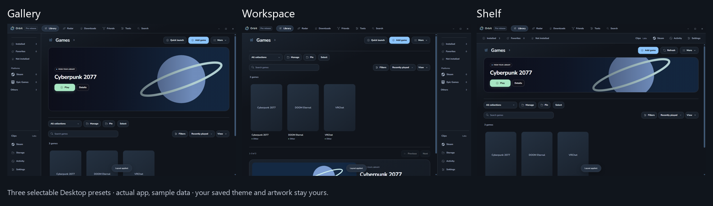
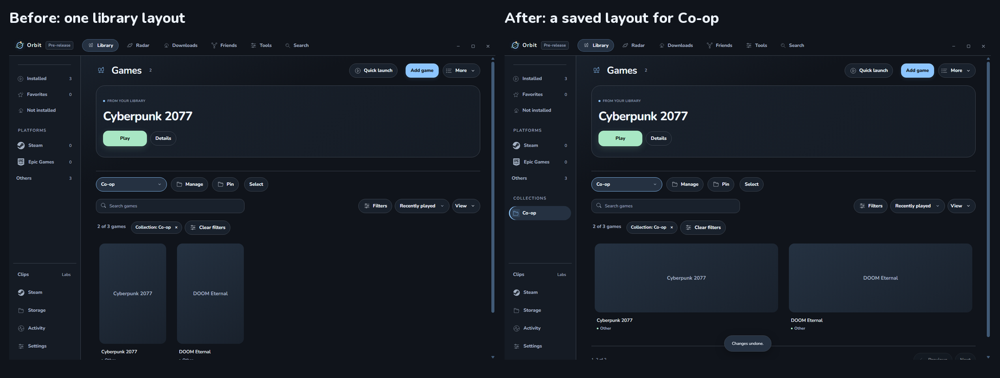
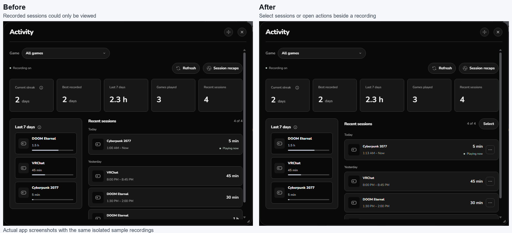
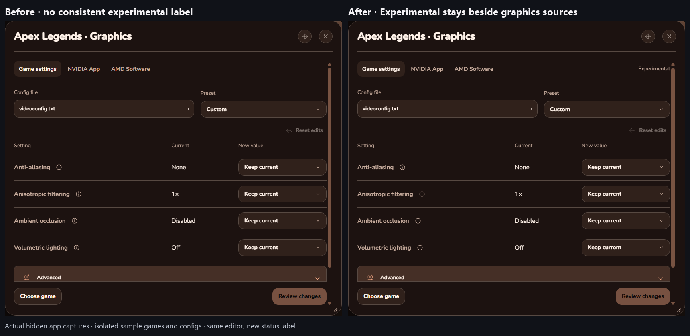

# Orbit 0.2.8 review and the next release

Planning review, November 4, 2026. Current installed build: **0.2.8-dev.17**. The 0.2.8 release is still unpublished. “Implemented” below means present in the development build; it does not mean every hardware or live-game check has passed.

**Recommendation:** finish and release 0.2.8, then start 0.3.0 with clipping as its main feature. Keep 0.2.9 available for necessary fixes from real use. There is no need to invent another feature release to fill that version number. This is a recommendation, not a publication decision.

## What 0.2.8 adds

### Desktop customization

- **Three layouts:** Gallery, Workspace and Shelf. Choose left, right or top navigation and wide or centered content independently.
- **Transparent top bar:** shows the selected theme background behind Orbit's bar. It does not make the Windows desktop visible through the app.
- **Optional sections:** hide the featured banner, Recents, What's new, and Platforms, Activity or Storage sidebar entries without deleting their data. Show all restores these sections without resetting other choices.
- **Section ordering:** drag sections into order, with arrow controls for keyboard use. Games can come first.
- **Recents controls:** choose 1–12 games and exclude individual games from Recents while retaining their library entries and history.
- **News controls:** mute games or show followed sources. Filtering happens before the news-source limit.
- **Header actions:** choose up to three frequent actions. Others remain in More, and narrow windows move secondary actions there.
- **Banner size:** Compact, Standard and Large, grouped with the existing banner layout choice.
- **Saved layouts:** up to twelve named layouts and Previous layout recovery. Themes, artwork, history and collections remain separate from layout changes.
- **Live customization preview:** see the result beside its controls; narrower windows can hide the preview to leave room for settings.

Example: use large artwork and left navigation for Gallery, or put Games first with right navigation in Workspace. Switching layout does not replace the theme.

### Library and collections

- Drag a game or a selected group into a manual collection. Pinned collections highlight accepted drops; other manual collections appear during the drag. Bulk Undo remains available.
- Save cover, banner or list layout, card size and spacing separately for each collection and for Games/Tools. Existing global preferences provide the initial defaults.
- Use **Remove from library** without uninstalling the game. Undo restores the entry immediately; Hidden games offers Restore later. Exclusions survive scans.
- Improve collection forms, smart-collection empty states, saved header order after resizing, and reachable controls in narrow menus.

Example: Co-op can use large banners while All collections keeps compact covers. Smart collections still follow their rules; dropping a game does not rewrite those rules.

### Activity and recorded sessions

- Edit the start and end of a completed recording.
- Merge recordings of the same game without counting the gap as playtime.
- Remove selected recordings after reviewing the change.
- Select recordings with Ctrl, Shift, checkboxes or keyboard controls, with relevant context actions.
- Undo the latest correction and recover it for seven days, including after restarting. Another correction replaces that recovery point; newer affected history and active sessions remain protected.
- Recalculate recorded plays and streaks while preserving older accumulated totals. Platform hours and achievements are not edited.
- Retain selection during Refresh and return to the selected game after cancelling a correction.

Example: two recordings lasting 45 minutes each become one 90-minute recording. A 20-minute gap is excluded; the recorded play count changes from two to one. Undo restores both.

### Friends

- Choose a main identity for confirmed Steam/Discord links. Discord is the initial default; each friend can override it.
- Use the chosen identity's name, main profile link and preferred avatar, with a fallback avatar from the linked provider.
- Keep both provider profiles accessible without competing for the main card's space.
- Preserve expanded profile controls and keyboard focus during refresh. Presence remains provider-specific, and matching names still require confirmation before linking.

Discord friends access and profile linking already existed before 0.2.8. This update improves how linked people are presented.

### Menus, navigation and transitions

- **Glide motion:** short popup entrances, a stable outer frame during internal navigation, and a startup crossfade that keeps the selected intro and sound. New actions can interrupt motion; reduced motion is respected.
- Return to the last Settings category, Appearance section and scroll position while the app window remains loaded.
- Use Ctrl+F inside Settings, return from Keyboard shortcuts to Settings, and find Settings in More when its sidebar entry is hidden.
- Type an option's name inside a Desktop dropdown. Finding it does not apply it until selected; Escape returns to the trigger.
- Open context submenus with pointer hover or keyboard controls, with consistent dismissal and focus return.
- Reduce duplicate routes, repeated descriptions and unnecessary decoration. Keep related actions together, primary popup actions reachable, and useful errors and privacy explanations intact.
- Correct button sizing, popup footers, collection forms, Storage drive wrapping, release-note spacing, long labels and narrow/light-theme layouts.

### Graphics settings — experimental

- Search likely local config locations across the visible library on demand, with bounded work and cancellation. This does not scan every drive or run a constant background search.
- Show artwork in the game picker, default to Played games and offer All games. A first launch may create a config, but play history alone does not establish compatibility.
- Separate recognized editable configs from likely files marked View only. Offer deeper search, manual file choice, dates, full paths and optional names for account-specific configs.
- Compare **Setting / Current / New value**. Use a preset or Custom, keep selected values unchanged, review changes and apply only checked edits after closing the game.
- Verify a local backup and provide Restore, preserving unrelated newer changes and stopping on conflicts.
- Support recognized Overwatch controls, VRChat particle limits, compatible Unreal/VALORANT engine quality groups, and flat VideoConfig files such as Apex. This is not universal access to every game's graphics menu.
- Make NVIDIA discovery reusable across checks, match the known Steam Overwatch identity, and offer Stop, Retry and cancellation when leaving the view. Vendor presets can be reviewed through the installed NVIDIA connection; live Apply remains unvalidated in this pass.
- Open AMD Software for its own per-game controls. Direct AMD per-game editing inside Orbit is not implemented.

Example: Apex's compatible file exposes named anti-aliasing and filtering values. VRChat's supported file exposes particle controls, not textures or general quality. Forty saved VALORANT files do not identify the active account automatically.

### Experiments and VR fixes

- Find early features in **More → Experiments** and **Settings → Experiments**: Graphics settings, VR overlay, the optional Steam connection and Discord friends preview.
- Keep the Clips prototype behind its existing capability gate. Opening Experiments does not enable recording, a connection or the VR helper.
- Label Graphics settings Experimental across game and vendor views.
- Repair the existing VR dashboard's trigger-release routing. Dashboard ID 0 was incorrectly treated as the end of a nonexistent panel drag, discarding clicks. Real screen-drag completion remains separate.
- Exercise press/release through the native helper in the hidden fixture, including dashboard navigation, search, media and panel tools. Physical headset confirmation remains pending.

The VR overlay itself predates 0.2.8; it is not a newly completed, hardware-validated VR product in this release.

### Efficiency, cleanup and preservation

- Avoid repeated full preference clones and artwork scans when Appearance is closed. A synthetic 1,000-paint workload went from 3,000 full clones and 1,000 scans to zero of each; this is an operation count, not a whole-app CPU/RAM percentage.
- Avoid redundant preference saves and unnecessary hidden-section work. Hidden news stops its requests; hiding Recents/banner releases their rendered content. Preserve required background tracking.
- Reuse history normalization and remove verified unused declarations. Reorganize historical documentation and repair affected links while retaining required native assets and licenses.
- Preserve both normal and dev profiles through the normal loaders, including themes, media, layout choices, startup preferences, connections and recorded history.

## What is checked, and what is not

The current installed build passed **756 unit checks, 873 packaged app checks and 8 native input cases**. Two opt-in native checks were skipped. Validation ran in isolated, hidden profiles. Both saved profiles and their existing histories survived installation; 46 recognized game configs stayed byte-identical through the tracked validation/install comparison.

A separate read-only audit checked 263 library entries, found editable configs for 17 games and detailed 12 games. Its 53 recognized files were verified unchanged during that scan. This is evidence from one library, not a universal compatibility claim.

Remaining release work: physical VR input confirmation, real-game config Apply/check/Restore, live NVIDIA Apply, comparable resource measurements, and a final 0.2.7 → 0.2.8 upgrade/package check. Do not treat the Experimental label as a reason to ship known data-loss, privacy or installation defects.

Existing startup scenes, unified search, launch tools, the main Controller layouts, basic history/streaks and the VR experiment are not all new 0.2.8 features. The bullets above describe their additions or improvements where applicable.

Evidence: [latest validation](VALIDATION-0.2.8-dev.17.md), [config findings](validation/0.2.8-dev.17/game-config-findings.md), [Desktop layouts](DESKTOP-LAYOUTS.md) and [graphics scope](GAME-OPTIMIZATION.md).

## Option A: a small 0.2.9 reliability release

Use this if real 0.2.8 feedback reveals problems that should be fixed before clipping is ready. Proposed scope:

1. Fix reported layout, popup, selection or saved-view regressions.
2. Resolve confirmed game-detection failures and make missing-drive, missing-executable and uncertain-ownership errors clearer. Keep game identities and history intact.
3. Address config-profile confusion and verified NVIDIA/graphics failures. Add a game-specific mapping only when its format and meaning are established.
4. Finish VR input fixes exposed by headset testing, without expanding the overlay into a larger toolkit.
5. Fix measured idle/tray, repeated-menu or helper-cleanup resource problems.

Keep it small. A full library-repair workspace, broad graphics coverage or another main-UI redesign should not become prerequisites for clipping. If no important issues appear, skip this release. Larger moved-library/remapping work stays on the backlog until it has real examples and a defined scope.

## Option B: move directly to 0.3.0 — clipping

The existing development-only prototype already has a 30/60-second replay buffer, 720p/1080p choices, an optional system-audio path, Save/Stop hotkeys, MP4 saves and a basic saved-file list. These are foundations to improve and validate, not evidence that public clipping is finished.

| Order | Proposed 0.3.0 work | User-facing example |
| --- | --- | --- |
| 1 | Prove the capture/encode/save/stop lifecycle on supported game windows and displays. Handle unavailable sources, save failure, full storage and interrupted recording. | Save the last minute, play the whole file, stop capture, and verify the recorder releases its resources. |
| 2 | Replace the text-only source choice with live, local previews. Show the actual capture region and preserve source proportions. Previewing must not start recording. | Pick Apex's window by its picture before starting the buffer. |
| 3 | Integrate saved clipping shortcuts with Orbit's existing shortcut settings. Keep a visible status, reachable Save/Stop, an emergency stop and clear shortcut-conflict recovery. | Save a moment from the game, then stop capture without finding a popup. |
| 4 | Provide tested duration/quality settings and understandable audio choices. Capture stays off until requested; microphone access, if added, is separate and opt-in. Prefer available hardware encoding and explain unsupported combinations. | Choose a supported replay duration, image quality and system audio without accidentally recording a microphone. |
| 5 | Build a compact local Clips workspace with thumbnails, game association where known, date, duration, size, playback and Show file. Let the user correct an uncertain game association. | Open a saved Apex clip beside other Apex clips rather than searching dated filenames. |
| 6 | Add a simple start/end trim and export while retaining the original. Keep export cancellable and make save completion clear. | Keep the useful 20 seconds from a one-minute recording and export a separate file. |
| 7 | Provide buffer/output limits and clear storage behavior. Stop safely or follow an explicitly chosen cleanup policy; do not silently remove kept clips. | Show the remaining storage budget and explain why recording stopped when space ran out. |
| 8 | Test real gameplay overhead, source changes and lifecycle cleanup, then verify profile migration and the final installer. | Compare the same game scene with clipping off/on and confirm CPU, private memory and GPU/frame-time costs under the same settings. |

The first public clipping release should deliver one dependable path: **choose a source → start buffer → save a moment → play it → trim/export → stop cleanly**. Keep the rest of Orbit's established layouts intact. Recording should not steal focus or turn itself on at Windows startup.

Save for later: multiple audio tracks and detailed mixing, multiple simultaneous sources, a full timeline editor, portrait reframing, automatic highlights, cloud upload, social sharing and a VR clipping-control expansion. A basic trim can ship first; the larger editing workspace remains the 0.4.0 milestone.

### Suggested development order

- **0.3.0-dev.1:** capture/save reliability and a measured baseline using the existing prototype.
- **0.3.0-dev.2:** live source picker, clear recording status and configurable shortcuts.
- **0.3.0-dev.3:** local clip gallery and playback, with storage controls.
- **0.3.0-dev.4:** simple trim/export, failure recovery and cleanup.
- **0.3.0 candidate:** supported-game/hardware checks, comparable resource measurements, privacy review, upgrade validation and matching release files.

These are proposed work packages, not release dates or promises to support every game, audio route or GPU. Adjust them after the first capture measurements.

## Recommended decision

Finish 0.2.8's remaining checks and release it separately. Begin 0.3.0 development after that. Use 0.2.9 only if the released 0.2.8 needs a maintenance update while clipping is being built. This keeps the next major addition clear without holding necessary fixes until 0.3.0.
