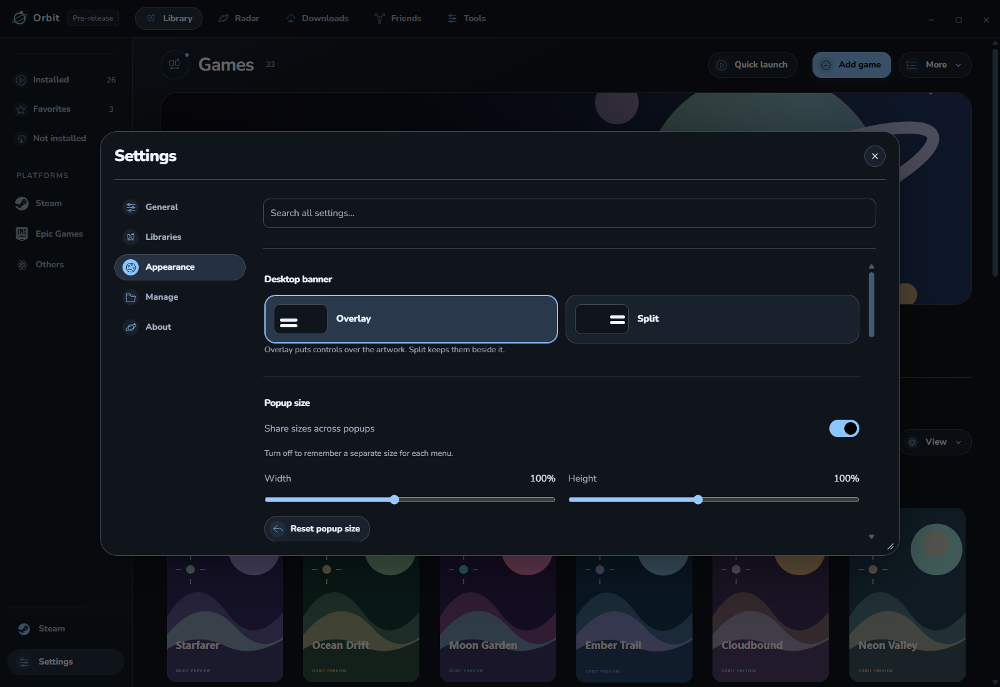

# Themes

Open **Settings → Appearance** to choose a palette, change colors or fonts, add a background, and import or export a theme. Save a custom theme to keep it; discarding a preview restores your selected theme.

## Choose and save your appearance

1. Open **Settings → Appearance → Theme** and select a palette.
2. Expand **Customize appearance**, choose colors or a background, give the theme a name and choose **Save theme**.
3. Use **Discard preview** to return to the saved theme without keeping pending edits.

The same area contains app-icon choices. Match the icon to the theme or choose an independent style. In-app colors update immediately; taskbar and tray artwork apply together after a full **Restart Orbit**. Windows can retain old artwork on a pinned shortcut.

## Startup and motion

Open Appearance's **Startup** section, choose a scene and use **Preview selected**. Choose a local video if preferred, and set startup sound/volume separately. Secret choices appear after their unlock. **Restart Orbit** runs the complete startup sequence; reduced motion and your sound choices are respected.

Use **Choose font** in Customize appearance for a supported local font, or **Reset font** to return to Orbit Rounded. Text size and contrast controls help readability; changing a font does not require replacing your theme.

For menu placement, section visibility and transparent bars, use [Desktop layouts](DESKTOP-LAYOUTS.md).

## Image backgrounds

Choose a PNG, JPEG, or WebP. Use automatic accents or choose colors manually, then adjust visibility for readability. Orbit stores a compressed copy and leaves the original unchanged. Exports and preference backups include the saved copy. Animated backgrounds and SVG files are unsupported.

## Theme files

A color theme uses this JSON format:

~~~json
{
  "schemaVersion": 1,
  "name": "My palette",
  "colors": {
    "background": "#111019",
    "surface": "#1d1826",
    "text": "#f0edf9",
    "muted": "#b7aac7",
    "accent": "#c4b5fd",
    "positive": "#bbebcf",
    "warm": "#ffccaa",
    "secondary": "#a9c6f0"
  }
}
~~~

All eight colors use #RRGGBB. Names can have up to 60 characters, with up to 24 custom themes. Imports cannot supply scripts, stylesheets, or external URLs. The editor warns about poor contrast; accent-button text adapts for readability.

## Contributing a palette

Add a unique preset in src/ui/themes.js, then run npm test. Check text, buttons, focus, and reduced motion. Keep effects finite and inexpensive. See [Contributing](../CONTRIBUTING.md).
