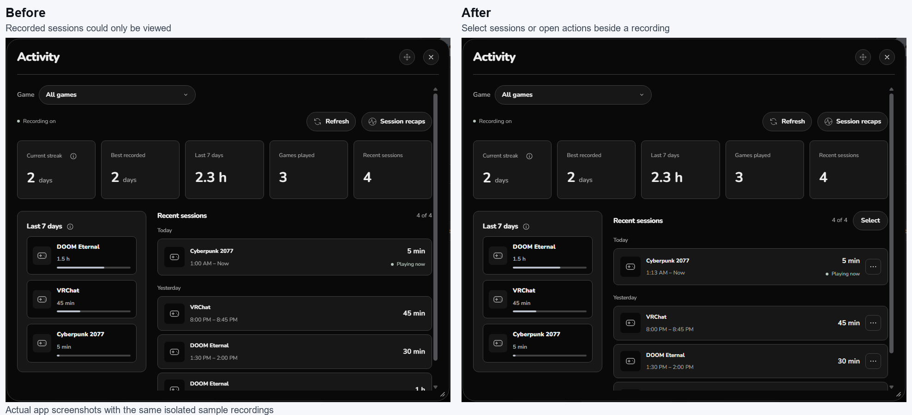
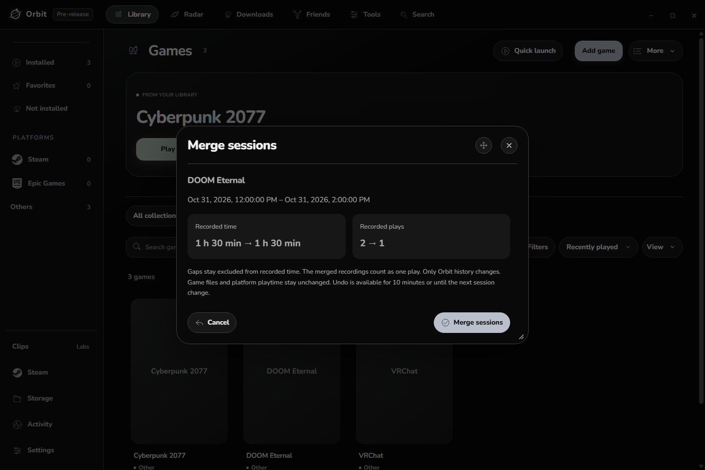

# Orbit 0.2.8 development check

## What changed

Activity can edit completed session times, merge split recordings, remove selected recordings, and Undo the latest correction. Changes are reviewed before saving. Running sessions stay protected.

Before: sessions could only be viewed. After: Select and the menu beside each session provide editing and organization actions. These actual app captures use the same isolated sample recordings.

Example checked: merge two DOOM Eternal recordings. Recorded time stays at 1 hour 30 minutes because the gap is excluded; the recorded play count changes from two to one. Undo restores both original recordings and their count.

## What passed

- 638 unit checks; two opt-in native checks skipped.
- Packaged app: 358 general checks, 33 existing Activity checks, and 20 correction checks.
- Edit, merge, removal, Undo, keyboard/range selection, stale reviews, running-session protection, write failure recovery, and refresh selection.
- Dark and light themes, narrow windows at 125 percent scale, long titles, and reachable action buttons.
- The package matches all 307 checked source and bundled files. The installer checksum and update metadata match.
- Normal and dev preferences pass the real loader limits. Copied histories retain identical source records, time totals, play counts and streaks under the old and new loaders.
- Installed quietly and reopened in the background. The installed archive and unpacked resources match the tested package. VRChat kept the same running process; no game was closed.
- After reopening, both profiles still retain their saved choices and every pre-install recording. Normal history has 95 source records versus 94 in the backup as ordinary tracking continued; the dev profile retains its two records.
- Checks ran in hidden isolated profiles. No games, real downloads, sign-ins or live recordings were edited.

## Findings fixed

- Whole-minute date fields can omit seconds. Valid times now normalize correctly instead of being rejected.
- Refresh retains the new multi-selection instead of discarding it.
- Date-picker icons inherit the selected theme, including light themes.
- Review durations show hours, minutes and seconds. Unchanged streak cards are omitted.
- History corrections and observations share an ordered write queue. Recap processing follows the completed observation.
- Correcting retained recordings adjusts only their contribution to persistent play counts. Older expired history totals remain intact.

## Resource review

No new background polling or network requests are added. Previews are limited to four, and Undo retains only the latest correction. UI listeners are replaced on refresh and use weak references for closed views. Corrections use indexed record lookups and one atomic history save per applied action.

In the same local fixture of 1,000 source sessions and 20 games, seven alternating runs of 75 unchanged snapshots measured a median of 0.51 ms before and 0.91 ms after. The additional roughly 0.4 ms builds the safe correction identities. This is a model timing, not a whole-app CPU, RAM, startup or gaming performance claim.

The existing native startup, tray, capture and VR implementations were not changed. No new native focus, game launch, real headset, or whole-process memory playtest was performed for this build. Those limits remain visible rather than being counted as passed checks.

## Remaining before publication

Use the installed development build normally, gather detection cases that still fail, and complete the release optimization review. No release, tag, updater feed or GitHub attachment was changed by this development work.

Undo lasts ten minutes or until another session correction, and ends when Orbit exits. History retention remains 180 days and 1,000 source sessions; Activity shows up to 100 combined sessions. Platform playtime and game files are unchanged.

Detailed local records: [candidate checks](../../../work/session028-ready.json), [measurements](../../../work/session028-measurements.json), [final preference preservation](../../../work/session028-preservation/final.json), [history loader comparison](../../../work/session028-preservation/history-loaders.json), [installed history](../../../work/session028-preservation/after-live-history.json), and [quiet installation](../../../work/session028-install.json).
