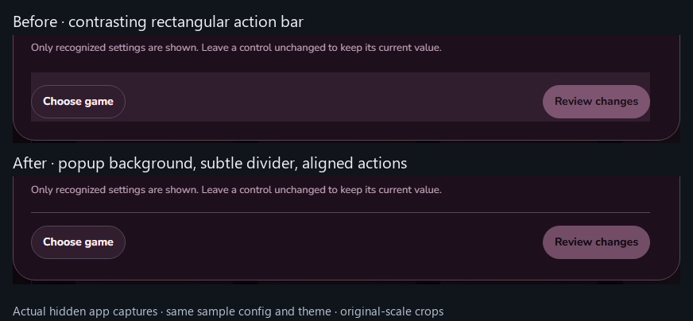
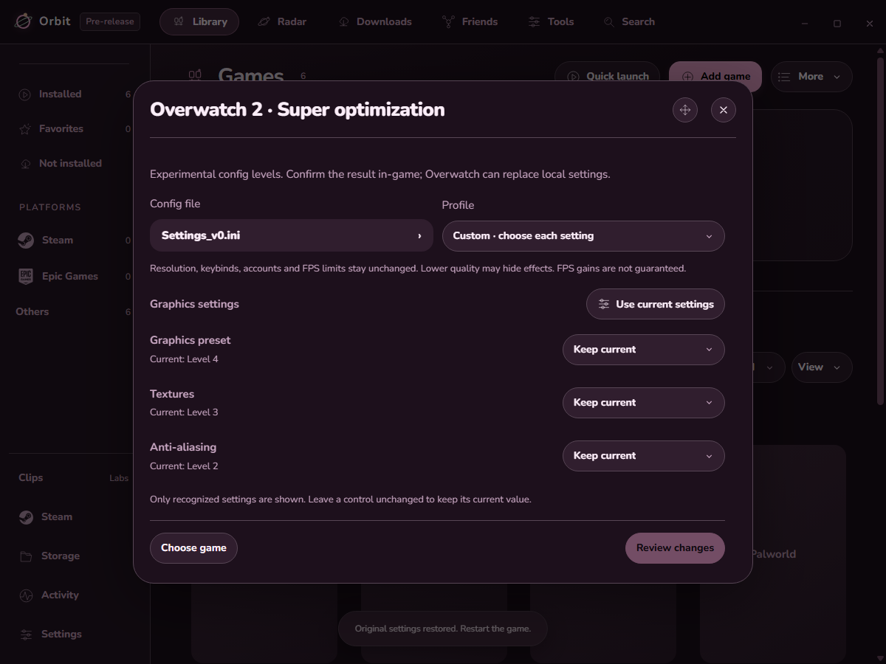

# Orbit 0.2.8-dev.10

Fixed the action bar highlighted in the screenshot. It now uses the popup's background, a subtle divider, and aligned buttons. Sticky actions remain reachable while the content scrolls. The same correction applies to graphics editing, change review and config selection.

Before: a contrasting rectangular panel sat behind the buttons. After: the actions sit within the popup's surface.

Actual hidden app captures use the same temporary Overwatch config and Roseberry theme. The light-theme/narrow check also verifies that the footer matches its popup and the buttons remain inside it.

**Passed:** 910 packaged app checks and 692 unit checks. Two opt-in native checks were skipped. Changed scripts parse, documentation links resolve, and isolated app checks recorded no shown or focused windows.

Installed quietly and reopened in the background. Installed files match the validated build. Normal/dev settings, custom themes, artwork, startup media and history were retained; real config hashes stayed unchanged. The running game process stayed alive. See the [evidence summary](validation/0.2.8-dev.10/evidence-summary.json).

The [individual graphics controls](VALIDATION-0.2.8-dev.9.md), backup/restore protections and supported-setting limits remain. No real config is applied by validation. No game, controller, headset or account authorization playtest is repeated. No performance gain is claimed.
