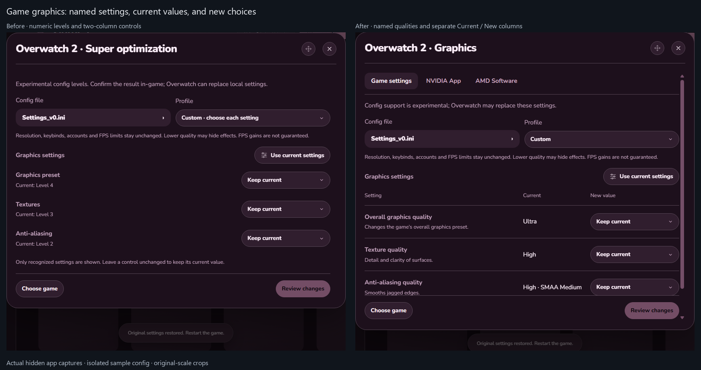
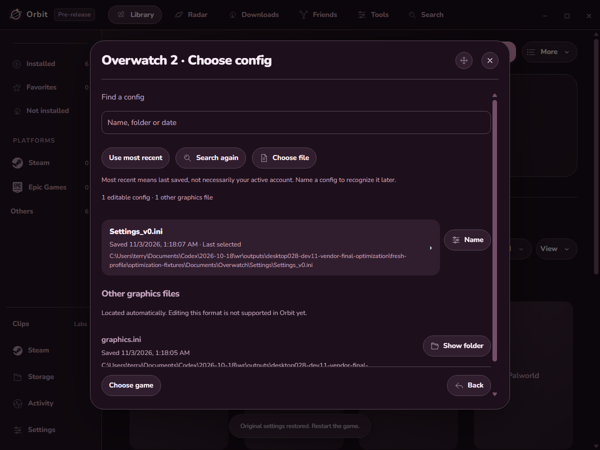
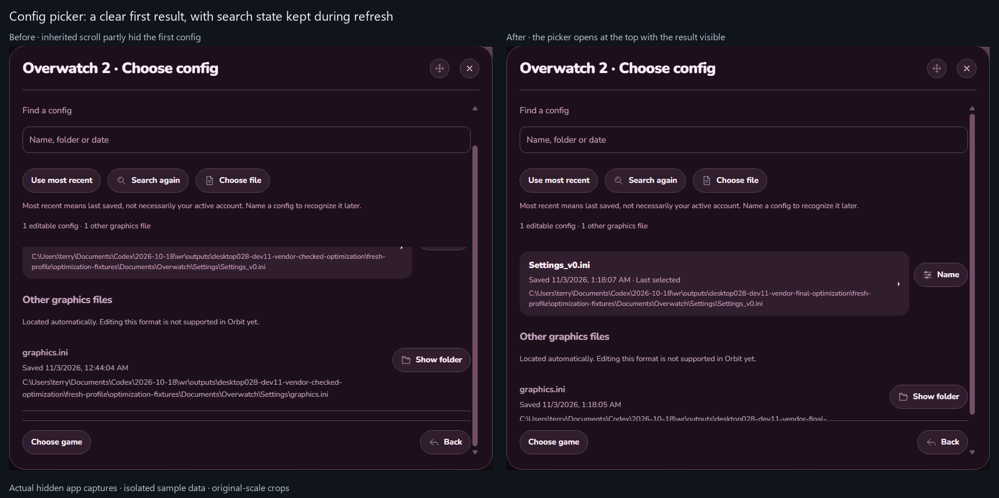
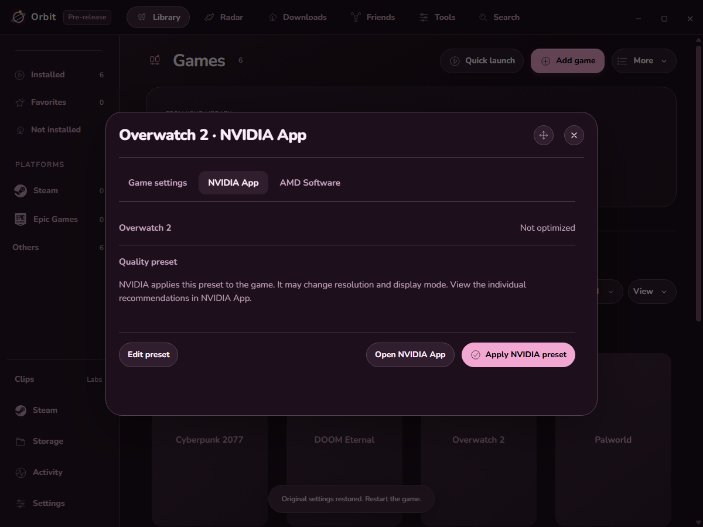

# Orbit 0.2.8-dev.11

Graphics controls now name the setting, explain it briefly, and separate Current from New value. Automatic file discovery checks likely game folders. NVIDIA App presets use its installed public connection; AMD per-game settings open in AMD Software.

## Examples

Before: Overwatch displayed Level 4 / Level 3 / Level 2. After: it shows Ultra, High, and High · SMAA Medium, with separate current values and choices. These are actual hidden app captures with temporary sample configs.

Automatic discovery lists editable configs separately from other likely settings files. Search again discovers a newly created file. Unsupported formats can be located without pretending they can be edited.

Before: the picker inherited the previous menu's scroll and partly hid the first config. After: it opens at the top. Search again keeps the typed filter and button focus while updating the results.

NVIDIA presets have a separate review. This sample uses a fake vendor connection; it does not demonstrate a live NVIDIA mutation. The interface does not fabricate individual recommended values when NVIDIA's public response omits them.

## Findings and limits

- Fixed a title-matching bug: normalizing ™ too early turned it into TM and could miss a game. Matching remains exact after punctuation/trademark normalization; it does not guess between similar games.
- The first vendor review left its important notice below the footer. Review now hides the preset editor so the notice stays visible.
- Switching to Custom could scroll before the compact frame finished fitting, leaving config labels partly covered by the source tabs. Scrolling now waits for layout; controls move into view only when needed. Config search also opens at the top, while Search again preserves the filter and focus.
- The file-scan fixture initially assigned several games the same parent install folder. It was corrected to give each game its own folder. Real-game files were not involved.
- Config scans have directory, entry, depth and result budgets. Search again bypasses a bounded cache. Bulk library checks keep their fast known-path search; opening a game performs the deeper scan.
- The deeper read-only check found a VALORANT shared config missed by the old account-folder search. Its location is now included in the quick search and labeled Shared config, with no automatic account selection.
- Added checks for stale, foreign, expired and replayed vendor reviews; duplicate Apply; provider errors; active games; existing config backups; unsupported presets; exact title matching; and helper cleanup. A failed or ambiguous provider response is not called confirmed.
- Validation uses sample game files and a fake GPU-app connection. It never applies a preset to a real game, opens Explorer, or starts a real GPU app window.
- The preservation check initially treated a changed rejected-format count as a changed file. The 42 recognized paths and hashes matched; the rejected count changed from six to seven. The check now compares exact recognized paths and contents and records rejected counts separately. Unsupported file contents were not compared.

A live read-only check connected to the installed NVIDIA App, matched Overwatch 2 and read its available presets. No live mutation was attempted. The installed interface returned no individual current/new setting rows. AMD Software is not installed on this PC, so its hardware behavior was not tested. Direct AMD per-game editing inside Orbit is not implemented; its button is an app handoff.

**Passed:** 923 packaged app checks and 722 unit checks. Two opt-in native checks were skipped. Changed scripts parse and documentation links resolve. Isolated app checks recorded no shown or focused windows.

Installed quietly and reopened in the background with no main window. Installed files match the validated build. Normal/dev settings, custom themes, artwork, startup media and history were retained. The 42 recognized real game configs kept identical paths and hashes. VRChat and SteamVR kept the same running processes across the quiet installation. See the [evidence summary](validation/0.2.8-dev.11/evidence-summary.json).

Real NVIDIA Apply, game/cloud persistence and AMD hardware still need a playtest. Physical controller/display and game-launch checks were not repeated. No FPS, CPU or RAM improvement is claimed. See the [short guide](GAME-OPTIMIZATION.md).
