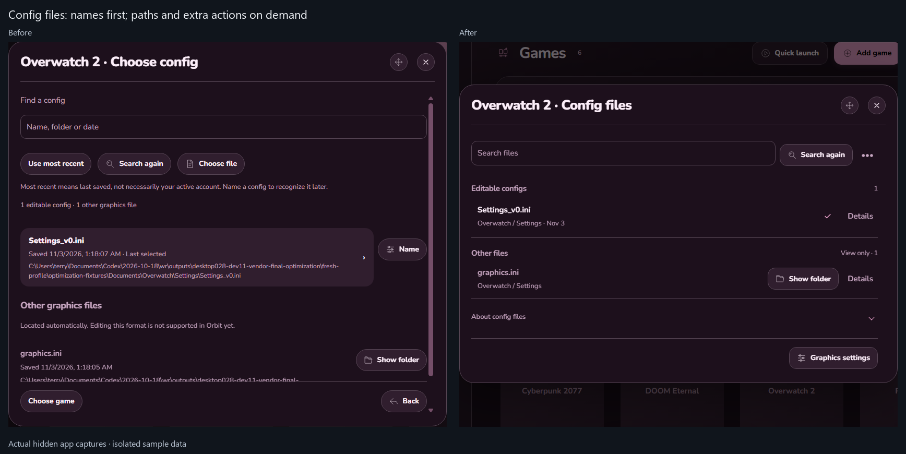
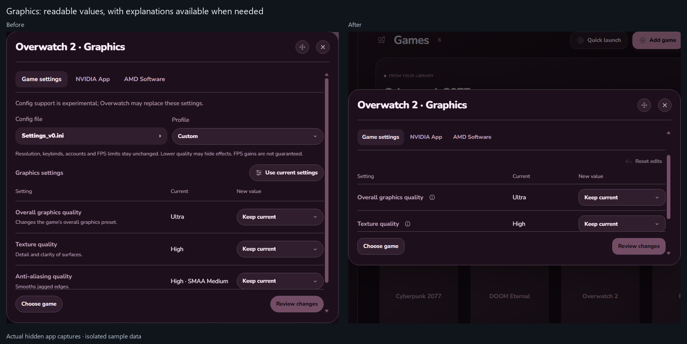
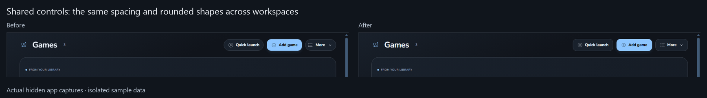
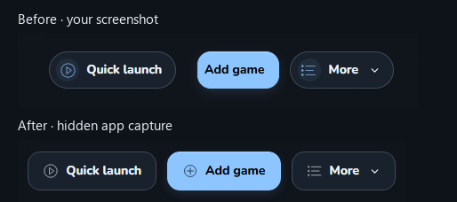
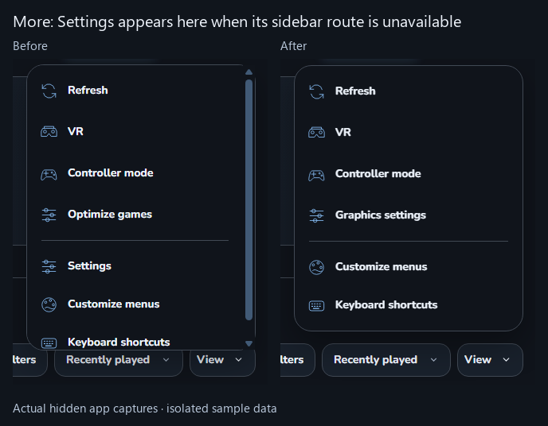
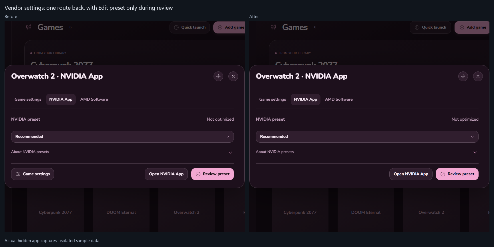
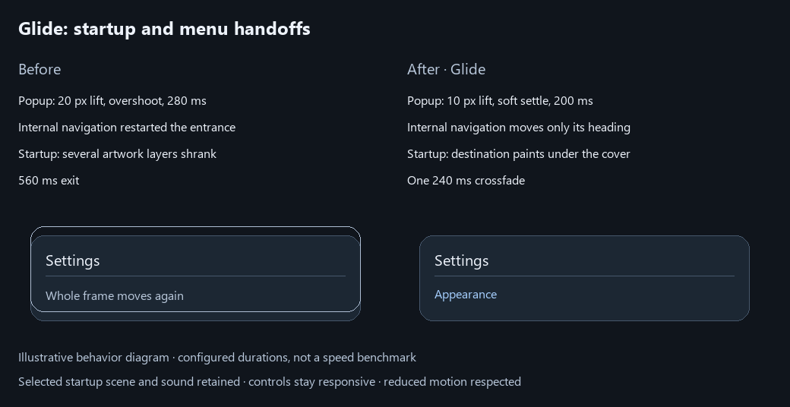

# Orbit 0.2.8-dev.12

Installed quietly and kept unpublished. Glide and the menu cleanup passed validation; saved choices were retained in both normal and dev profiles.

Shared Desktop controls and context menus are quieter. Config files use compact rows; paths and secondary actions expand when needed. Graphics values keep their Current/New columns, with setting explanations available through the info control.

## Before and after

Before: the config picker stacked three actions, repeated instructions and long paths above and inside large filled cards. After: search and refresh share a toolbar, files use readable rows, and Details reveals the full path. Config options keeps browsing and choosing another game available.

Before: graphics descriptions and disclaimers competed with the controls. After: settings and values lead, help opens on demand, and the review keeps the quality tradeoff visible before Apply.

Shared button shapes, spacing, label weights and context-menu icons were reviewed across Library, Radar, Downloads, Friends, Tools, Settings, Steam and the popup catalog. Existing layouts, real artwork, provider symbols and saved themes remain the design foundation.

These are actual hidden app captures with isolated sample data. They are not game-performance measurements.

## Findings

- Full paths and repeated file explanations made the new config picker difficult to scan. File Details and Config options retain those actions and information on demand.
- Repeated row descriptions crowded the graphics table. Named controls now have accessible help, while quality warnings stay visible during review.
- Scrolling an inner graphics section could scroll the outer dialog and clip its title. Scrolling now targets only the content area; checks cover the title and close control.
- The icon heuristic could match “presets” as “reset” and add an unrelated Back icon. Word matching is corrected, and About disclosures have no decorative icon.
- Context-menu styles duplicated their own dimensions and added a filled icon tile to every row. The duplicate rule is removed and meaningful icons use one quiet column.
- A generic disclosure selector overrode component styles, turning small informational rows into filled bars. Its exclusions now have zero selector weight, so each component can apply its intended treatment.
- The disclosure arrow could protrude past its row and create horizontal scrolling. Its row now reserves room for the arrow; full paths also wrap within the content width.
- Pinned header actions had conflicting styles: Add game kept different corners, while More kept different padding. They now share 44 px minimum height, 14 px corners, 10 × 16 px padding and 12 px gaps. Widths follow their labels. The Desktop-only rule also covers other actions pinned into this header.

Before: the user's screenshot. After: a hidden app capture with isolated sample data. The header geometry and existing Settings/Friends checks passed (12 checks); no native window was shown or focused.

The [review scope and design decisions](validation/0.2.8-dev.12/ui-review.md) record which families were checked and where no layout change was needed.

## Validation

731 unit checks and 1,012 app checks passed; two opt-in native checks were skipped. All 399 source/test JavaScript files passed syntax checks, and the documentation links resolved. Validation windows were hidden and never focused.

The final archive differs from the preceding candidate only in its isolated regression fixture. Fourteen passed suites were retained after archive-integrity comparison confirmed their runtime code was unchanged; the full 358-check regression was repeated on the final archive. The download focus fixture now waits for the preceding dialog to settle before checking the next control. Earlier failed attempts remain in the detailed work logs.

The installed archive and unpacked files match the validated build. Both profiles retained their settings, custom themes, artwork, popup preferences and remembered connection data. The normal profile kept its selected custom theme, three custom themes, Singularity startup and 110 history records; the dev profile kept seven custom themes and its history. All 42 recognized real game configs were byte-for-byte unchanged. Unsupported file contents were not compared.

See the [evidence summary](validation/0.2.8-dev.12/evidence-summary.json) for details.

The user selected Glide. Popup entrances use a 200 ms lift; close uses 140 ms; destination headings use a 140 ms lift; startup ends with a 240 ms crossfade after the destination has painted. These are configured durations, not measured startup gains. The selected intro duration, artwork and sound are retained. Logical input changes immediately, and reduced motion avoids these animations.

The menu review also removes the repeated Settings entry from More while the sidebar route is visible, keeps one Game settings route in vendor views, and replaces the ambiguous last-saved-file shortcut with explicit named config rows. Return labels identify Graphics settings or Edit preset. More still offers Settings when the sidebar is unavailable.

Before: More repeated the sidebar's Settings route and called graphics editing Optimize games. After: the duplicate is hidden when unnecessary and the destination is named Graphics settings. The sidebar-unavailable fallback was tested separately.

Before: vendor views repeated Game settings in their tabs and footer. After: the tab provides that route; the footer only adds Edit preset when a review needs it.

Before: changing menus could replay the entire popup entrance, and startup shrank several artwork layers. After: internal navigation leaves the frame steady and startup fades one held cover over a painted destination. Reopening during a close resumes from its current opacity instead of jumping back to full visibility.

This is a behavior diagram. Hidden app input and cleanup checks provide the validation evidence; the diagram is not a performance measurement.

Physical headset, controller, display, game-launch and vendor-Apply playtests are not repeated here. NVIDIA Apply and AMD hardware retain the limits documented for [dev.11](VALIDATION-0.2.8-dev.11.md). No CPU, RAM or FPS improvement is claimed. Nothing is published.

Design review used [Unslop by Damir Sokolovsky](https://heydamir.design/unslop), CC BY 4.0, within Orbit's existing design and saved themes.
