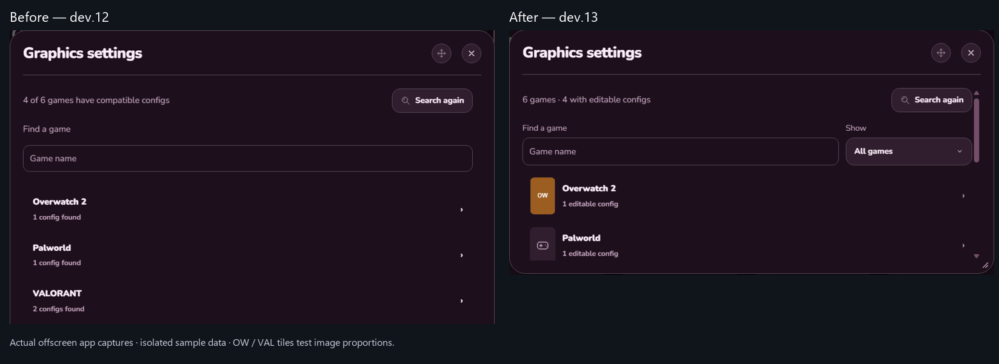

# 0.2.8-dev.13 validation

Game config search now shows artwork and defaults to Played games. All games includes unplayed or unknown-history entries and remembers the choice. Contractors folder matching is corrected.

Remove from library excludes a game without uninstalling it. Undo restores it immediately; Hidden games offers Restore later. Library reloads retain the exclusion and other saved choices.

Before: text-only game rows and a misleading “No compatible config found” message after a quick miss. After: artwork, a Played/All choice, and “Find config files” for a deeper search. Config and GPU menus also avoid an extra large banner above their controls.

These are actual offscreen app captures with isolated sample data. Geometry-test artwork is labeled in the image; it is not replacement artwork for real games.

The read-only local review found editable configs for both Contractors games. Some other games use formats the editor does not support. Playing a game can create a config, but does not guarantee editable support.

Detailed checks, installation and preservation results: [evidence summary](validation/0.2.8-dev.13/evidence-summary.json).

Live NVIDIA/AMD behavior, physical VR/controllers and real game launches were not repeated. No CPU, RAM or FPS improvement is claimed. This build remains unpublished.
