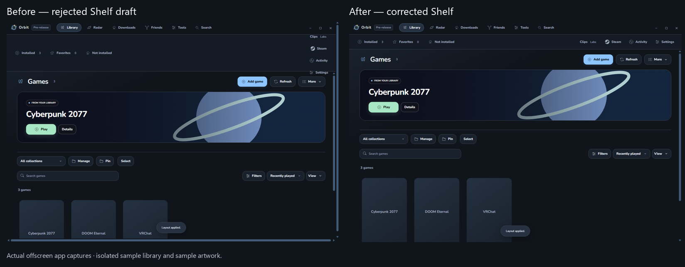
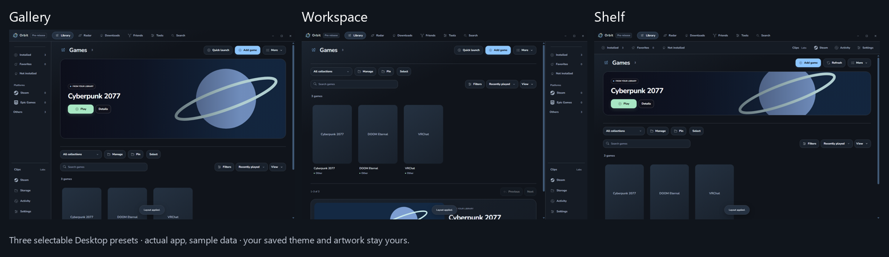
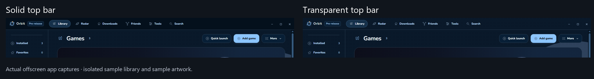

# 0.2.8-dev.14 validation

Three Desktop presets are available in Settings → Appearance → Layout: Gallery, Workspace and Shelf. Navigation position, content width and top-bar transparency can also be changed separately. Previous layout and named layouts retain those choices.

The first Shelf draft incorrectly stacked utilities, leaving a tall empty strip. The corrected draft places filters and utilities in one compact row. The resize handle no longer overflows; resizing is mirrored for right navigation.

These are actual offscreen app captures with isolated sample games and code-drawn sample artwork. They do not show or replace the user's library.

The transparency comparison uses a temporary sample theme background. Your saved theme stays unchanged.

Checks, installation and saved-settings verification: [evidence summary](validation/0.2.8-dev.14/evidence-summary.json). [Layout guide](DESKTOP-LAYOUTS.md).

Physical hardware, real game launches and live vendor Apply were not repeated. No CPU, RAM or FPS gain is claimed. Nothing is published.
