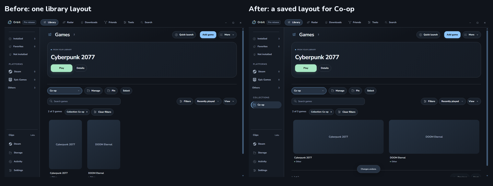
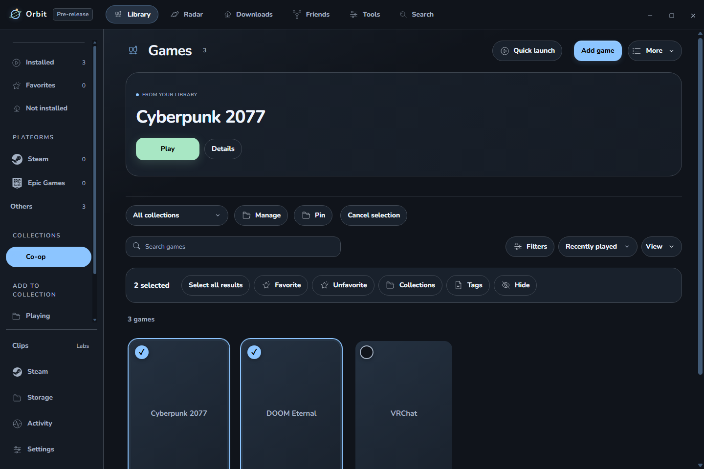
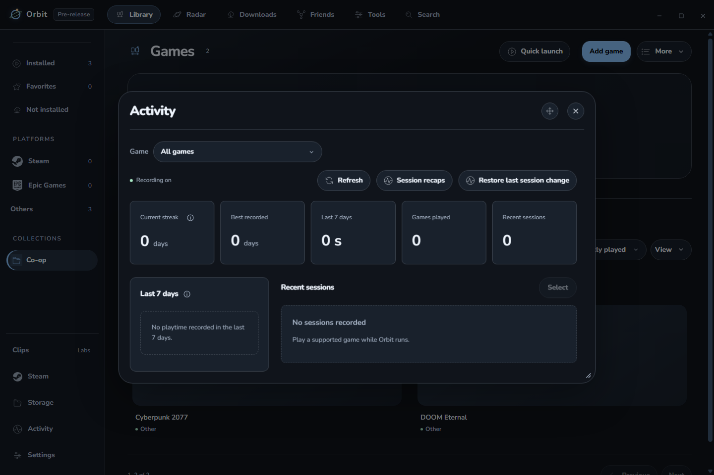

# Orbit 0.2.8-dev.2 check

## What changed

Drag one game or selected games onto a manual collection. Pinned collections highlight when they accept a drop; other manual collections appear temporarily while dragging. Smart collections are not edited by dropping games. The existing bulk Undo reverses an addition.

Before: one library layout was shared. After: Co-op can remember banners and larger cards while All collections keeps covers. These are actual app captures with the same isolated fixture games; their artwork is intentionally unavailable.

Example checked: dropping two selected fixture games onto Co-op adds both. Undo removes just that addition; cancelled and foreign drags leave the library alone.

Before: closing Orbit ended session Undo. After: the latest correction can be restored for seven days, including after the saved history is reloaded. Newer affected history and active sessions remain protected. This uses a normal-loader reload in an isolated profile, not a native restart playtest.

## What passed

- 645 unit checks; two opt-in native checks skipped.
- 425 packaged app checks: 358 regression, 33 Activity, 20 correction, and 14 collection/recovery checks.
- Collection-specific cover/banner/list layouts and sizing survive reload. Old global settings remain the initial defaults.
- Seven-day recovery survives reload, preserves later unrelated observations and older counts, refuses stale/oversized restores, and survives failed writes without losing prior recovery.
- Narrow light-theme layout, existing Controller library, cancellation, selection, and Undo checks passed.
- Normal and dev preferences passed their normal storage loaders. Copied histories retained identical recordings, times, counts, and streaks under the old and new loaders.
- All 309 checked packaged source/bundled files match the tested source. Installer metadata and checksum match.
- Installed quietly. VRChat and Roblox retained the same running processes during installation. The installed archive and native resources match the validated package.

## Cleanup and limits

History and recovery now use one recording normalizer. Removed the unused workspace variable and an unused duration helper. GitHub's 485 tracked files were checked for generated clutter, duplicates, references, and documentation organization: 45 historical documents moved into History/Reference, 34 affected links passed, and required duplicate native logo/license files were retained. The public repository still contains 0.2.7 app code; development features and release assets were not published.

No new polling or network requests were added. Collection views are bounded to 200 entries; only the latest session recovery is stored, with a two-megabyte limit. No CPU, RAM, startup, frame-time, or GPU gain is claimed without measurements.

Physical drag feel, a fresh native game launch/focus check, and headset testing were not performed. Earlier user startup/game/controller playtests remain separate evidence. Before publication, gather everyday feedback and complete the optimization review.

Detailed local records: [candidate checks](../../../work/desktop028-dev2-ready.json), [installation](../../../work/desktop028-dev2-install.json), [profile preservation](../../../work/desktop028-dev2-preservation/final.json), [history preservation](../../../work/desktop028-dev2-preservation/after-live-history.json), and [repository cleanup](../../../work/repo-all-files-receipt.json).
