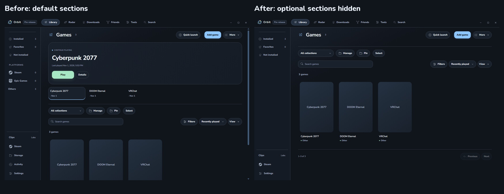
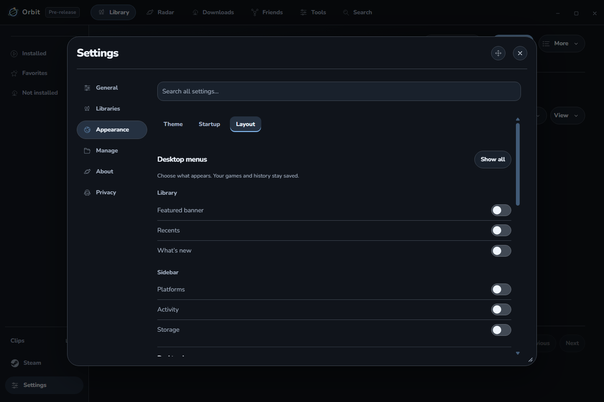
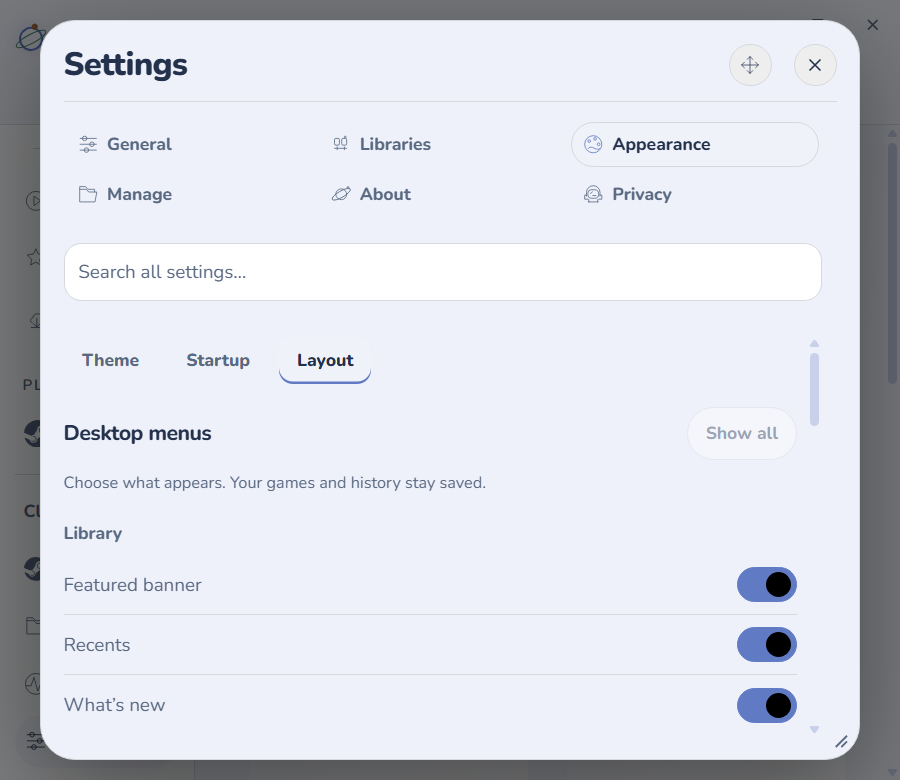

# Orbit 0.2.8-dev.3 check

Choose which Desktop sections appear in **More → Customize menus**, also available in **Settings → Appearance → Layout**. Switch the featured banner, Recents, What’s new, Platforms, Activity, and Storage independently. **Show all** restores these sections without resetting other preferences.

Before: every optional section appeared. After: hidden sections collapse and the games move up. These are actual before/after app captures using isolated sample games and recent-play timestamps; artwork is intentionally unavailable in this fixture. The screenshot fixture also verifies that populated Recents releases its buttons when hidden.

Example checked: hide Recents, close Settings, and reload the app. Recents remains hidden. Turn it on again while leaving the banner hidden; Recents returns independently. Games, history, filters, selection, and layout preferences remain saved.

## Checks

- 651 unit checks passed; two opt-in native checks skipped.
- 441 packaged app checks passed: 358 regression, 33 Activity, 20 correction, 14 collection, and 16 menu checks. These cover saving/reloading choices, restoring sections, selected games, the active Installed filter, the guide, and unchanged Controller layouts.
- Switches and labels fit at 125% scaling in a narrow, light-theme popup. Content scrolls within the saved popup frame.
- Hidden Recents releases its cards. A hidden banner releases its image and avoids new banner requests. Hidden news releases thumbnails; the request-count fixture confirms it makes no news requests until restored. No new polling was added.

Installed quietly. Normal and dev profiles passed their normal preference loaders after installation and reopening: selected theme, startup choice, all custom themes, artwork, layout choices, and remembered connections were preserved. All saved recordings and play totals remain. The running Roblox process stayed running. Menu visibility is included in preference backup/restore. This build stays unpublished.

No CPU, RAM, GPU, or startup improvement is claimed without comparable measurements. This pass uses hidden automated checks; no new physical-controller, headset, game-launch, or Windows focus playtest was performed.

Detailed local evidence: [candidate checks](../../../work/desktop028-dev3-ready.json), [package contents](../../../work/desktop028-dev3-package-verification.json), [installation](../../../work/desktop028-dev3-install.json), [settings preservation](../../../work/desktop028-dev3-preservation/final.json), and [menu checks](../../../outputs/desktop028-dev3-packaged-menus/menus-checks.json).
