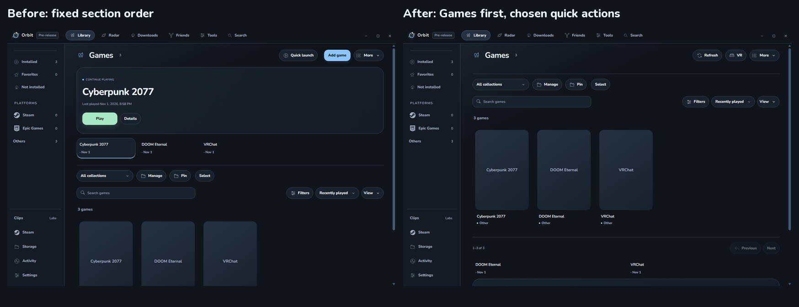
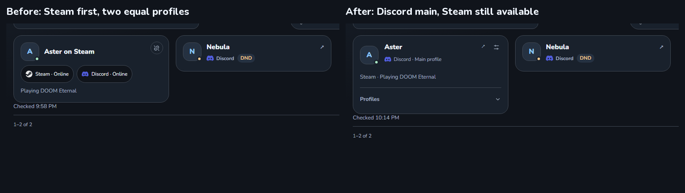
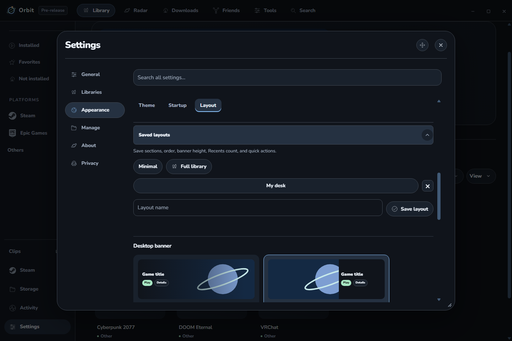
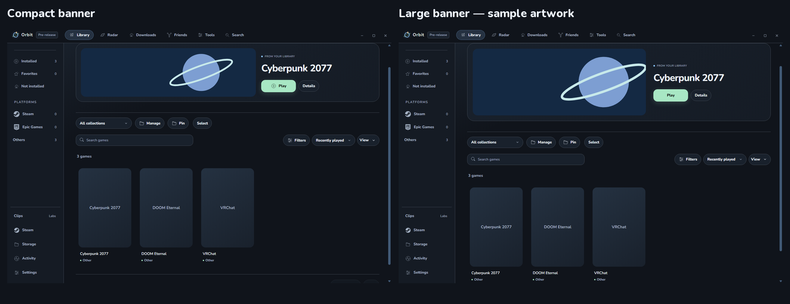
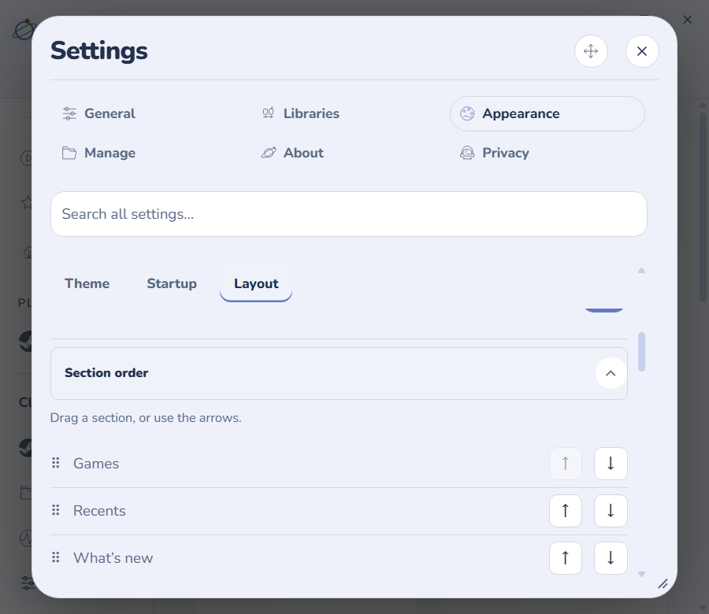

# Orbit 0.2.8-dev.4 check

## Changes

**More → Customize menus**, also in **Settings → Appearance → Layout**, now supports:

- Drag section ordering, with arrow buttons for keyboard use. Games can appear first.
- A Recents limit from 1–12 games and individual exclusions. Right-click a recent game to remove it from Recents; its library entry and history remain.
- News muting and followed-only sources. Right-click a news card to mute that game. Filtering happens before the eight-game news limit, and duplicate Steam entries cannot bring muted news back.
- Up to three header actions; the other actions remain in More. Narrow windows move secondary actions into More.
- Compact, Standard, and Large banner heights, grouped with the banner layout controls.
- Minimal, Full library, and up to twelve named menu layouts. Saved layouts include section visibility/order, banner height, Recents count, and header actions. Exclusions and news-source choices stay independent.

Before: section order was fixed. After: the same sample library puts Games first and uses Refresh/VR as its header actions. These are actual app captures with isolated sample data; game artwork is intentionally unavailable.

**Friends → Profile links** now has a default main provider, initially Discord, and a saved override for each linked friend. The main identity supplies the name and main profile link; its avatar is preferred, with the other linked avatar as a fallback. Both identities remain under Profiles. Steam activity is labeled as Steam activity, and fresh presence still determines Online eligibility and ordering. Names only suggest matches; linking still requires confirmation.

Before: Steam was always primary and both profile controls competed for space. After: Discord is prominent, with both profiles available in a disclosure. These are sample identities, not a live account sign-in check.

Example checked: choose Steam for one friend, change the global default, then return that friend to Default. The override works independently, and the confirmed link and preference survive reload and a temporary provider disconnect. A selected friend beyond the first thirty saved links still has reachable controls.

## Results

- 665 unit checks passed. Two opt-in native checks were skipped.
- 466 packaged app checks passed: 358 regression, 33 Activity, 20 correction, 14 collection, 16 visibility, and 25 customization/profile checks.
- All routine checks stayed hidden with no native-window show or focus.
- Profile choices, menu presets, section order, Recents choices, and news criteria survive the normal preference reload. Preset save failures roll back visibility and presentation together.
- Narrow layouts at 125% renderer zoom, light/dark themes, and reduced motion were checked. Main-profile buttons and utility controls have separate hit areas. Controller section structure and Recents policy remain intact.
- Old news responses cannot appear after source criteria change. Candidate selection remains bounded to eight games and two jobs; no new polling was added.
- Explicit settings backup now includes profile-link decisions, banner layout, and the new customization preferences.
- Installed quietly and reopened in the background. Normal and dev profiles retained their selected themes, all custom themes, startup choice, artwork, library/menu settings, and remembered connection. The normal profile's 101 source recordings and dev profile's 2 recordings retained their time and play totals. The running Roblox process stayed running, and installed files match the checked package.

Compact and Large below use code-drawn sample artwork to check sizing. This is a comparison of options, not a performance measurement.

No new live sign-in, hardware-controller, headset, Windows scaling, or game-focus playtest was performed. Existing provider permissions were not expanded. No CPU, RAM, GPU, or startup gain is claimed without comparable measurements. The build remains unpublished.

Detailed local records: [candidate checks](../../../work/desktop028-dev4-ready.json), [package verification](../../../work/desktop028-dev4-package-verification.json), [installation](../../../work/desktop028-dev4-install.json), [settings preservation](../../../work/desktop028-dev4-preservation/final.json), [history preservation](../../../work/desktop028-dev4-preservation/after-live-history.json), and [feature checks](../../../outputs/desktop028-dev4-final-customization/customization-checks.json).
