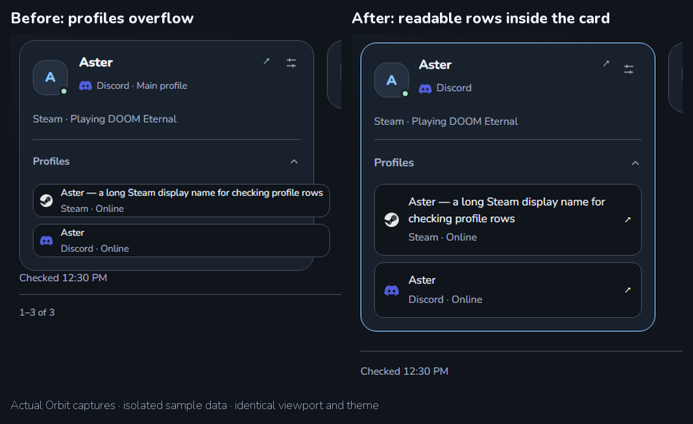
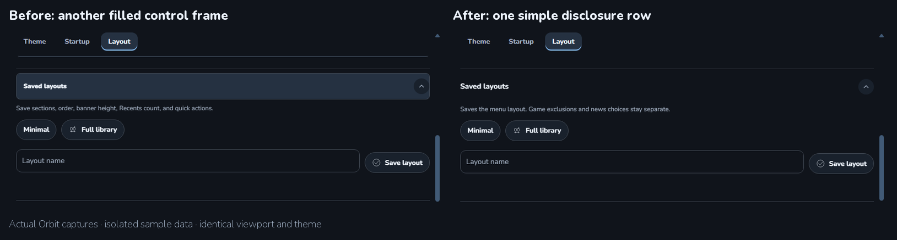
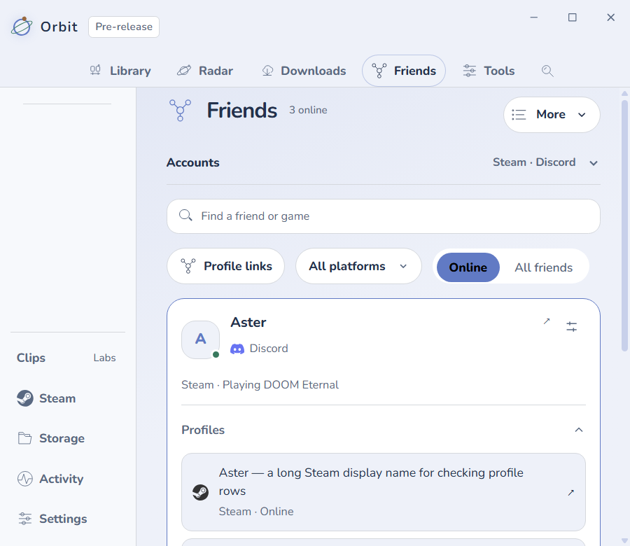
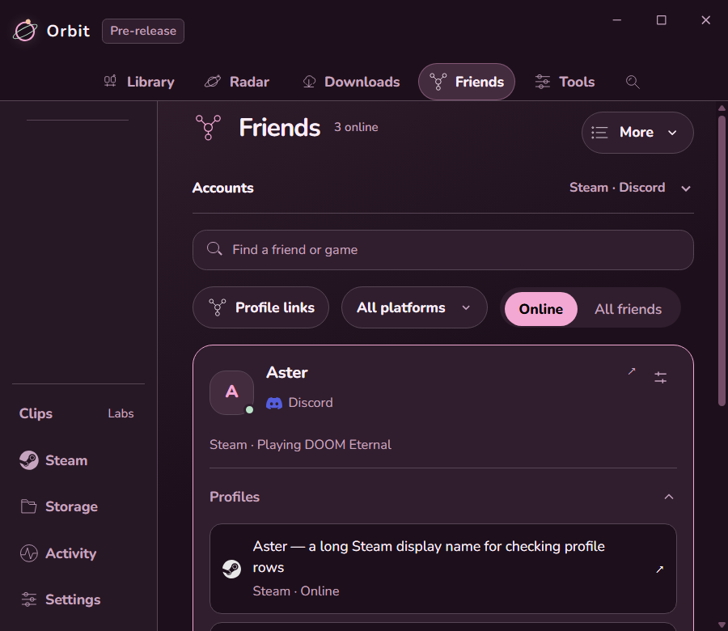

# Orbit 0.2.8-dev.5 check

Settings and Friends now have quieter disclosure rows and more consistent spacing. Expanded friend profiles fit inside their card and show long names and status fully. Refresh keeps Profiles expanded and retains the focused profile control.

## Before and after

Before: secondary profile buttons extended past the card and clipped their text. After: they wrap naturally inside the card, with separate logo, text, and link areas. Both provider identities remain available.

Before: Saved layouts added another filled control frame. After: one simple disclosure row uses the existing section hierarchy. The explanation still distinguishes menu layouts from individual game/news choices.

These are actual Orbit screenshots with isolated sample identities, the same viewport, and the same theme. They show the UI, not a live account sign-in or performance test.

## Passed

- 665 unit checks and 517 packaged app checks passed. Two opt-in native tests were skipped.
- All automated app checks stayed hidden, with no native-window show or focus.
- Settings navigation, search, resizing, single chevrons, saved menu layouts, collections, Activity, and history corrections passed regression checks.
- Dark, Cloud, and Roseberry themes, narrow layouts at 125% renderer zoom, and reduced motion were checked. This does not replace a real Windows display-scaling test.
- Desktop polish does not apply in Controller mode. Existing provider permissions, friend linking rules, game launching, and startup scenes were not changed.

Example checked: focus Steam under Profiles, then refresh. Profiles stays open and keyboard focus returns to Steam. The same fixture also checks that long names and status remain inside their card.

The user's selected theme remains in control; Roseberry is shown below.

## Installation and limits

Installed quietly and reopened in the background without exposing a native window. The installed archive and native resources match the validated build. Roblox stayed running throughout installation.

Both normal and dev profiles passed the normal preference loader and retained their saved choices, custom themes (3 normal, 7 dev), selected themes, startup choice, artwork, library/menu settings, and remembered connection. All 101 previous normal-profile recordings remain, alongside one newer tracked recording; the dev profile retains its 2 recordings. Recorded time and play totals were retained.

No new live sign-in, controller, headset, native focus, or game-launch playtest was performed. No CPU/RAM/GPU/startup gain is claimed. Existing polling intervals were not increased and this pass adds no polling. The build remains unpublished.

Detailed local records: [candidate checks](../../../work/desktop028-dev5-ready.json), [package](../../../work/desktop028-dev5-package-verification.json), [installer](../../../work/desktop028-dev5-installer-verification.json), [installation](../../../work/desktop028-dev5-install.json), [background reopen](../../../work/desktop028-dev5-background-reopen.json), [preferences](../../../work/desktop028-dev5-preservation/final.json), [history](../../../work/desktop028-dev5-preservation/after-live-history.json), [UI checks](../../../outputs/desktop028-dev5-final-polish/polish-checks.json), [observations](../../../outputs/desktop028-dev5-final-polish/redline-observations.json), and [design audit](UNSLOP-0.2.8-dev.5.md).
