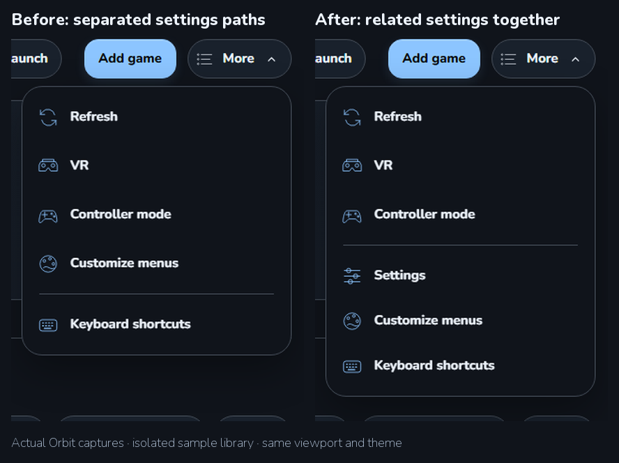
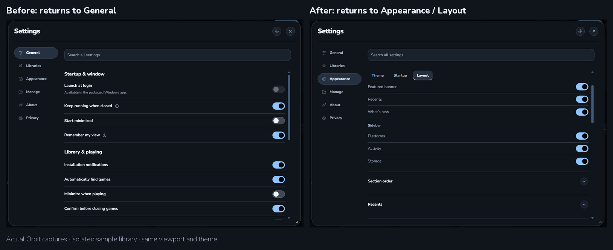
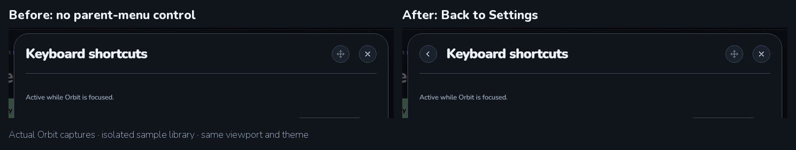
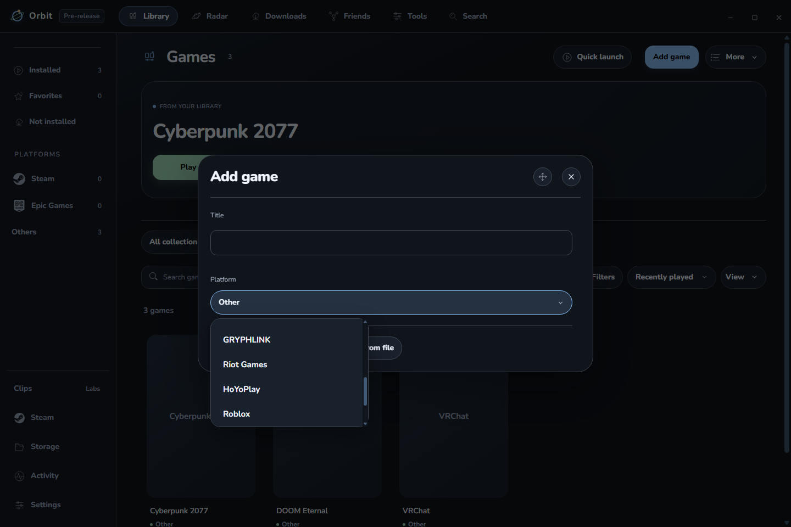
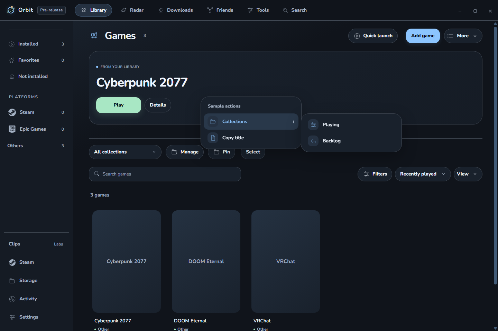

# Orbit 0.2.8-dev.6 check

Menus are easier to navigate without changing the main layouts. Settings returns to the last category, Appearance section, and scroll position while the window remains loaded. More groups Settings, Customize menus, and Keyboard shortcuts together.

## Before and after

Before: Settings was separate from the other settings paths in More. After: it is available alongside menu customization and shortcuts. The sidebar Settings button still works.

Before: closing Appearance → Layout and reopening Settings returned to General at the top. After: it returns to Appearance → Layout at the same scroll position. This is a window-session checkpoint, not a saved form or credential cache. Direct Search destinations still open the requested setting.

Before: opening Keyboard shortcuts from Settings replaced its parent menu. After: the header includes Back to Settings, returning to the original category and Customize control. Closing the popup still dismisses it normally.

These are actual Orbit screenshots with an isolated sample library and unavailable game artwork. They are navigation examples, not a live account or game-launch check.

## Other improvements checked

- Ctrl+F focuses Search all settings when Settings is open.
- Type an option's name in a Desktop dropdown to find it. Repeated first letters cycle matches. Finding an option does not apply it until selected; Escape returns to the trigger.
- Hover over a right-click submenu to open it. Escape returns one level; the right arrow reopens the submenu. Selecting an action returns the same command as before.
- Narrow menus at 125% renderer zoom retain reachable controls. Cloud/light and Orbit/dark were checked here; the retained Desktop polish suite also checks Roseberry.
- Controller Home/Library layouts remain unchanged, and the extra Desktop Settings entry is hidden in Controller mode.

Example checked: type R in Add game's Platform dropdown to find Riot Games, then R again to find Roblox. The stored value stays Other until an option is selected.

Example checked: hover Collections, press Escape, then Right. Escape leaves the root menu open; Right reopens Collections with keyboard focus. The image shows the open submenu, while the automated assertions check the keyboard transitions.

## Results and limits

665 unit checks and 593 packaged app checks passed. Two opt-in native checks were skipped. All app suites stayed hidden with no native-window show or focus. Checks cover navigation, Settings/search/resizing, shortcuts, launch-option configuration, Activity/corrections, collections, Desktop customization, and the previous Friends polish.

The first dropdown fixture opened before queued popup-close events had settled. It was corrected to wait for the rendered trigger and use that control; the final packaged run passed. This was a fixture-timing correction, not evidence of a repaired live dropdown failure.

Installed quietly and reopened in the background without exposing a native window. The installed archive and unpacked native resources match the validated package. The running Roblox process stayed running.

Both normal and dev profiles passed the normal preference loader and retained their settings, selected theme, custom themes (3 normal, 7 dev), startup choice, artwork, library/menu choices, and remembered connection. The normal profile's 105 recordings and dev profile's 2 recordings retained their time and play totals.

No new real-controller, headset, Windows scaling, game-focus, or live sign-in test was performed. No CPU, memory, or startup speed gain is claimed. The Settings checkpoint is bounded and transient; submenu delay uses one cleared timer and no polling. Existing saved preferences are not migrated. The build remains unpublished.

Detailed local evidence: [candidate checks](../../../work/desktop028-dev6-ready.json), [navigation checks](../../../outputs/desktop028-dev6-final-navigation/navigation-checks.json), [Settings checks](../../../outputs/desktop028-dev6-final-settings/settings-layout-report.json), [Desktop command checks](../../../outputs/desktop028-dev6-final-tools/desktop-tools-report.json), [package](../../../work/desktop028-dev6-package-verification.json), [installer](../../../work/desktop028-dev6-installer-verification.json), [installation](../../../work/desktop028-dev6-install.json), [background reopen](../../../work/desktop028-dev6-background-reopen.json), [preferences](../../../work/desktop028-dev6-preservation/final.json), and [history](../../../work/desktop028-dev6-preservation/after-live-history.json).
