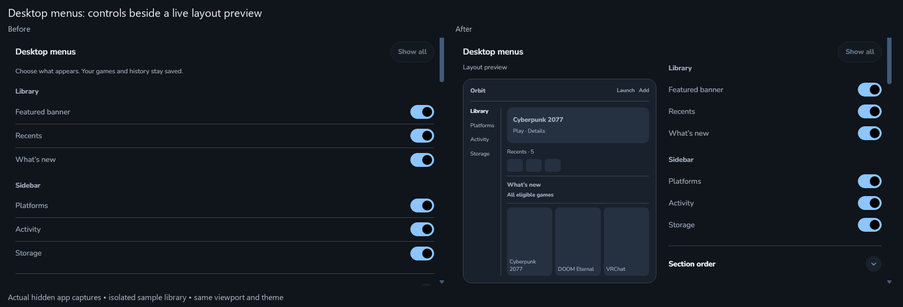
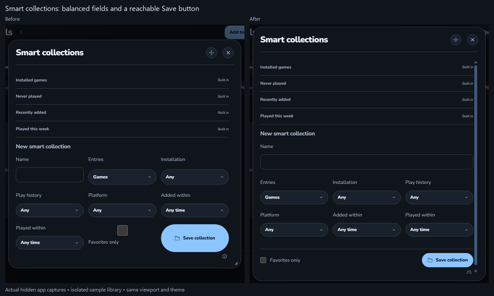
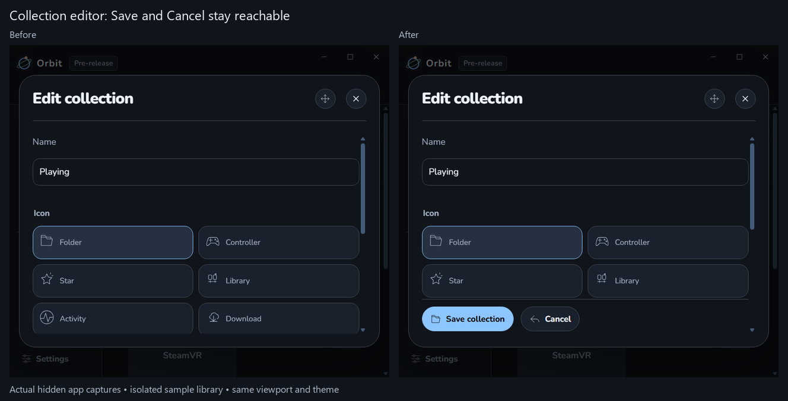
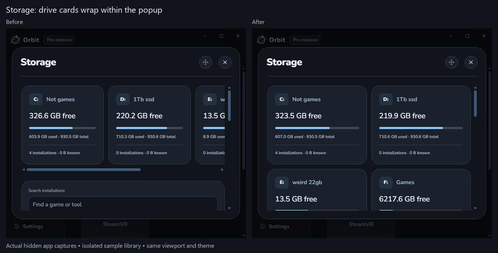
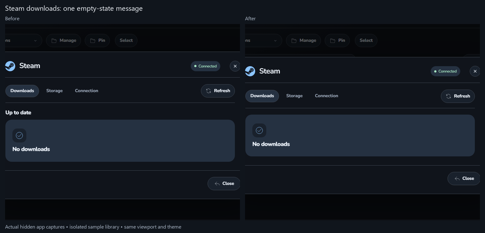
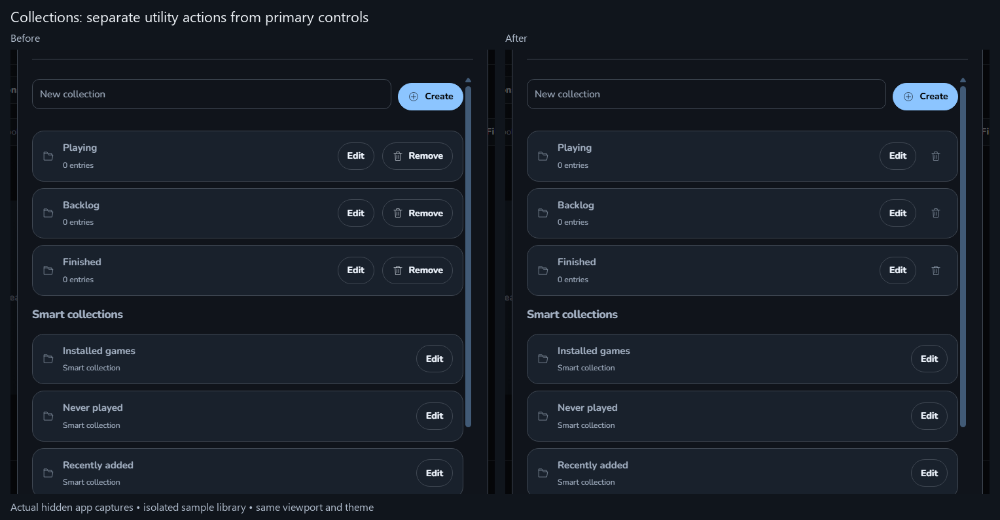
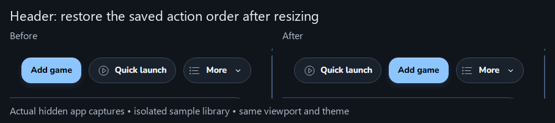
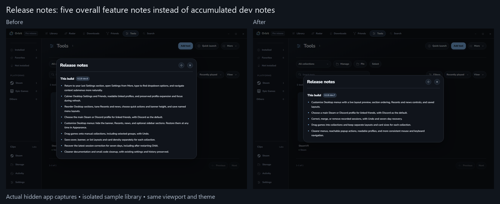

# Orbit 0.2.8-dev.7 validation

Desktop menus now uses the selected Live layout: a preview beside the controls. At narrow widths, Preview opens only when requested. Other fixes keep collection actions reachable, wrap Storage cards, remove a repeated Steam empty status, and restore header actions in their saved order after resizing.

**Passed:** 868 packaged app checks, 665 unit checks, and 358 source-file syntax checks. Two opt-in native tests were skipped. Both normal and dev profiles were backed up and checked with the normal preference loader. The quiet installation passed: installed files match the validated build, the running game kept the same process, both profiles retain their saved preferences, and all 109 normal / 2 dev history rows remain. Orbit reopened in the background. The release remains unpublished.

**Still needs normal use:** the new preview and narrow popup behavior on the user's physical displays. This pass did not repeat native controller, headset, game-launch, account authorization, Windows sign-in, or taskbar checks. No CPU/RAM/FPS gain is claimed.

## Before and after

Actual app captures with an isolated sample library; these are not the earlier design mockups. Each pair uses the same viewport and theme. The preview represents the layout and reuses already loaded artwork; it is not a screen capture.

Before: six switches spread across the Settings panel. After: the layout appears beside its switches and responds to visibility, order, Recents, banner height and header choices.

Before: the Smart collection checkbox and Save button stretched into oversized grid cells. After: Name spans the row, filters balance below, and a normal-size Save stays reachable.

Before: a narrow collection editor hid Save and Cancel below its fields. After: its action row remains reachable while scrolling.

Before: narrow Storage required sideways scrolling for drives. After: drive cards wrap within the popup.

Before: Steam repeated the empty-queue status. After: it shows one empty state; active queue controls return when needed.

Before: collection removal competed with editing as a full-size action. After: it has a separately named utility control, with the existing confirmation retained.

Before: returning from a narrow window put Quick launch after Add game. After: the saved action order returns.

Before: release notes accumulated individual development changes. After: five overall feature notes cover the same scope.

See the [whole-menu review](MENU-AUDIT-0.2.8-dev.7.md), [exact code removals](CODE-CLEANUP-0.2.8-dev.7.md), and [check summary](validation/0.2.8-dev.7/evidence-summary.json).
