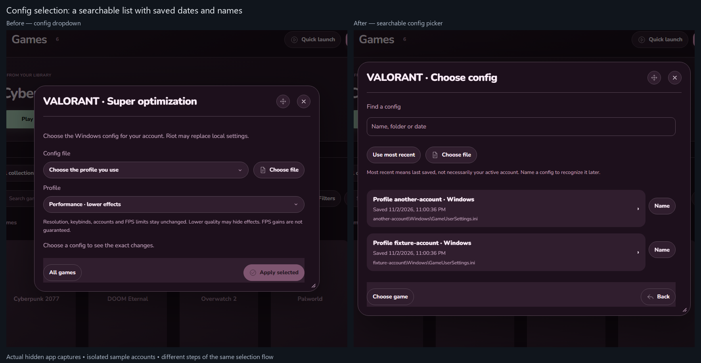
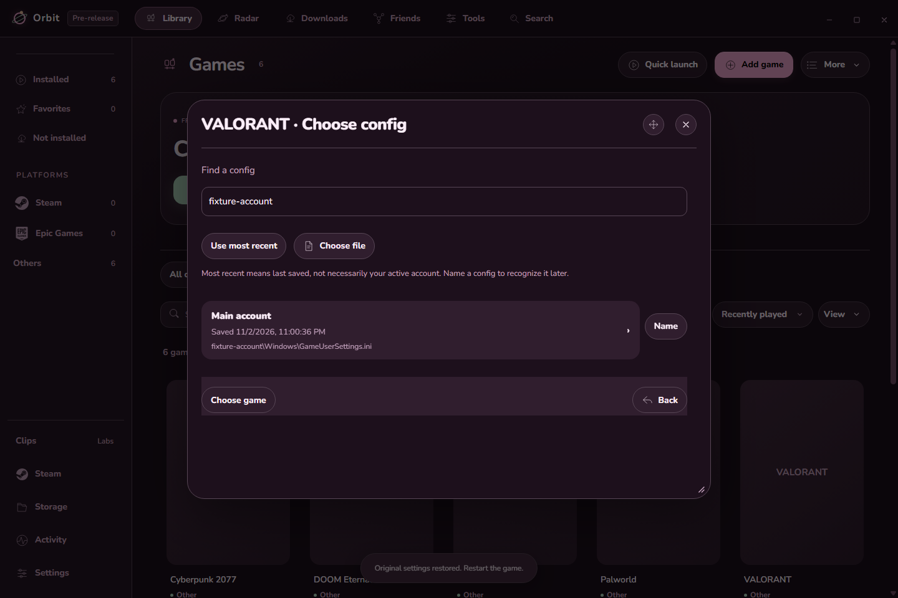
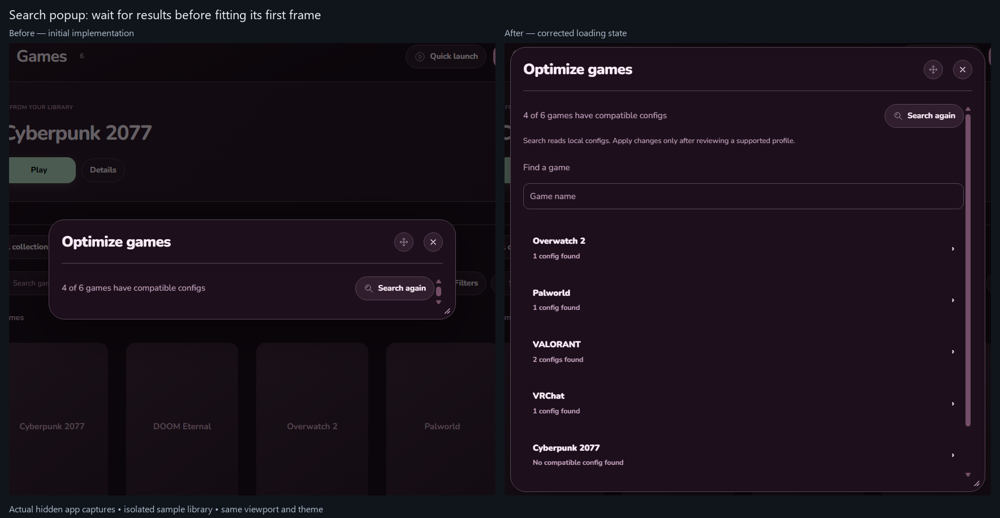
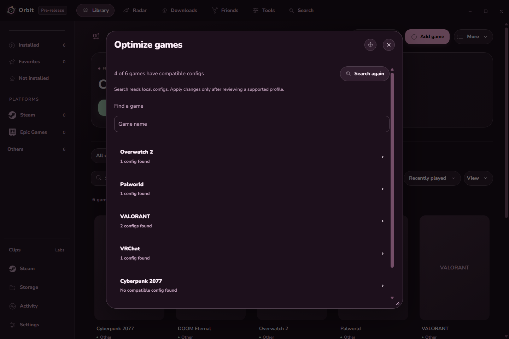
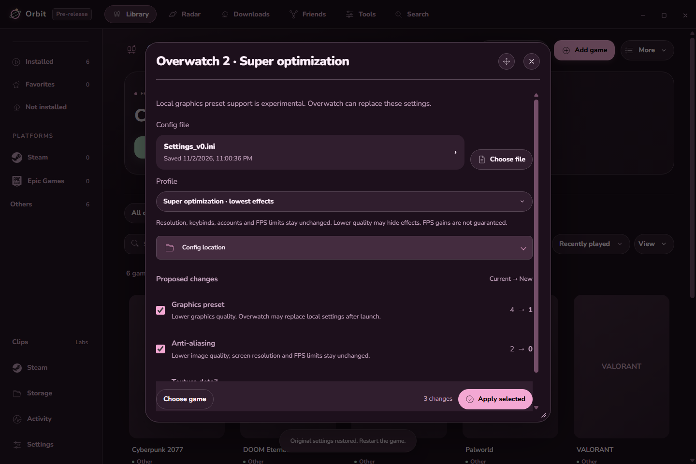
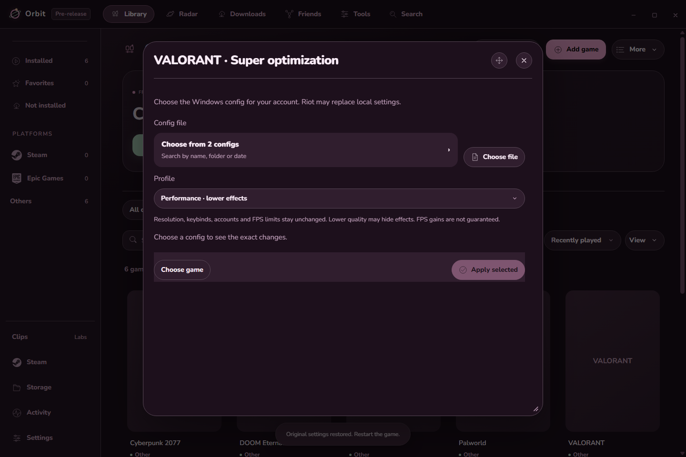
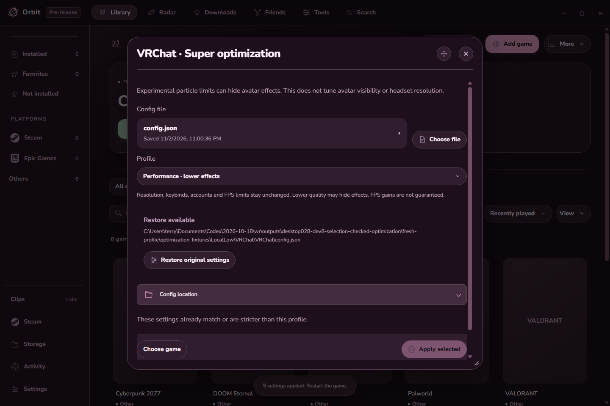

# Orbit 0.2.8-dev.8 validation

Added local config discovery and reviewed game optimization. More → Optimize games scans the library. Game options → Super optimization opens one game's preview. Config and preset choices persist; Apply creates a verified backup and Restore protects newer settings.

Game rows are full-width selection buttons. Configs use a searchable picker with saved dates, an explicit Use most recent action and private names such as Main account. Names are saved in Orbit metadata; naming a config does not edit the game file.

Before: config selection used an account-folder dropdown. After: a searchable list shows dated config cards, with names saved for later.

Initial support: Overwatch, VRChat, VALORANT and compatible Unreal user configs. Unsupported files are skipped. This does not claim that every game has a working profile or that these presets provide the best settings for every PC.

## Examples

Actual hidden app captures below use an isolated sample library and temporary config files. No real game was launched or configured for these checks.

Before: the first implementation fitted the search popup while its loading message was visible, hiding the results. After: it waits for the results before fitting. This pair shows a development bug found and fixed during this feature, not the released 0.2.7 UI.

The search checks all games in the visible library and sorts compatible configs first. A filter and incremental result display keep large libraries manageable.

The preview names each proposed setting, its current value, its new value and its quality tradeoff. The user can keep individual settings. Apply remains a separate action.

Multiple VALORANT configs start with no account selected. An explicitly chosen config is remembered across restarts.

Restore remains available after applying. It restores the original bytes when possible, merges unrelated newer edits, and stops if an optimized value was changed outside Orbit.

## Findings and checks

- Found and fixed the loading-frame sizing bug and a long config label that overlapped Choose file.
- The per-game preview also waits for its asynchronous settings before fitting, so its first proposed setting is visible on a fresh wide frame.
- The first backend test caught a Windows fsync failure on a read-only temporary-file handle. The replacement write now uses a writable handle; Apply/Restore checks passed afterward.
- A repeated validation initially reused its saved fixture account choice; a fresh isolated profile confirmed the first-choice behavior. Remembering that earlier choice was correct product behavior.
- Fixed fixture-only refresh/DOM-cloning errors in the new validation runner. These were not game configuration failures.
- Kept duplicate unrelated VRChat beta entries, existing stricter particle budgets, unknown JSON fields, INI comments, CRLF and supported BOM encodings.
- Tested stale/foreign/expired previews, invalid formats, missing or duplicate settings, corrupt backups, read-only/linked files, interrupted writes and running-game refusal. No process is closed to make Apply pass.
- Tested discovery of more than 1,000 entries with no more than three concurrent jobs, cancellation, and persisted file/preset choice.
- Final packaged UI checks use wide Roseberry and narrow Cloud at 125% renderer zoom, with reduced motion. Physical display scaling and controller/headset playtests were not repeated.

Read-only inspection on this PC found one compatible Overwatch config, one VRChat config and 39 VALORANT configs; six VALORANT files were unrecognized or unreadable and skipped. Their content hashes are checked again after validation and installation. No real config is applied as part of validation.

There are no before/after FPS, CPU, RAM or frame-time measurements for these presets. In-game behavior, quality tradeoffs and cloud-setting persistence still need a user playtest. Overwatch's preset mapping is experimental; VALORANT may replace local settings. VRChat's particle limiter is documented as experimental by VRChat.

See [how to use optimization and its sources](GAME-OPTIMIZATION.md). **Passed:** 896 packaged app checks and 686 unit checks. Two opt-in native tests were skipped. Changed JavaScript files parse and the updated documentation links resolve. The final packaged checks recorded no shown or focused validation windows. See the [evidence summary](validation/0.2.8-dev.8/evidence-summary.json).

## Installation and preservation

Installed quietly and reopened in the background. Installed files match the validated package; the running Roblox process stayed alive. Normal and dev settings, themes, artwork, startup media and optimization metadata were retained. All saved history rows remain. Real game config hashes stayed unchanged.

The older snapshot differed in two values saved by the previous Orbit session before the new build was opened: the library filter changed from Installed to Roblox, and a Roblox last-opened timestamp advanced. Those newer values were retained. All other saved choices were compared strictly, and neither live profile was rewritten to match the older snapshot. The release remains unpublished.
