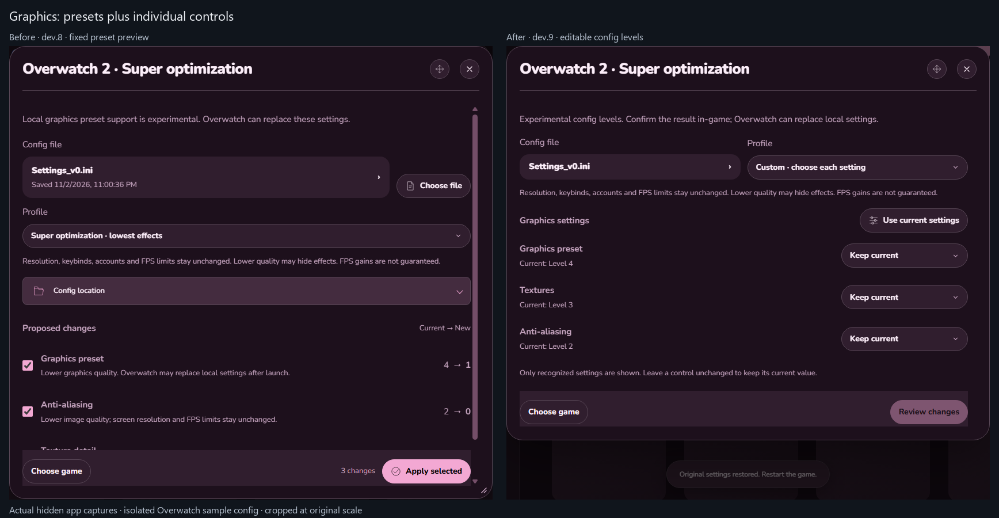
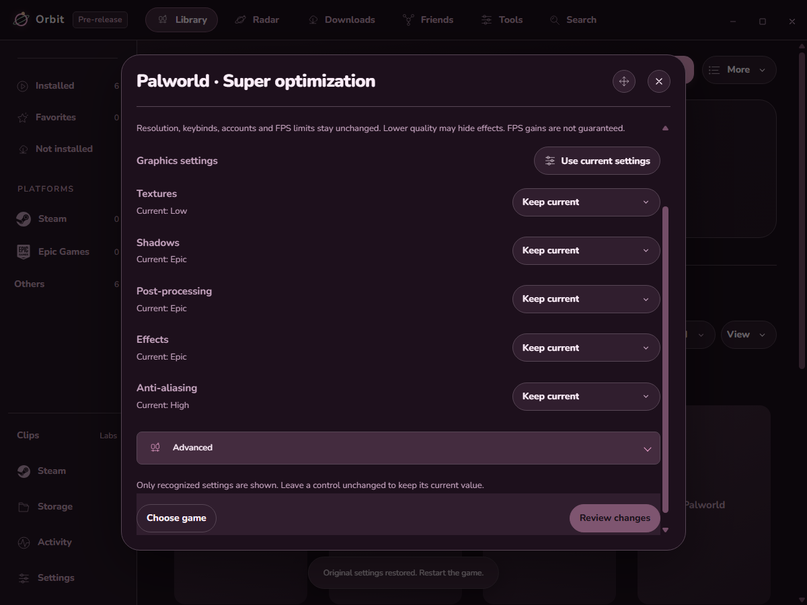
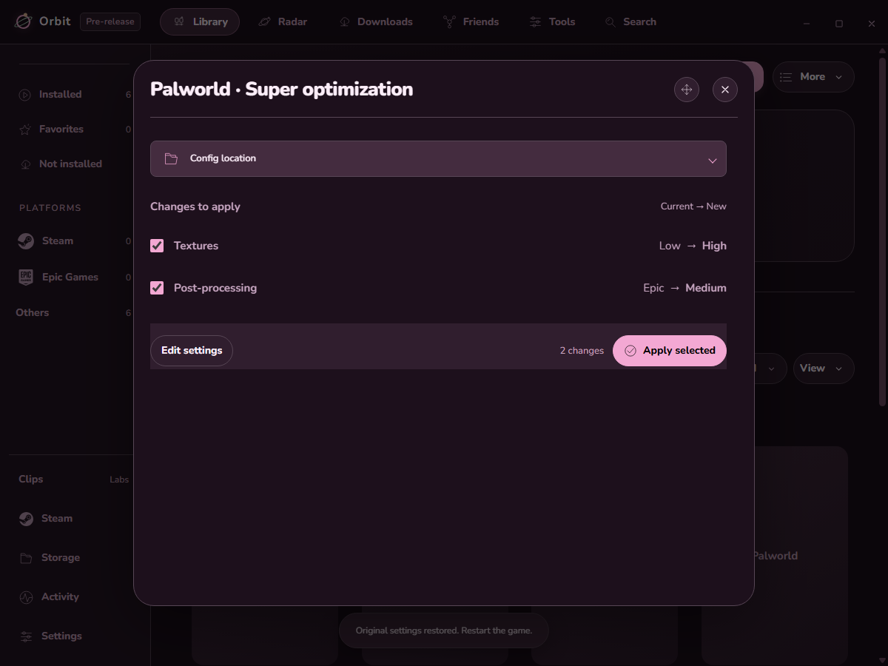
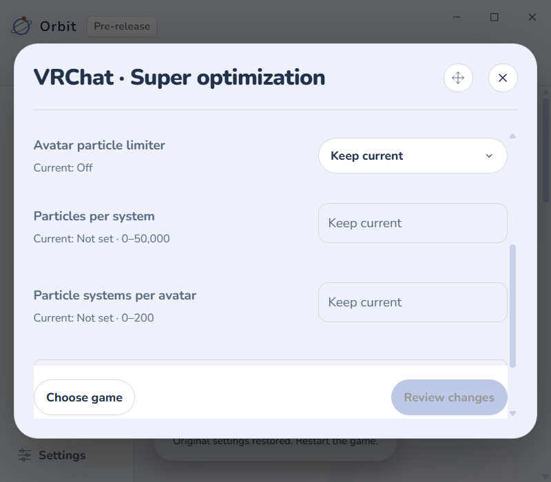

# Orbit 0.2.8-dev.9

Custom graphics controls are added to game optimization. Choose **Custom**, adjust recognized settings, then **Review changes → Apply selected**. Less common controls stay under Advanced. Keep current leaves a setting untouched.

## Examples

These are actual hidden app captures using an isolated sample library and temporary configs. They demonstrate the interface, not measured game performance.

Before: dev.8 offered a fixed preset preview. After: dev.9 also lets users choose individual texture, anti-aliasing and preset levels. Overwatch uses numeric config levels because its mapping remains experimental.

For compatible Unreal configs, users can raise texture quality while lowering post-processing, leaving other settings unchanged. Review lists only the proposed changes, using readable quality names.

VRChat exposes its documented particle limiter and bounded particle budgets. General graphics remain in VRChat's own menu. Narrow windows keep controls readable and the footer reachable.

## Findings

- The first Custom view had too much header content above its settings. Config and profile controls now share a row; choosing Custom brings the editor into view.
- Review hides setup controls and shows only the changes, their current/new values, and Apply. Returning to edit keeps choices and restores keyboard focus.
- Expanding Advanced keeps the popup frame stable. Light/dark and narrow layouts use the existing theme and popup rules.
- Invalid values disable Review and Apply. Unknown keys, absent INI settings, unsupported levels and cross-game tokens are rejected in the main process.
- Editing or reviewing does not modify the game config. Apply still requires the game closed, verifies a backup, and protects against stale previews. Restore retains unrelated newer edits and stops on conflicts.
- Custom choices are remembered for the selected config. A newly chosen account starts with its current settings.

## Checks

**Passed:** 908 packaged app checks and 692 unit checks. Two opt-in native tests were skipped. Changed JavaScript parses; documentation links resolve. Final isolated checks recorded no shown or focused validation windows. The [evidence summary](validation/0.2.8-dev.9/evidence-summary.json) records the build and preservation results. Installed quietly; installed files match the validated candidate. Normal/dev preferences passed the strict loader comparison, history was retained, and real game config hashes stayed unchanged. The running Roblox process stayed alive. The later footer correction is documented in [dev.10](VALIDATION-0.2.8-dev.10.md).

No real config is applied during validation. No game is launched, no account is reauthorized, and no controller or headset test is repeated. In-game quality, cloud-setting persistence and FPS effects still need a user playtest. No FPS, CPU or RAM gain is claimed.

See the [short guide and primary references](GAME-OPTIMIZATION.md).
