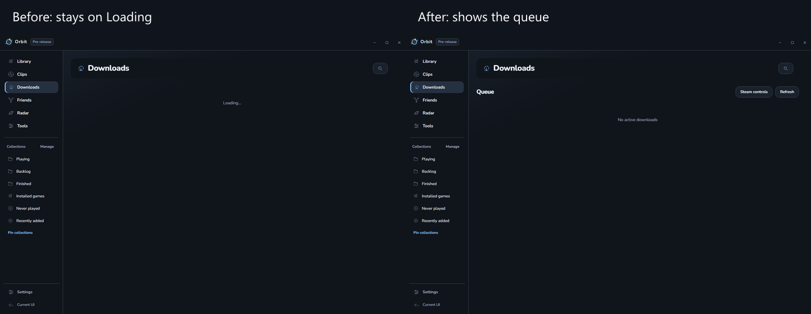
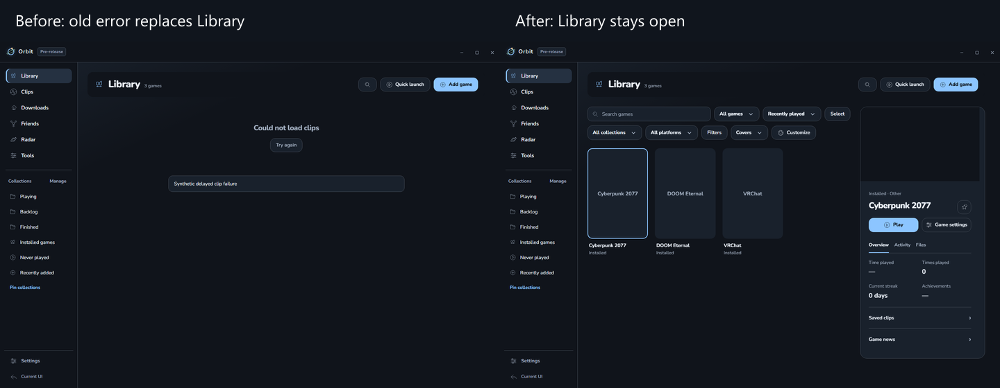
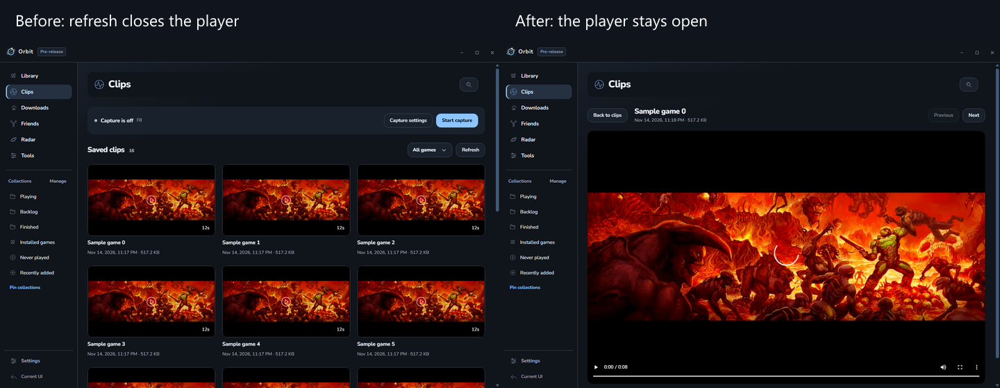
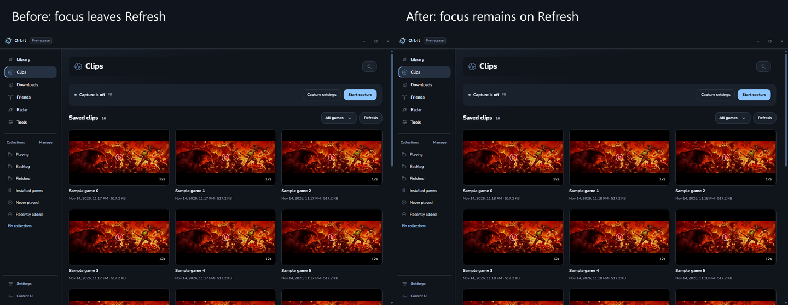
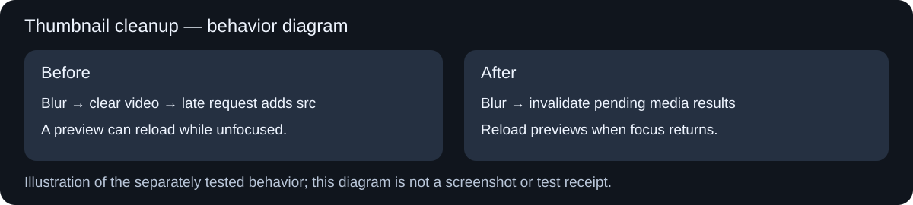
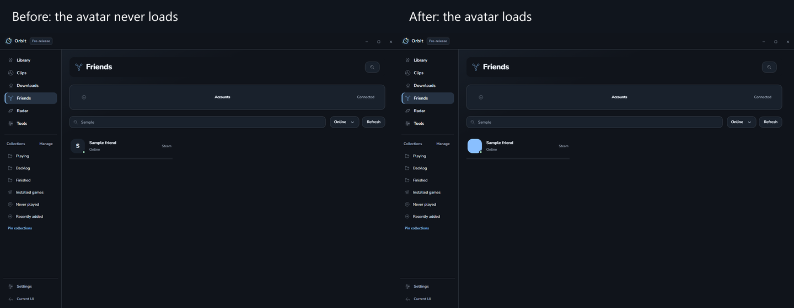

# Orbit 0.3.0 broad polish

Six navigation and background issues were reproduced and repaired in regular Orbit. The validated candidate was installed with Setup visible, and saved choices were preserved. **831 unit tests and 968 packaged UI/regression checks passed.** Two opt-in native-window tests were skipped. Nothing was published.

| Finding | Before | After |
| --- | --- | --- |
| Returning to Downloads during a request | The page could remain on Loading. | It loads the current queue after the old request settles, without duplicate concurrent loads. |
| Leaving Clips before a request fails | The delayed error could replace the Library page. | Only the page that owns the request can display its error. |
| Opening a clip while gallery refresh is pending | The late refresh could close the player. | Playback stays open and gallery data refreshes in the background. |
| Refreshing the gallery with the keyboard | Focus moved off Refresh when controls were rebuilt. | The equivalent control keeps focus and the gallery scroll position is retained. |
| Losing focus during thumbnail loading | A late request could restore a cleared video source. | Old media results are ignored; previews resume on focus. |
| Friends avatars | Observing a hidden image meant loading never started. | The visible avatar container triggers image loading. |

Friends previews also resume after returning to the app, and an empty All friends view now says “No friends to show.”

## Before and after

All five pairs below are actual screenshots of the same isolated synthetic fixture before the repair and in the repaired package. They contain sample games and clip files. The focus pair's labels describe the separate automated active-element check; the image alone does not prove focus.

The old page stayed on Loading after leaving and returning; the repair opens the current queue.

The old failure replaced Library content; the repair leaves Library visible.

The old refresh returned to the gallery after a clip was opened; the repair retains the player.

A separate active-element assertion confirms Refresh retains keyboard focus.

This is an illustrative behavior diagram. The hidden fixture separately verified no video source was restored after blur and that previews resumed on focus.

The sample friend has a local fixture avatar. The repair loads it without changing account permissions or making a real account connection.

## Review coverage

The package passed 596 existing regression checks, 260 shared-screen checks, 41 Workspace checks, 12 Search/focus/release-gate checks and 59 new navigation/layout checks. The release-gate fixture explicitly disabled the development capability override.

The screen audit covered both Desktop compositions, mixed layouts through the existing suite, representative shared dialogs, Settings, launch choices, collections, activity, account states, Clips, Downloads, Friends, Radar and Tools. New layout checks covered 1440, 800, 500 and 360-pixel windows, 100% and 125% zoom, dark and light themes, with motion off. Existing transition and experimental VR fixtures passed. No real download, game installation or account was changed for a test. All background-window receipts passed.

Source review retained the two-second tray-unload target and active-work safety gates, bounded news caching, deduplicated image requests and limited image concurrency. No capture quality, user setting or established major layout was reduced or replaced.

## Memory and responsiveness

The previous and repaired packages ran sequentially after other build/test jobs finished, using the same hidden 1440 × 1000 Workspace fixture, no recording, motion off and 36 Settings open/close cycles. Each phase used eight samples after settling, followed by an additional idle period. No forced trimming or garbage collection was used.

| Phase | Before: working set / private MiB | After: working set / private MiB |
| --- | --- | --- |
| Initial | 750.3 / 346.2 | 613.4 / 214.6 |
| 12 cycles | 683.5 / 285.8 | 745.8 / 348.2 |
| 24 cycles | 676.2 / 277.0 | 868.5 / 471.0 |
| 36 cycles | 768.1 / 369.1 | 750.1 / 351.3 |
| After idle | 599.7 / 221.3 | 601.3 / 222.8 |

These are sums from Electron's process metrics; working set can count shared pages. Both runs finished with no open dialogs, no retained modal children, no active video sources and capture off. Popup activity caused temporary memory growth that settled during the workload. This limited run does not rule out leaks elsewhere or support a general performance-gain claim. GPU/VRAM, real-game FPS, capture overhead, startup timings and network throughput were not measured.

## Preservation and release limits

The installed archive matches the validated package. The normal preference loader retained the active theme, seven custom themes, Afterglow startup, artwork, library choices, capture preferences and remembered connection. Both profile locations were checked and present data backed up; no separate dev profile was present. No games ended during installation.

The installer remains unsigned. The legacy compatibility feed returned 404 during the preceding release review; it must be restored during explicitly approved publication and live update discovery verified afterward. Live headset input, broader real-game capture, sleep/wake, device changes and AV sync remain playtest work. Previous user playtest evidence was retained without repeating disruptive tests.

The source/asset scan and current draft status are recorded separately in the release-preparation receipt. Historical validation documents describe their original candidates.
