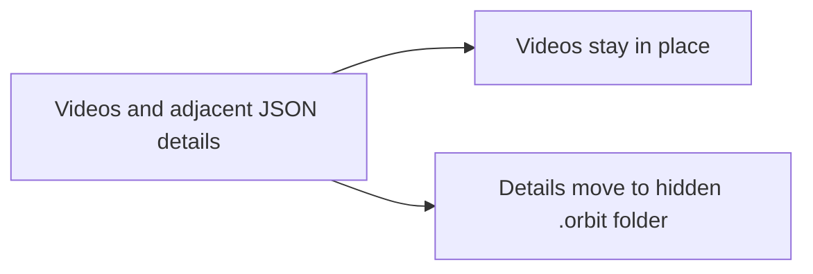

# Cleaner clip folders

Clip details now live in a hidden **.orbit** folder instead of beside every video. Existing details move there automatically when Clips loads. Keep that folder with your videos when moving or backing up the collection.

Your folder was backed up and cleaned: **13 detail files moved, 17 recordings preserved, no recordings deleted.** Filenames, sizes, timestamps and file identity stayed unchanged; the relocated details match their original bytes. Windows confirmed that .orbit is hidden.

| Before | After |
| --- | --- |
| Recording.mp4 and Recording.mp4.json beside each other | Recording.mp4 remains in place; details live in hidden .orbit |
| Repeated JSON icons between videos | Videos remain visible in the main folder |

Illustrative file layout; the counts above come from the actual migration check. Titles, game associations, dates and bookmarks remain available in Orbit. Active session details are left alone until recording has stopped. Conflicting files are kept instead of overwritten, and a failed relocation leaves the old details readable.

**851 unit tests and 82 targeted packaged checks passed.** Coverage includes legacy migration, replay saves, full-session checkpoints, interrupted sessions, bookmarks, playback and deletion in both Desktop interfaces. Windows recycling passed with generated files and internal details. Two native-window tests remain opt-in and were skipped. No capture, game or account sign-in was started for validation.

Setup ran visibly, and saved settings, seven custom themes, artwork, startup selection and capture/library choices passed normal-loader checks. Remembered credentials were unchanged during Setup; normal startup may refresh their encrypted storage. The development profile is absent and was not created.

Publication and compatibility-feed restoration remain manual user actions. The installer remains unsigned. No new hardware or performance claims are made.
