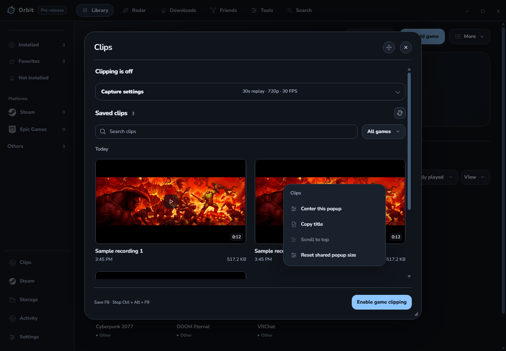
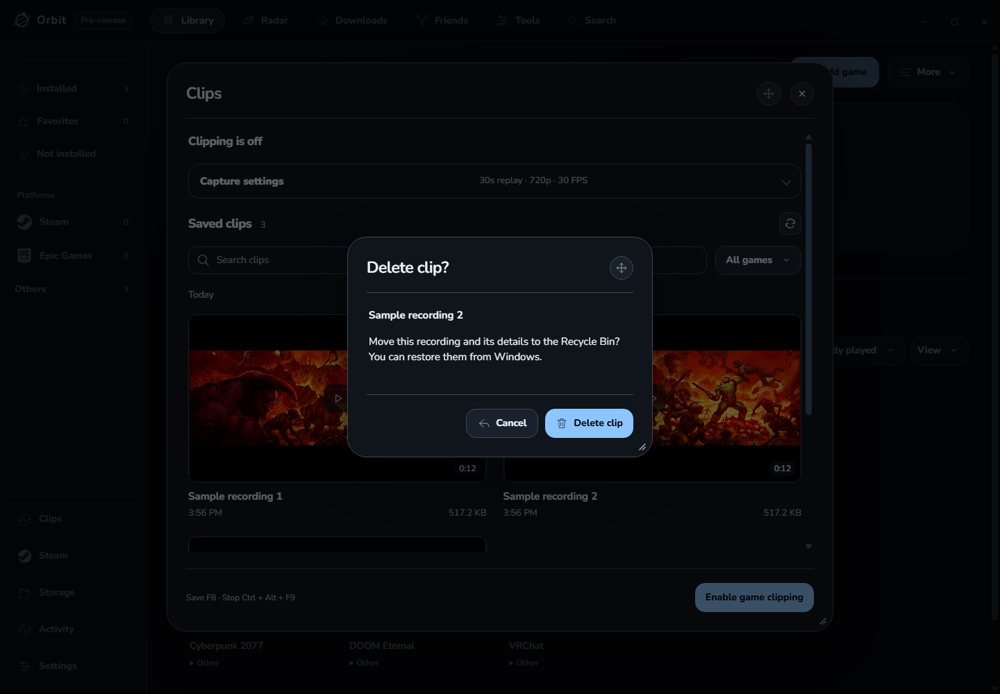
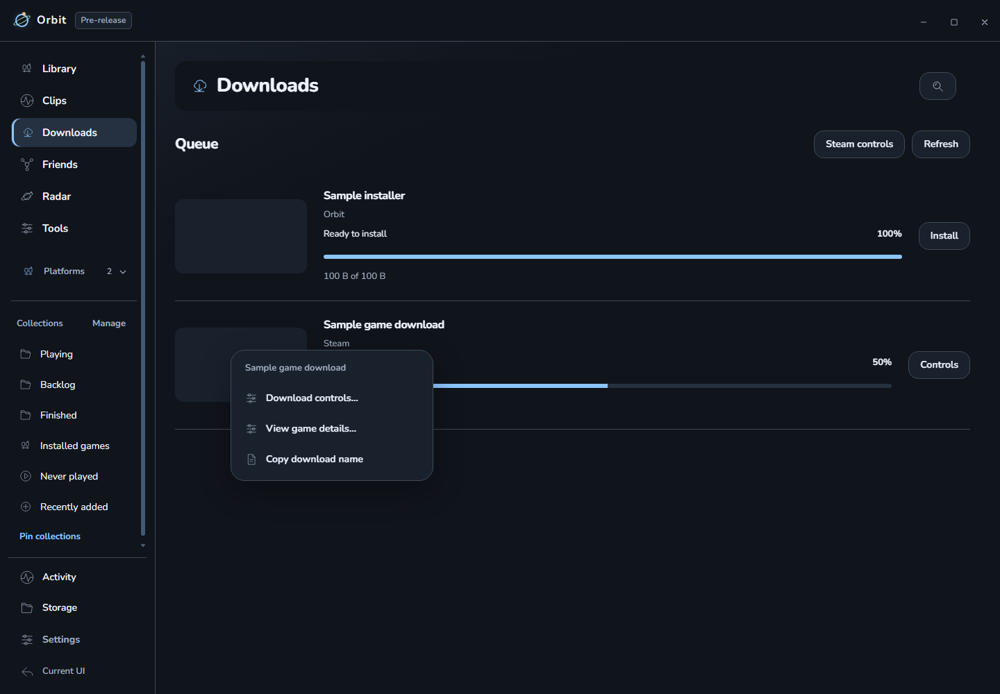
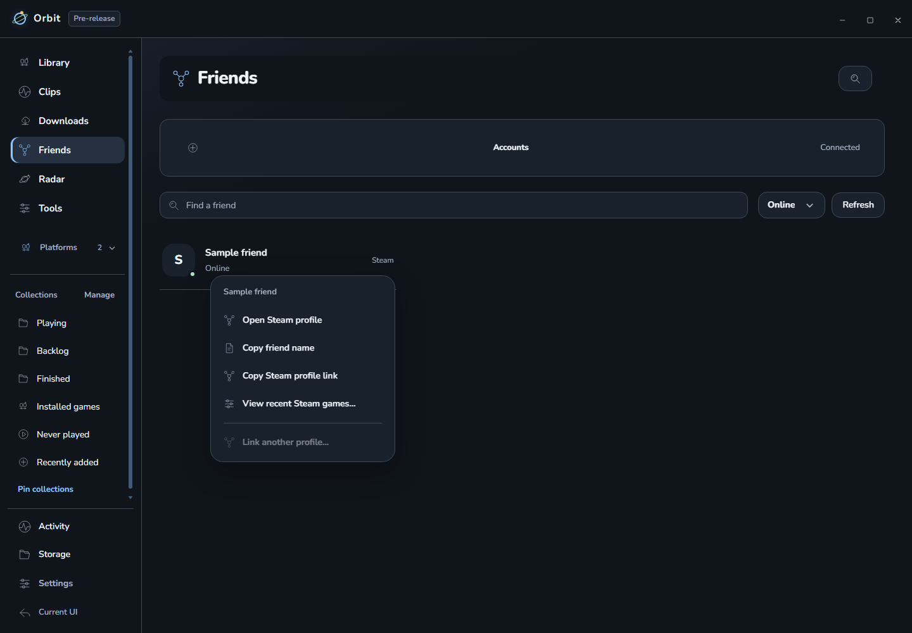
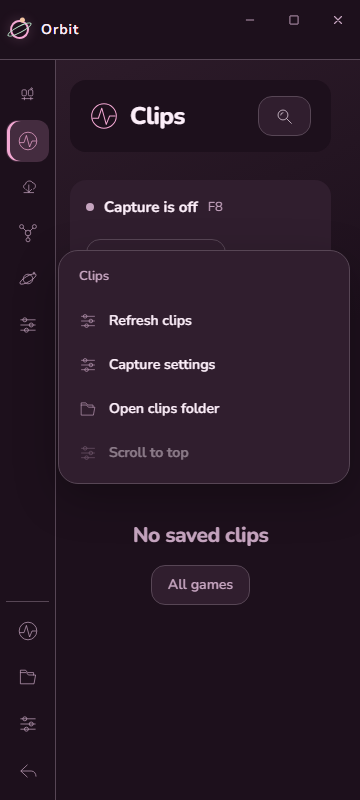

# Clips and right-click menus

Saved clips now have **Delete clip** in their right-click menu and player. Confirmation moves only the selected recording and its details to the Windows Recycle Bin. Cancel keeps them; recycling failure leaves the recording available and offers another attempt. Active recordings cannot be removed.

## Before and after

Before: right-clicking a saved clip showed general popup controls.

After: the menu follows the selected recording and offers playback, Show file, Copy clip title and Delete clip.

Actual hidden Orbit screenshots using the same isolated sample library, viewport and theme. Sample recordings are generated test media.

Cancel receives initial keyboard focus. Separate checks verified that Cancel and a simulated recycling failure preserve the recording, and that deleting the playing or final clip leaves a usable gallery with filters and focus preserved. Windows recycling was also checked with newly generated files, without touching user clips.

## Other menus

Downloads now offers controls for the selected transfer, or Review installer for an installer download. It does not run an installer from the context menu.

Friends offers the selected provider profile and relevant actions; its background menu controls the actual visible friend filter.

News opens the selected article in Orbit, collections select their actual collection, wishlist editing returns to its Workspace page, and theme actions use the existing theme controls. Text editing keeps its normal commands.

Menu placement, keyboard typeahead, Escape and focus return passed at narrow and wide sizes, including 125% scale. Existing Current and Workspace interfaces remain available.

## Validation limits

841 unit tests passed; two native-window tests remain opt-in and were skipped. Packaged checks include the 36 new clip/menu checks, existing interface regressions, release-version feature gates, and hidden-window checks. These fixtures do not certify physical controller/headset behavior, real-device audio, or game performance. No performance improvement is claimed.

The installer remains unsigned. Publication and the compatibility feed remain manual; the public feed has not been changed.
