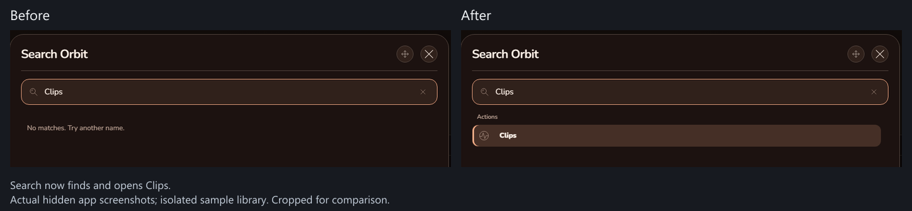
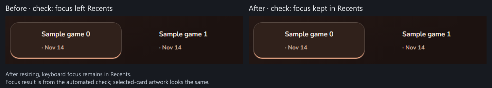

# 0.3.0 final polish

Two UI issues were reproduced and repaired. The new package passed 829 unit tests, 596 packaged checks, 41 Workspace checks and 12 targeted checks. Two native-window tests remain opt-in and were skipped. Nothing was published.

## Fixed in this pass

| Finding | Before | After |
| --- | --- | --- |
| Clips was missing from Search | Searching for Clips returned no matches. Hiding its sidebar shortcut could remove a useful alternative route. | Search opens Clips in either Desktop interface, including when its navigation shortcut is hidden. Recording stays off. |
| Recents lost keyboard focus after resizing | Reducing the window width removed the focused card and left focus on the page. | Focus stays on a surviving recent card. Existing focused cards retain their focus. |

Actual hidden app screenshots with an isolated sample library. Search now shows the Clips action; activating it was also checked separately.

Actual cropped screenshots after the same window resize. The selected-card styling looks similar, so it is not proof of keyboard focus. The labels report the separate automated focus check: before, focus left the row; after, focus stayed within it. Placeholder artwork belongs to this isolated test fixture, not the user's library.

## Other findings

- **Release blocker: the compatibility update feed is missing.** Both `v0.2.0-pre.1/latest.yml` and its release-by-tag API return 404. Existing installations use this address. Restore it as part of approved publication. This review did not change the public feed.
- The installer remains unsigned, as already stated in the release notes.
- The GitHub draft currently holds the preceding repair. These final-polish files must replace it before publication; preparing local files does not update the draft.
- The earlier release-version clipping gate repair remains present. Clips is enabled for the release version without relying on the test-only development override. The redundant layout shortcut and duplicate Clips experiment route remain removed. These were earlier repairs, not new fixes in this pass.
- Seven Settings search routes reached visible, focused controls: theme, startup, app icon, popups, keyboard shortcuts, updates and tray behavior. No additional defect was reproduced there.
- The review did not reproduce additional failures in popup sizing, settings layout, navigation, clipping controls, audio controls, VR UI fixtures or transitions. Automated coverage does not prove every hardware combination or visual state is flawless.

## Memory and responsiveness

The same hidden 1440 × 1000 Workspace fixture was run before and after, with motion off, no recording and 36 Settings open/close cycles in batches of 12. Each phase used eight samples after a 1.8-second settle; the last phase followed an additional ten seconds idle. No forced memory trimming or garbage collection was used.

| Phase | Before: working set / private MiB | After: working set / private MiB |
| --- | --- | --- |
| Initial | 701.5 / 296.0 | 702.6 / 299.6 |
| 12 cycles | 862.3 / 458.8 | 840.8 / 439.7 |
| 24 cycles | 722.3 / 323.0 | 733.3 / 336.8 |
| 36 cycles | 723.9 / 325.0 | 718.6 / 322.1 |
| After idle | 598.3 / 220.7 | 600.8 / 225.1 |

These are sums from Electron's process metrics. Working set can count shared pages; private memory is a different measure. The popup workload produced a temporary increase, then released memory without intervention. It did not show continuing growth across these cycles. It does not explain every reported 700 MB spike or rule out leaks in other workloads.

Both runs settled at about 0.1% CPU by Electron's sampling. The differences are too small and the workload too limited to claim an optimization gain. This pass changed navigation behavior, not capture quality, cache policy or startup performance.

Both fixtures ended with no open dialogs, no children retained in the modal body, no active video elements and capture off. Source review confirmed the existing two-second tray-unload target and active-work safety gates, hidden-preview cleanup, bounded news caching and limited thumbnail concurrency. GPU/VRAM use, gaming FPS, live capture overhead, startup timing and network throughput were not measured in this pass.

## Preservation and installation

The candidate was installed with Setup visible, and its installed archive matches the tested package. Normal-loader verification retained the active custom theme, seven custom themes, Afterglow startup, artwork, library choices, remembered connection and capture preferences. Both normal and dev profile locations were checked; no separate dev profile was present. Both locations were backed up where present. No games were running before or after this installation. Routine validation stayed hidden.

The curated source scan checked 933 files and found no credential patterns or private profile files. It did not decrypt credentials and cannot prove that an unknown or obfuscated secret is absent.

## Still needs a playtest

- Live headset clicks, wrist placement and panel readability; VR remains experimental.
- Broader real-game capture, exclusive fullscreen, device changes, sleep/wake, AV sync and performance.
- Update discovery through the repaired compatibility feed after authorized publication.

The user's earlier confirmations of startup/restart, game handoff, physical controller navigation and repaired microphone/PC audio remain playtest evidence. They were not repeated during this quiet review.

Detailed local evidence: `work/final030-unit.log`, `work/final030-release-suites.json`, `outputs/final030-audit-layout-packaged/layout-report.json`, `outputs/final030-ui-packaged/workspace-report.json`, and the before/after `outputs/final030-resources-*/resources-report.json` files.
