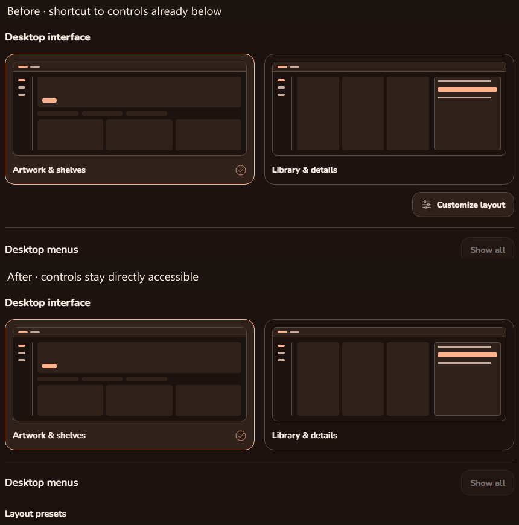
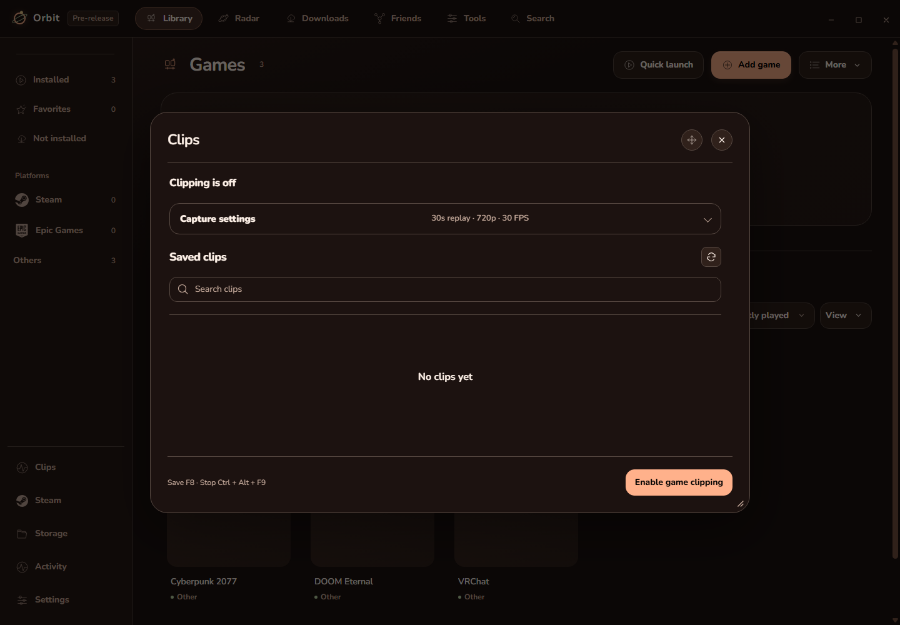

# 0.3.0 candidate repair

The first 0.3.0 candidate hid Clips because its capability gate accepted only `0.3.0-dev.*` version names. Test mode also enabled that gate, so the earlier fixture results did not catch the release-version failure. **The previous GitHub attachments are superseded; replace them before publication.**

## Fixed

- Clipping is available in 0.3.0 release builds and later. The sidebar entry opens Clips without a Dev badge. Capture remains off until enabled; microphone and PC audio remain opt-in.
- Removed the redundant Customize layout shortcut, its unused handler and its styling. Layout parts remain directly in Appearance → Layout → Desktop menus.
- Removed the duplicate Clips prototype route from Experiments. Graphics settings and VR remain experimental.

Actual hidden-app screenshots with the same sample library, theme and window size. Before: an extra button returned to the controls on the same page. After: interface choices lead directly into those controls.

Actual isolated fixture screenshot. The gallery is intentionally empty and recording is off; no real recording was started.

## Checks

- 829 unit tests passed; two opt-in native tests skipped. Release capability explicitly covers 0.3.0 and later, with older releases still excluded.
- 103 packaged checks passed for Settings, navigation, clipping and audio.
- 41 Workspace checks and eight targeted checks passed. The targeted fixture forces the development capability override off and confirms release IPC, the sidebar route, the options remaining available, both Desktop interfaces and opt-in audio.
- The preceding 596-check review remains a baseline, rather than a claim that every suite was rerun for this small repair.

Installer, saved-profile and GitHub-asset receipts are recorded locally after completion. Native headset interaction and broader real-game capture/performance still need playtesting.

## Before publication

The existing compatibility update endpoint at `v0.2.0-pre.1/latest.yml` and its release-by-tag API return 404. Restore that compatibility endpoint as part of the approved publication, so existing installations can find the new version. Preparing this candidate does not modify the public feed or publish a release.

Local evidence: `work/polish030-unit.log`, `work/polish030-release-suites.json`, `outputs/polish030-layout-packaged/layout-report.json` and `outputs/polish030-ui-packaged/workspace-report.json`.
