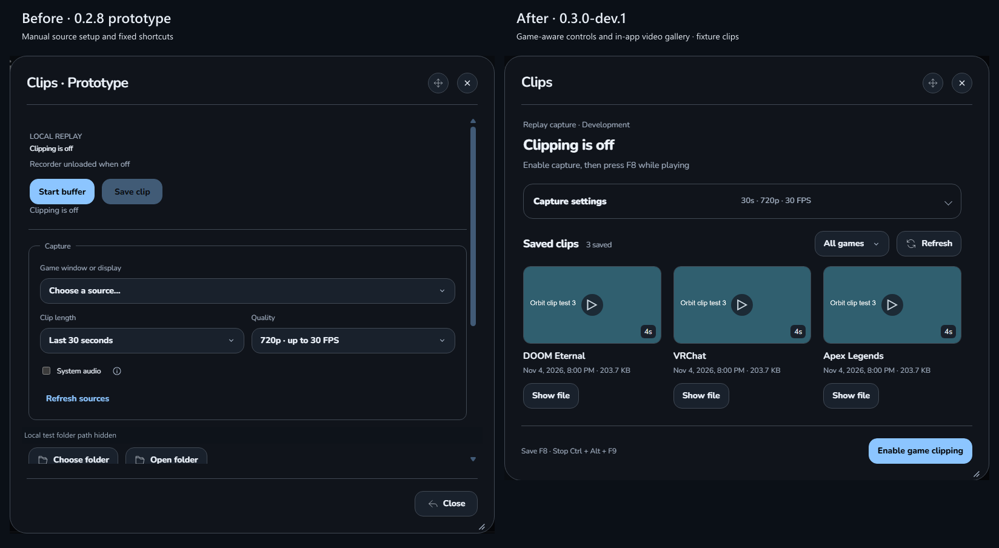
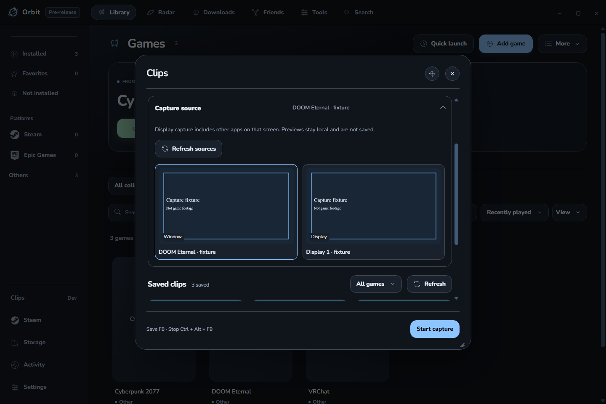

# 0.3.0-dev.1 validation

The first clipping build adds game-aware replay capture, saved controls, visual source choices and local playback. It is a development build, not a public release candidate.

## What changed

Before: manually select a source each time, use fixed shortcuts, and open saved clips in another app.

After: enable game clipping, wait for a detected game, press F8, and review the saved clip inside Orbit. Manual capture and explicit display selection remain available.

The after image uses a synthetic recorder test video labeled with sample game names. It is not footage captured from those games and is not evidence of game compatibility.

Before: a text-only source list. After: local pictures make window/display selection explicit. Previewing does not start recording or save images.

## Checks

- Lifecycle fixtures cover game-window matching, exit, changed ownership, overlapping Start/Stop, shortcut conflicts, saved settings, clip metadata and path validation.
- The recorder fixture encodes a generated canvas into a playable H.264 MP4, saves while capture is active, then stops the worker and removes its temporary buffer. It does not capture the real desktop, microphone or system audio.
- Hidden app fixtures cover settings persistence, source previews, video thumbnails, playback, gallery filtering, cleanup, footer separation and a 540-pixel window. Native windows stay hidden and unfocused.
- Passed 767 unit checks, 873 packaged regression checks and 16 clipping UI checks. Two opt-in native checks were skipped.
- The packaged recorder saved a playable 4.3-second synthetic H.264 clip, then exited and removed its buffer. This is a functional fixture result, not a gameplay performance benchmark.
- Installed quietly with both normal and dev profiles preserved, including themes, artwork, startup choices, remembered connection files and recorded history. VRChat stayed running; no game was ended by installation.

## Still needs testing

Real-game capture, protected/exclusive-fullscreen compatibility, physical shortcut use, 1080p/60 FPS and system-audio behavior need a user-agreed playtest. No game FPS, CPU, RAM or startup gain is claimed. H.264 hardware encoding is requested; this is not proof that every GPU uses a hardware encoder.

Saved clips are not automatically deleted. The rolling buffer is bounded on disk, but configurable output quotas, ongoing free-space checks, trim/export and automatic event highlights remain later work.
