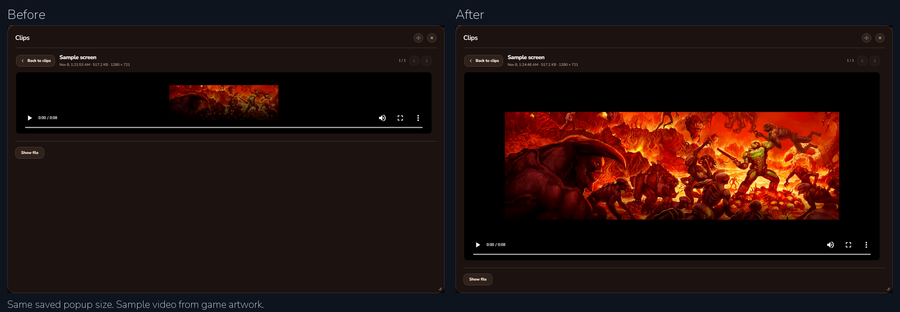

# 0.3.0-dev.10 — player fills saved popup sizes

Fixed and installed locally. Nothing published.

Before: a manually sized popup could leave the player at its 220px minimum height, with unused space below the footer. After: the playback area fills the popup and grows when its height changes. Saved dimensions stay intact, and the video keeps its proportions. Recording resolution and files are unchanged.

Actual app screenshots with a sample video made from game artwork, not recorded gameplay. In the matching 1564 × 960 fixture frame, the video container grew from 220px to about 675px high. This is a layout measurement, not a recording-quality or performance gain.

## Validation

103 packaged checks passed, including shared sizes, separate Clips sizes, reopening, manual width/height combinations, actual corner dragging, switching between gallery and playback, automatic sizing, tall windows, and narrow 125% scaling. The existing clipping controls and popup suites also passed. Added saved-height regression checks to the existing opt-in Clips polish fixture.

The earlier dev.9 checks covered automatic sizing and width dragging but missed the manual-height case shown by the user. This pass reproduced that failure before applying the correction.

Only the player flex-sizing rule, regression fixture, version and development notes changed. Recorder/audio/backend code is byte-identical to dev.9; its 779 passing unit tests were not repeated for this CSS-only repair. All current automated windows stayed hidden and unfocused. No capture, microphone, visible fullscreen, or new gameplay playtest was started.

## Installation and preservation

The installed package and 33 unpacked resources match the checked build. The normal loader retained the selected custom theme, seven custom themes, Afterglow, saved popup sizes and other preferences, remembered connection, and 117 history records. Both normal/dev profile locations were checked; only the normal profile existed.

All 28 saved video/metadata files retained their names, sizes and modification times; contents were not rehashed. VRChat and Roblox stayed running with the same processes. Orbit reopened in the background, and profile/clip checks passed again afterward.

Detailed local records: `work/clips039-final-suites.json`, `work/clips039-scope.json`, `work/clips039-install.json`, `work/clips039-preservation/`, and `outputs/clips039-packaged/clips-fit-report.json`.
