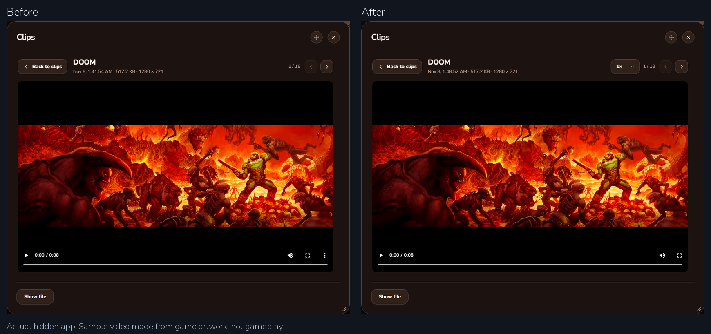
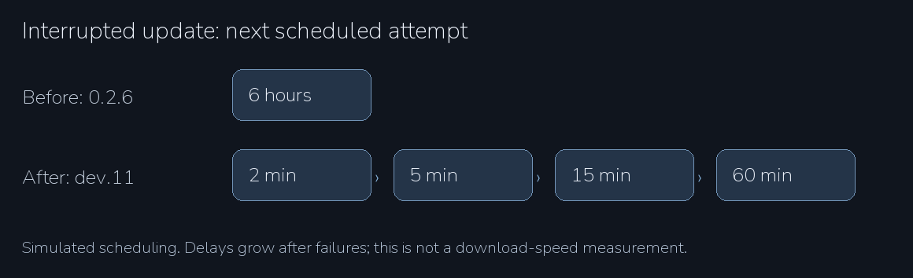

# 0.3.0-dev.11 — Playback controls and update recovery

## Changed

- Interrupted automatic updates retry after 2, 5, 15 and then 60 minutes, instead of waiting six hours after the first failure. A slow download cannot start twice. Disabling automatic updates cancels pending checks.
- The clip player's native fullscreen permission is allowed only for Orbit's own local main frame. Other permissions, remote pages, subframes and other windows stay denied. Hidden validation never enters native fullscreen.
- A direct playback-speed choice replaces the browser overflow tools. It keeps the selected speed while browsing clips. Show file remains available.
- Visual review caught a new speed selector being squeezed by the utility-button width rule. It now has its own readable width, including at narrow sizes and 125% scaling.

The recorder and audio backend are unchanged. No recording modes were added in this build. See the separate [Medal research and proposed modes](CLIPPING-RESEARCH.md).

## Before and after

Before: playback exposed browser overflow tools and Orbit denied fullscreen permission. After: speed has an Orbit menu and the permission decision allows the local player. These are actual hidden-app screenshots using a sample video made from game artwork. The image does not prove a native fullscreen playtest passed.

Before: a simulated failed startup check in the published 0.2.6 code scheduled its next attempt in 360 minutes. After: the same failure in dev.11 schedules a two-minute retry, with increasing delays after further failures. This diagram shows simulated timer scheduling, not download speed or a test on the friend's PC.

## Passed

- **787 unit checks**, including five new update-recovery cases and three fullscreen-permission cases. Two explicitly opt-in native playtests stayed skipped.
- **140 hidden app checks**: actual speaker mute/unmute, speed-menu input, playback and navigation, missing-file recovery, repeated open/close cleanup, saved popup sizing, light theme, narrow widths and 125% scaling.
- The public shared feed downloaded successfully and pointed to **0.2.8**. Its digest matched GitHub's published feed asset, and the published 0.2.6 source uses that same feed. The release installer asset exists with the size advertised by the feed. No public release files were changed.
- The packaged source and updater configuration match the development candidate. Its installer remains unpublished.
- Installed quietly as **0.3.0-dev.11**. The normal preference loader retained the active custom theme, all seven custom themes, Afterglow, saved choices, artwork and remembered connection data. All 117 history rows and the 28 saved video/metadata files remained present with unchanged recording inventory. Roblox stayed running; no live capture or VR helper was replaced.

Initial fixture setup failed because its IPC argument was missing; the harness was corrected and the complete player suite passed afterward. Screenshot review, rather than the initial assertions, found the squeezed speed label; a readability and actual menu-input check was then added.

## Limits

- The friend's failed update is not diagnosed conclusively: their update status and logs were unavailable. Poor connectivity plus brief app use is consistent with the six-hour retry gap, but is not a confirmed cause. Their 0.2.6 copy cannot acquire this retry fix until it updates. Running the official 0.2.8 installer is a fallback if its own updater keeps failing.
- Native fullscreen entry/exit still needs a user-agreed visible check. The permission decisions passed unit tests; routine hidden fixtures deliberately deny native fullscreen to avoid interrupting a game.
- No real interrupted installer download, game recording, microphone/device test or performance comparison was performed in this pass. Existing audio quality feedback remains user playtest evidence; no CPU/RAM/FPS gains are claimed.

Detailed local records: `work/clips040-unit-final.log`, `work/clips040-final-suites.json`, `work/clips040-update-investigation.json`, `work/clips040-package-verification.json`, and `work/clips040-preservation/` in the development workspace. Installation and preservation results are recorded separately in `work/clips040-install.json`.
