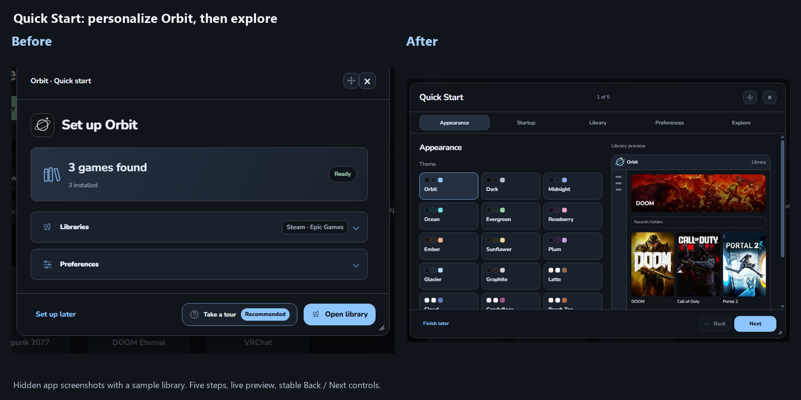
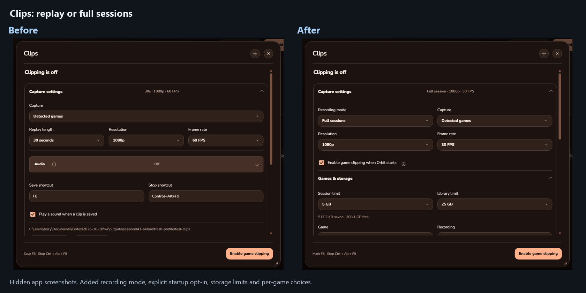
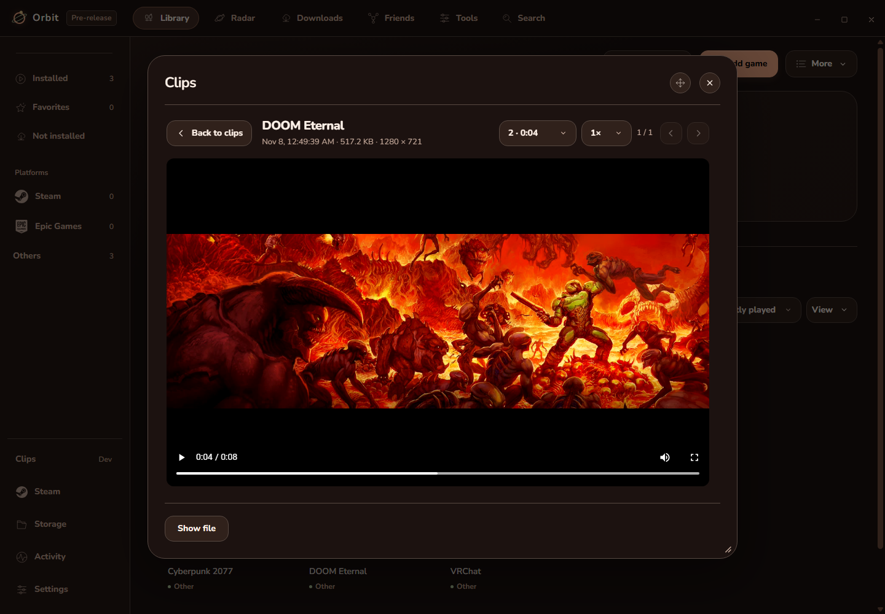
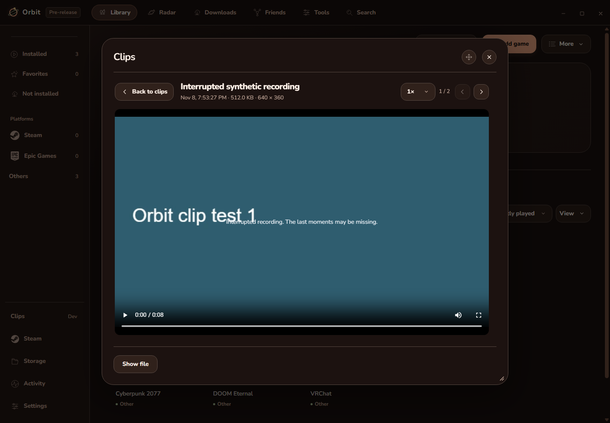

# 0.3.0-dev.12 validation

Installed quietly on November 8, 2026. Unpublished.

**Changed:** Quick Start now covers appearance, startups, library layout, preferences and the app tour. Clips adds full sessions, bookmarks, per-game choices, optional startup arming and storage limits.

**Passed:** 795 unit checks, 594 hidden UI checks and five synthetic recording cases. The installed files match the reviewed package. Existing settings, seven custom themes, Afterglow, play history and 28 video/metadata files were retained. VRChat stayed running during installation. No real screen or microphone was captured by the checks.

**Still needs testing:** real-game FPS/resource impact, long recordings and sleep/wake. Two opt-in hardware playtests were skipped. No performance gain is claimed. Trimming/export, separate audio tracks and automatic game-event highlights remain planned.

## Quick Start

Before: preferences were hidden in expandable sections. After: five clear steps show a live library preview, save chosen preferences and keep Back/Next in place. Reopening keeps completed setup and existing choices. The final action starts the real tour.

## Recording choices

Before: replay-only settings. After: choose replay clips or full sessions, set limits and override recording for individual games. Startup arming is a separate opt-in and never selects a desktop source automatically. Saved clips are never automatically deleted.

## Bookmarks and interrupted recordings

Example checked: F8 marked a synthetic full-session recording; game exit saved it with the correct game identity. Selecting a moment moved the player to that time. This screenshot uses sample publisher artwork, not recorded gameplay.

A separate forced-interruption test retained a readable fragment, which also played in Orbit. Interrupted files keep a warning; final frames may be missing, and other crash cases may not be recoverable. This image shows generated test frames.

The first broad screenshot run exceeded its 120-second test-harness limit. A complete rerun with a 300-second limit passed. This is a validation-harness change, not a measured app speed improvement.

[Detailed results](validation/0.3.0-dev.12/details.json) · [Quick Start guide](QUICK-START.md) · [Clipping guide](CLIPPING.md) · [Research and remaining work](CLIPPING-RESEARCH.md)
