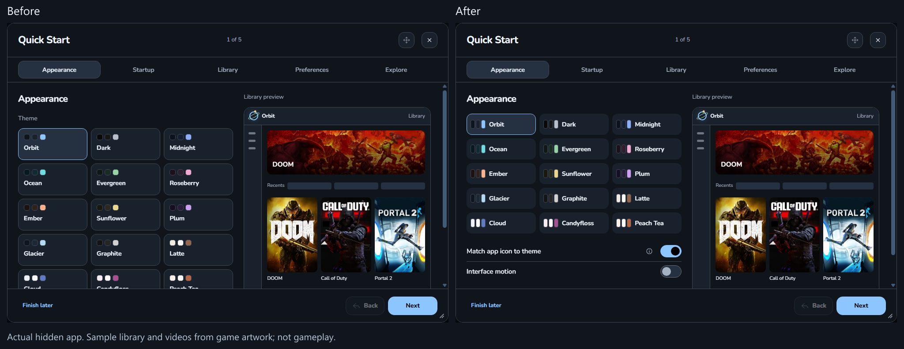
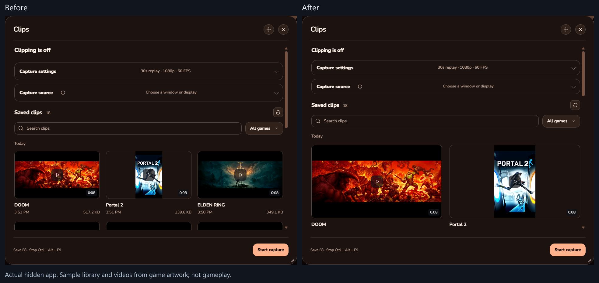

# Quick Start and Clips polish

Quick Start uses compact theme choices without shrinking the text. Clips gives saved recordings larger previews and keeps capture setup rows shorter. Existing layouts, playback controls, and saved choices remain intact.

## Before and after

Before: theme cards pushed the icon and motion choices farther down. After: compact horizontal choices leave more room for those settings.

Before: three small clip previews shared the default popup width. After: two larger previews make recordings easier to identify; portrait content keeps its proportions.

These are actual screenshots from isolated app checks. The library and videos use sample game artwork, not gameplay or the user's recordings.

## Checks

- Passed: 803 unit tests; two opt-in hardware tests skipped.
- Passed: 26 Quick Start and 37 clip-viewer checks against the packaged build.
- Passed: 596 broader checks covering settings, navigation, popup resizing, clipping controls, synthetic VR, and transitions.
- Passed: packaged files match all 361 checked source files; installer update metadata and checksums match.
- No new recording, live headset, or physical-controller playtest performed. No CPU or memory improvement is claimed for this visual polish.
- Existing browser content-security warnings appeared during the broad checks. They did not fail these checks and are not treated as resolved by this pass.

Installed locally through visible Setup. The installed files match the tested build. The normal loader retained the saved theme, seven custom themes, Afterglow startup, library choices, managed artwork, and remembered connection. No separate dev profile was present. VRChat and Roblox kept their original running processes during installation.

The build remains unpublished. Detailed machine-local reports are in `outputs/ui014-*` and `work/ui014-*` in the development workspace.
