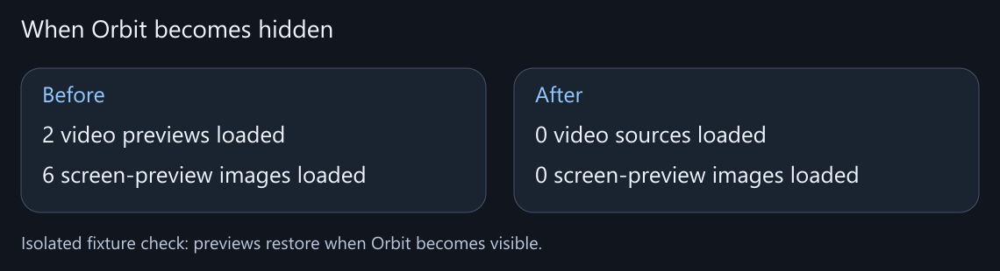
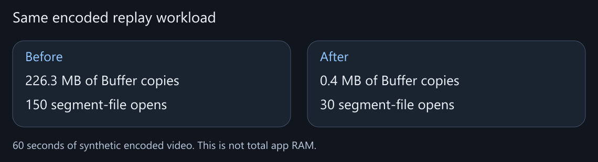

# Clipping resource use

Clipping now avoids repeated packet copies, keeps the current replay segment open between writes, and releases hidden clip and screen previews. Resolution, frame rate, bitrate, replay length, audio selection, volume, and synchronization are unchanged.

## Before and after

Before: hiding the sample gallery left two video previews and six screen-preview images loaded. After: all eight release their sources, and visible previews return when Orbit becomes visible. Closing the viewer also releases media.

Before: every replay batch copied packet payloads into larger buffers and reopened the segment file. After: writes use existing packet views and retain one current-segment handle. Partial disk writes are retried, and the handle closes on rollover or Stop.

The diagrams explain behavior verified with isolated fixtures; they are not screenshots or recordings of the user's games.

## Measurements

Same machine, Node version, packet data, buffer length, disk, and workload. Three trials per side, alternating order. The workload feeds 60 seconds of already encoded 1080p60 video at 10 Mbps through replay buffering; it runs faster than real time.

| Buffering measurement | Before | After |
| --- | ---: | ---: |
| Instrumented Buffer copy bytes | 226,263,233 | 404,067 |
| Segment file opens | 150 | 30 |
| Median buffering wall time | 254.4 ms | 132.4 ms |
| Median buffering CPU time | 282 ms | 125 ms |

A separate 120-second synthetic PCM delivery workload retained all 6,000 frames. Concatenation copies fell from 52,248,000 bytes to zero; median framing time was 49.6 ms before and 25.5 ms after. Split packets still need one assembly buffer. These measurements exclude browser message copies and the existing audio-timeline copy; they do not mean all recording is zero-copy.

These are reductions in buffering work, not percentages of total app RAM, game FPS, or overall recording CPU usage.

The short live synthetic recorder comparison sustained about 60 encoded FPS on both sides with no queued audio buildup. Its Electron-process median private commitment was about 397 MiB before and 432 MiB after; median CPU readings were 3.83% and 4.40%. This single traced run does not demonstrate a total-memory or overall-CPU improvement. Native audio-helper memory and GPU VRAM are outside those figures. Chromium tracing showed Windows Media Foundation's video-encode-accelerator path processing frames on both sides; Orbit continues to label its request honestly rather than claiming a particular GPU encoder.

## The reported 700 MB spike

Not reproduced. A quiet 17-second sample of the installed app, with no recorder present, showed approximately 120 MiB private working set and 219–220 MiB private commitment across five Orbit processes. Shared working-set totals are a different measure. This short sample cannot rule out intermittent spikes, longer-session growth, or recording overhead. No forced memory trimming was used.

## Checks

- 806 unit tests passed; two opt-in hardware tests skipped.
- 596 packaged regression checks passed.
- 26 Quick Start and 40 clip-viewer/resource-lifecycle checks passed in the packaged build. Eight repeated menu cycles completed; this does not prove there can be no long-term leak.
- Hidden generated video/audio exercised the recorder, saving, decoding, synchronization, and shutdown without opening user screens, microphones, or game audio.
- Packaged mixed audio, microphone-only audio, and 2560×1440 recording decoded successfully with continuous generated audio and cleaned temporary buffers. Two concurrent test recorders reached the seven-second shutdown deadline; both passed when repeated individually. Concurrent multi-recorder performance remains unvalidated; Orbit's normal path uses one recorder.
- Real game-capture performance, real devices, and the user's intermittent spike still need observation. Recording quality was not lowered.
- The first restricted-environment full-test attempt hit temporary-folder permission errors and was stopped. The complete rerun in the normal test environment passed.

Detailed reports are in the development workspace: `work/clip015-benchmark.json`, `work/clip015-capture-summary.json`, `work/clip015-installed-memory.json`, and `outputs/clip015-*`. No release is published by this work.

## Installation

Installed 0.3.0-dev.15 locally through visible Setup. Installed files match the validated package. The normal preference loader retained the selected custom theme, all seven custom themes, Afterglow startup, artwork, library choices, and remembered connection. No separate dev profile was present. Roblox kept its original running process through installation; no running game was closed by the installer script.
