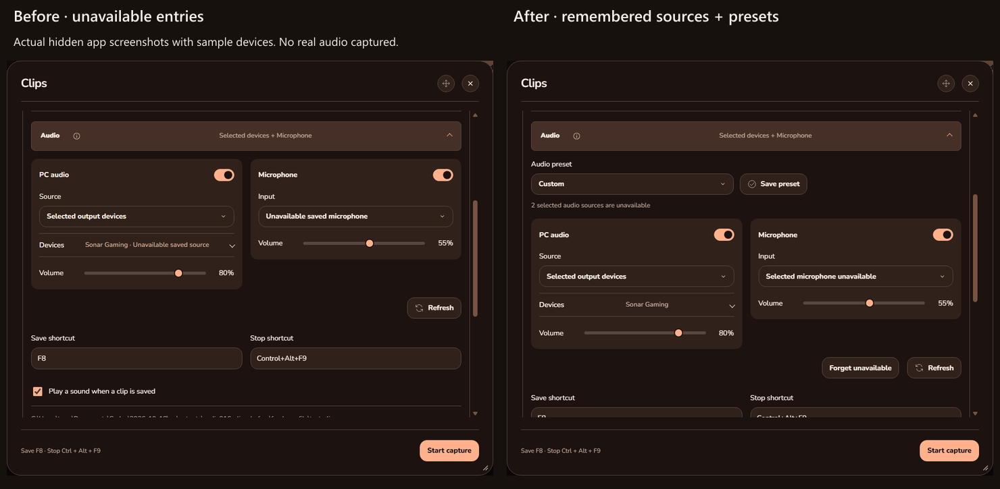
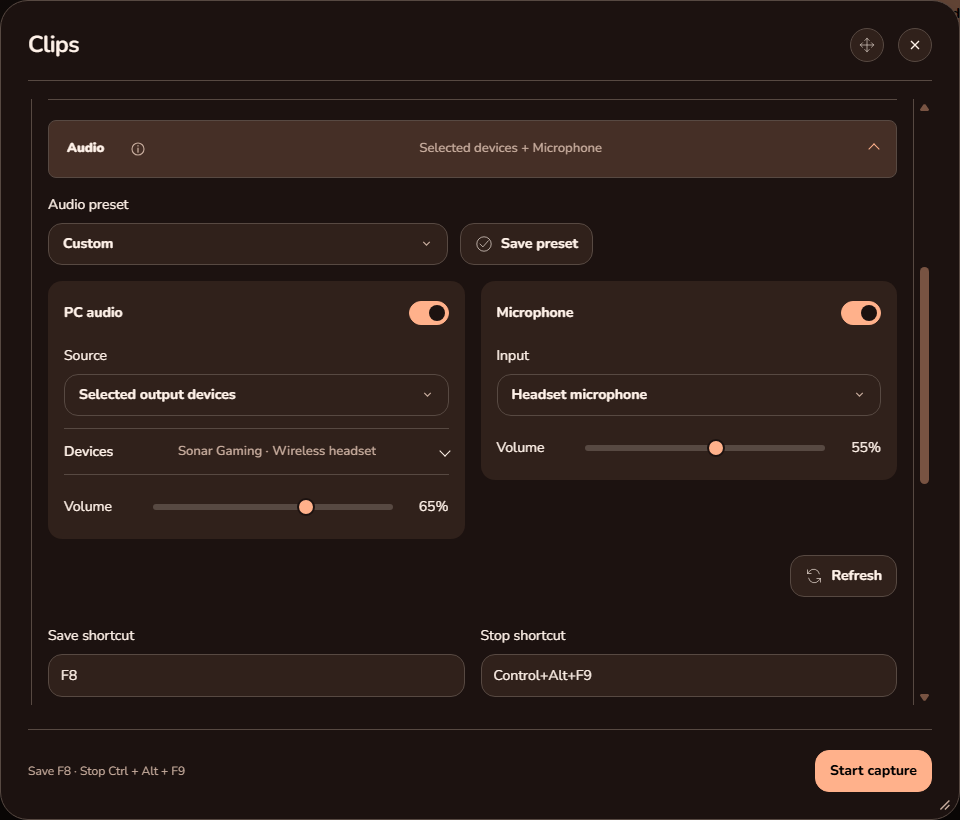

# Audio reconnect and presets

Missing audio sources no longer block recording. Orbit keeps their selections, records the remaining sources, and reconnects the same device or selected app when it returns. If all selected sources are unavailable, recording continues with silence. It does not choose a different microphone or switch to whole-PC audio.

Five audio presets are available: Game only, Game + microphone, PC audio, PC + microphone, and No audio. Up to twelve named presets remember source choices and separate PC/microphone volumes. Resolution, frame rate, recording mode, and other capture preferences stay unchanged.

## Before and after

Before: missing sources appeared as unavailable list entries. After: the available lists contain current sources, the missing choices stay remembered, and audio presets sit above the two audio groups. An optional Forget unavailable action clears missing current choices without deleting presets.

Example checked: the sample headset output and microphone disappear, a volume is changed, then both return already selected. The microphone is not replaced by a different available input.

These are actual hidden-app screenshots using sample devices. They do not show a physical headset reconnect test.

## What passed

- 810 unit tests passed; two opt-in hardware tests skipped.
- 596 packaged regression checks, 14 audio-menu checks, and 26 Quick Start checks passed. The audio controls also fit a narrow window at 125% scale.
- Generated native audio exercised a missing PC source, both sources missing, and both returning. The decoded replay contained the remaining microphone, silence during the all-missing interval, then both signals again.
- A generated full-session recording retained its bookmark, saved playable video and audio, removed its temporary buffer, and exited its recorder. Its first run reached the seven-second shutdown deadline while other validation was running; an individual repeat passed with the same deadline. Concurrent-recorder performance is not validated.
- Closing or hiding the audio controls stops their device-list refresh loop. Presets and remembered selections survived reopening the menu.

The checks caught an extra unavailable-microphone option being added even when the saved microphone was available. That option is now added only when it is needed; the final packaged checks passed.

## Still needs a playtest

Real headset disconnects, Windows default-device changes, protected application audio, and real-game audio timing were not tested here. Reconnect uses the same Windows device ID or selected app path; Orbit does not guess a replacement when Windows assigns a new device ID. A game-only capture remains bound to its original game process.

This change does not establish a CPU or RAM reduction. The earlier intermittent 700 MB report remains unconfirmed. Existing quality choices and the previous audio continuity fixes are retained.

Detailed evidence: `work/audio016-unit-final.log`, `work/audio016-release-suites.json`, `work/audio016-package.json`, `outputs/audio016-clips-packaged/audio-presets-report.json`, `outputs/audio016-recorder-hotplug/report.json`, and `outputs/packed-audio016-session-fixture/report.json` in the development workspace. No public release is published by this work.

## Installation

Installed **0.3.0-dev.16** through visible Setup. The installed app and native audio helper match the validated package. The normal preference loader retained the selected custom theme, all seven custom themes, Afterglow startup, library choices, artwork, and remembered connection. No separate dev profile was present. Preferences also passed after the quiet reopen, and Roblox retained its original running process throughout installation.

Profiles are backed up in `work/audio016-preservation`. Installation evidence is in `work/audio016-installation.json`; preference checks are in `work/audio016-preservation/final.json`.
