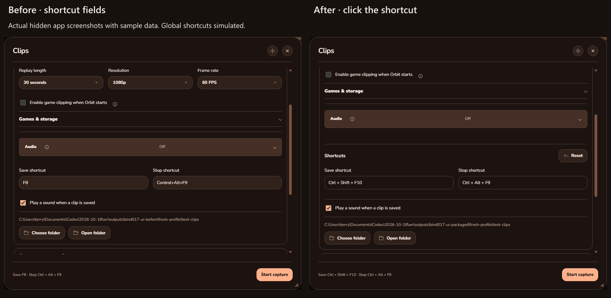
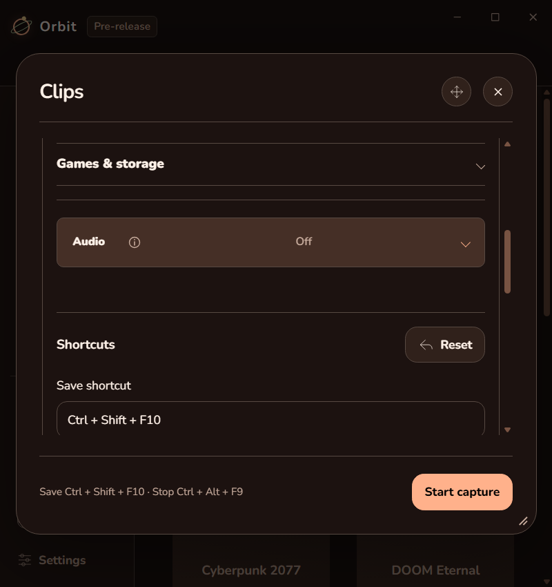

# Change clipping shortcuts

The Save/moment and Stop shortcuts are now clickable buttons. Click the displayed combination, press the desired keys, or press Esc to cancel. A shared **Reset** restores defaults. Both shortcuts can change while clipping is running; capture quality and audio choices are unaffected.

## Before and after

Before: editable fields looked like static text and were disabled during recording. After: each shortcut is its own edit button, stays available during recording, and Reset restores F8 and Ctrl + Alt + F9. There are no separate Change buttons.

Example checked: replace Save with Ctrl + Shift + F10, close Clips, and reopen it. The saved combination remains. Recording a Ctrl + K combination does not open Search while the shortcut field is listening. Esc cancels without closing Clips.

On narrow popups the two shortcut rows stack. The scroll area and primary actions remain usable.

These are actual hidden-app screenshots with sample data. Keyboard registrations and the live-recording state were simulated; no game, screen, or microphone was recorded.

## Checks

- 816 unit tests passed; two opt-in hardware tests skipped.
- 596 packaged regression checks passed across settings, navigation, popups, clipping, audio menus, VR fixtures, and transitions.
- New lifecycle checks cover live rebinding without replacing the recorder, swapping Save and Stop, occupied keys, failed preference writes, Stop during a pending save, and concurrent edits.
- Conflicts and save failures retain previous choices and working shortcuts. Temporary registrations are released; another owner's shortcut is never removed.
- Capture settings still require stopping recording. Only the two shortcuts can change live.
- Fourteen packaged hidden UI checks cover changing, cancellation, duplicate rejection, conflicts, failed saves, reset, reopening, and a narrow popup at 125% scale.

The review also caught the app's clipping-settings callback retaining an unsuccessful change in its in-memory store. It now restores the previous store value when writing fails, alongside retaining the previous shortcut registrations.

Real keyboard delivery while playing a game is not tested here. Windows or another application can reserve a shortcut; Orbit reports registration failures instead of silently replacing the old binding. No performance gain is claimed.

Detailed reports live in the development workspace: `work/bind017-unit-full.log`, `work/bind017-release-suites.json`, `work/bind017-package.json`, and `outputs/bind017-ui-packaged/shortcut-report.json`. The audio reconnect work and its generated recorder checks remain documented in [dev.16](VALIDATION-0.3.0-dev.16.md). No public release is published by this work.

## Installation

Installed **0.3.0-dev.17** through visible Setup. The installed files match the tested candidate. The normal preference loader retained existing clipping choices, the selected custom theme, all seven custom themes, Afterglow startup, library choices, artwork, and the remembered connection; no separate dev profile was present. Checks also passed after the quiet reopen. Roblox kept its original running process through installation.

Backups: `work/bind017-preservation`. Installation record: `work/bind017-installation.json`.
