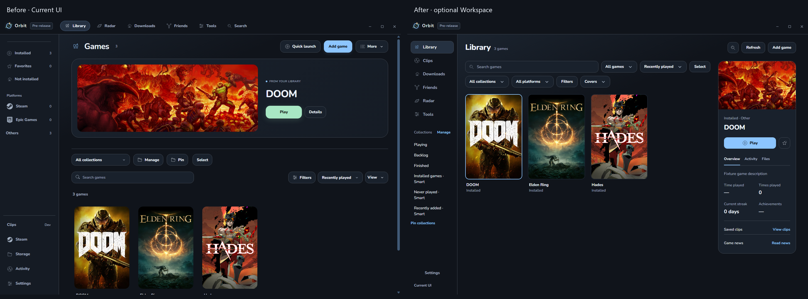
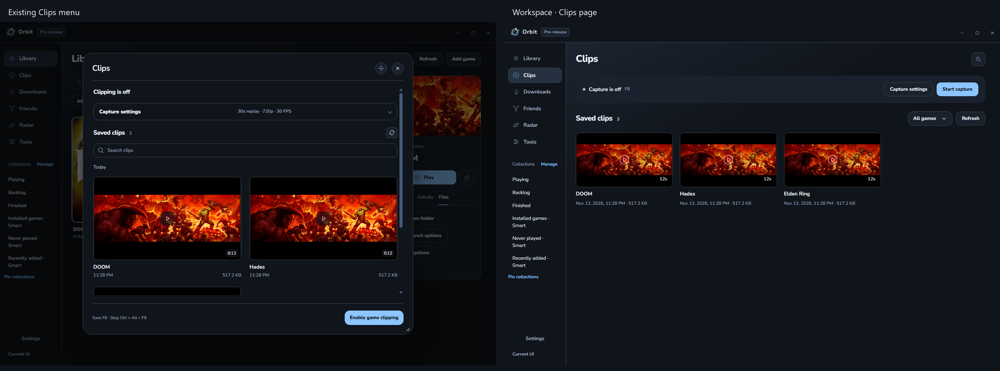
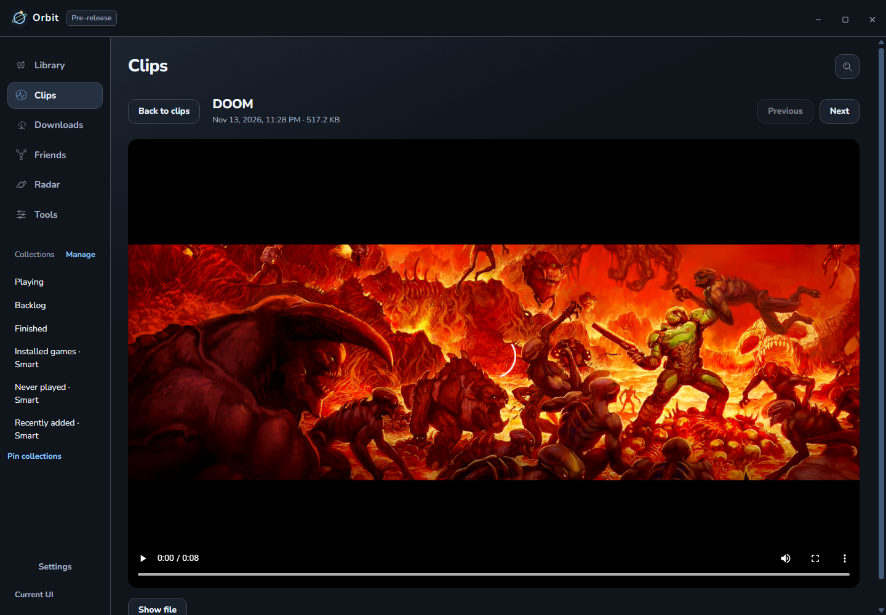

# Optional Workspace interface

**Built and installed 0.3.0-dev.18.** Current UI remains the default. Choose **Settings → Appearance → Layout → Desktop interface → Workspace** to try it; choose Current UI in the sidebar to return.

Workspace has its own desktop shell, game grid and side panel, plus Clips, Downloads, Friends and Settings pages. Launching, recording, account connections and advanced utility dialogs use Orbit's existing services. Controller mode keeps its existing interface.

## Before and after

Before: the Library leads with a featured banner and opens game details in a popup. After: selecting a card updates the side panel; Overview, Activity and Files stay beside the grid. Covers, banners, lists, size and spacing save separately from Current UI.

Before: Clips lives in its existing popup. After: Workspace gives the gallery its own page and a large player. Capture settings still opens the complete recording controls.

Example checked: open a saved clip, then leave Clips. Its video source is released. Four repeated open/leave cycles passed. Reloading Orbit retains Workspace, the last page, artwork preferences and search state.

These are actual hidden-app screenshots using isolated sample games, people and recordings. They are not screenshots of the user's library or proof of a real recording test.

## Findings and fixes

- Adding Desktop interface after Settings restored its position shifted the page by 115 pixels. It now mounts before restoration; reopening retains the same category and scroll position.
- Saved-clip status carries an object. Comparing the filename prevents an unchanged status from repeatedly rescanning the gallery.
- Download controls now use the clicked installation's identity. Installer downloads retain their separate Install/Cancel actions.
- Smart-collection and Search routes update Workspace without changing Current UI's collection filter. Bulk edits and Undo use the existing library service.
- Workspace respects the selected rounded/custom font, colors and background. Friends retains confirmed links, main-profile choices, fresh-presence filtering and the periodic-refresh preference.
- Metadata requests and avatar loads are bounded. Departing pages release media and subscriptions; hidden pages stop their optional polling. No CPU or RAM improvement is claimed without comparable measurements.

## Checks

- **821 unit tests passed; two opt-in tests skipped.**
- **596 packaged regression checks passed** across Current UI, settings, navigation, popups, clipping, audio menus, VR fixtures and transitions.
- **41 Workspace checks passed**, including selection, bulk Undo, context menus, theme changes, normal reload, player cleanup, installation-specific download actions, narrow windows and 125% scaling.
- Hidden checks recorded no shown or focused windows. No real screen, microphone, game launch or account authorization was used.
- One reused popup-test profile retained coordinates from an earlier test. The same package passed all 36 popup checks in a new isolated profile; the earlier failures remain in the detailed record.

Settings and artwork were backed up before visible Setup. Installed files match the reviewed package. The normal preference loader retained the active custom theme, seven custom themes, Afterglow startup, library choices, artwork and remembered connection after the quiet reopen. No separate dev profile was present. Roblox retained its process throughout installation. Nothing was published.

## Still needs hands-on review

Real-game capture and physical input were not repeated for this UI change. Hardware performance and the reported 700 MB spike were not measured here. Advanced game/capture/account dialogs remain shared, and the existing tour describes Current UI; use that mode for its tour.

[Workspace guide](WORKSPACE.md). Additional actual screenshots: [Settings](validation/0.3.0-dev.18/workspace-settings-after.png), [Downloads](validation/0.3.0-dev.18/workspace-downloads-after.png), [Friends](validation/0.3.0-dev.18/workspace-friends-after.png), [narrow Library](validation/0.3.0-dev.18/workspace-library-narrow.png), [light theme](validation/0.3.0-dev.18/workspace-light-after.png).

Detailed development records: `work/workspace018-unit.log`, `work/workspace018-release-suites.json`, `work/workspace018-package.json`, `outputs/workspace018-ui-packaged/workspace-report.json`, `work/workspace018-installation.json` and `work/workspace018-preservation/final.json`.
