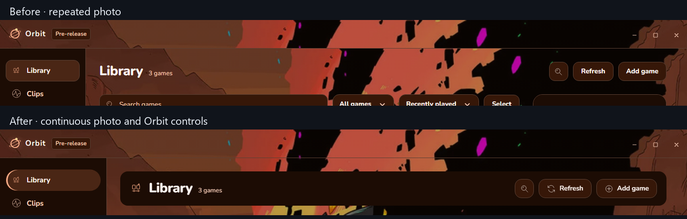
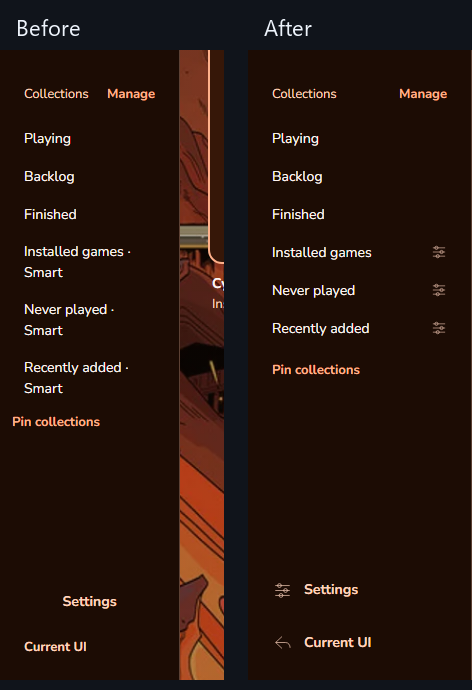

# Workspace theme and sidebar fixes

**Installed 0.3.0-dev.19.** Workspace now uses Orbit's shared rounded-control token, page icons, selected-navigation accent, typography and saved theme colors. The selected custom theme and background are unchanged.

## Before and after

Before: the photo was painted separately behind the titlebar, Workspace and its main panel, creating a seam. After: one continuous background sits behind the interface, and the heading has a readable themed surface. Narrow windows also drop the unused titlebar row.

Before: smart-collection suffixes wrapped into extra lines, and Settings and Current UI had different alignment. After: collection names stay on one line with a separate smart-collection icon; the footer actions share spacing and icons. Long names keep their full accessible label and tooltip. Short sidebars scroll instead of shrinking their controls.

These are actual hidden-app screenshots with sample data and a sample photo theme. The photo-opacity setting stayed at 70% throughout the checks.

## What passed

- 821 unit tests; two opt-in tests skipped.
- 99 packaged checks for Settings, navigation, popup fit and transitions.
- 41 Workspace checks for selection, bulk Undo, playback cleanup, saved-state reload and switching between interfaces.
- 18 targeted checks for shared Orbit controls, photo continuity, long labels, short windows, narrow navigation, 125% scaling and exclusion from Controller mode.

Checks used isolated profiles and did not show or focus native windows. Hardware/gameplay and performance measurements were not repeated for this visual repair; no RAM or CPU improvement is claimed.

Visible Setup installed the reviewed package. Backups and normal-loader checks confirmed that the active custom theme, all seven custom themes, Afterglow startup, artwork, interface and other saved choices were preserved after the quiet reopen. Roblox retained its process. No separate dev profile was present. Nothing was published.

Details: `work/workspace019-unit.log`, `work/workspace019-release-suites.json`, `outputs/workspace019-ui-packaged/workspace-report.json`, `outputs/workspace019-layout-packaged/layout-report.json`, `work/workspace019-package.json`, `work/workspace019-installation.json` and `work/workspace019-preservation/final.json`.
