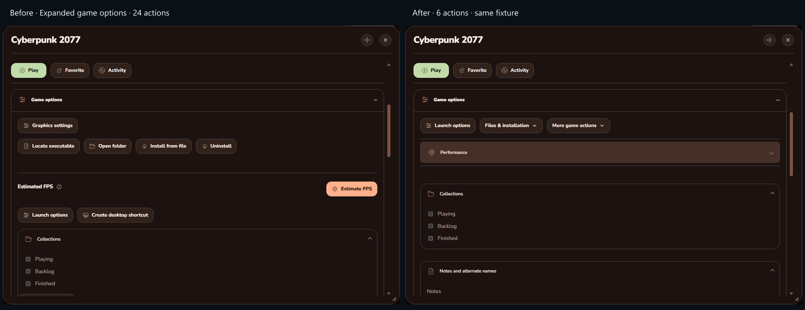
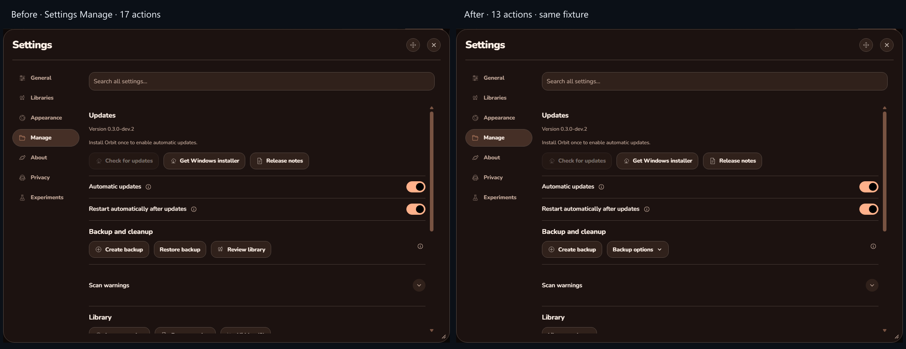

# 0.3.0-dev.2 validation

Fewer visible buttons across game details, Settings, storage, VR, informational popup footers and the Clips gallery. Useful actions remain available through groups named for their purpose. Clipping from dev.1 is retained.

## Before and after

Expanded game options: **24 → 6** visible action buttons in the same fixture. Files and occasional tools move into menus; Performance opens on request. Notes, tags and collections show Save after editing.

Settings → Manage: **17 → 13** visible action buttons. Storage rows: **3 → 2**. These are fixture UI counts, not whole-app performance gains. Before images suspend the cleanup in the same build to keep the fixture and window comparable.

## What was checked

- Original action controls stay connected. Named menus support arrow navigation, Escape and focus restoration.
- Save controls appear after edits, hide after successful saves, and remain available for a second edit or an edit made during a save.
- Repeated layout updates keep More triggers visible. An early grouping defect that moved a trigger into its own menu was fixed before installation.
- Storage keeps Measure visible and puts Open folder/Uninstall under More. Read-only popups keep the header close control and drop duplicate Close footers.
- Friends and Downloads retain their already compact controls. Appearance and VR group occasional tools. Capture Stop, primary actions and destructive confirmations remain available.
- Physical controller/headset feel and real-game recording still need playtesting. Quiet fixture checks do not establish hardware compatibility or gameplay overhead.

## Results

- Passed **767 unit checks**, **873 packaged regression checks**, **22 menu checks** and **16 clipping UI checks**. Two native checks remain opt-in and were skipped.
- The final packaged recorder saved a playable **4.2-second synthetic H.264 MP4**, exited and removed its temporary buffer. No real desktop or audio was captured for this check.
- Fixed the review fixture to open Performance before requesting FPS. Repeated test runs now get new isolated profiles so saved sample layouts cannot contaminate the next run.
- Installed **0.3.0-dev.2** quietly and verified that the installed application and native resources match the tested files. Orbit reopened in the background; capture remained off. Nothing was published.
- Both normal and dev profiles retain their saved preferences, custom themes, artwork, startup choices, remembered connections and clipping settings through the normal loader. All **115 normal-profile sessions** and **2 dev-profile sessions** remain, with recorded play totals preserved.

See [the new menu paths](MENUS-0.3.md) and [clipping validation](VALIDATION-0.3.0-dev.1.md). Detailed local records: [packaged checks](../../../work/button030-final-suites.json), [menu checks](../../button030-ui/action-density-report.json), [installation](../../../work/button030-install.json), and [preservation](../../../work/button030-preservation/final.json). No CPU, RAM or game-FPS gain is claimed from reducing visible buttons.
