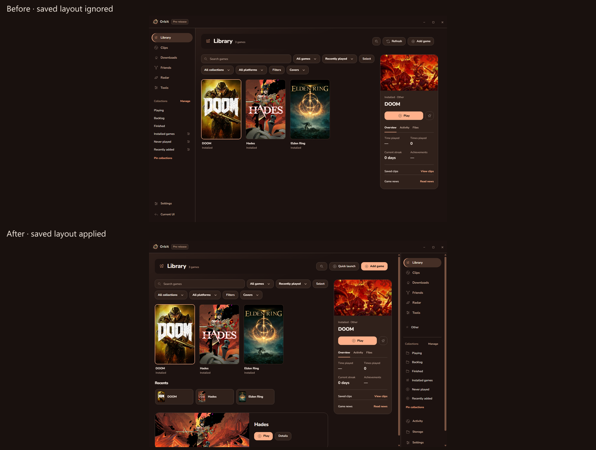
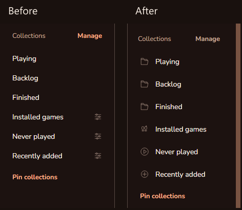
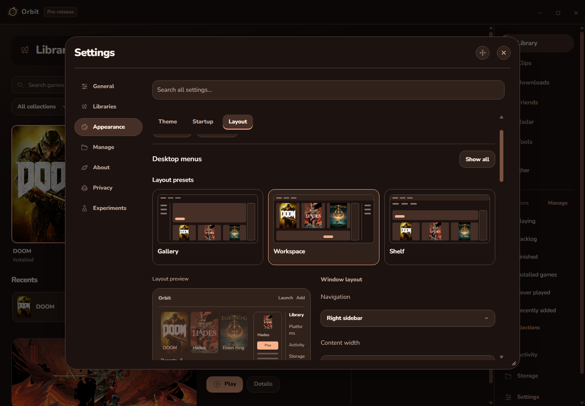

# Workspace layouts and release review

**Installed 0.3.0-dev.20.** Desktop layout settings now work in Workspace. Your chosen interface and theme stay selected. Nothing was published.

## Before and after

Before: choosing the Workspace layout preset still left navigation on the left, and its section choices were ignored. After: navigation moves right, Games comes first, and the saved section order, visibility and quick actions apply. Gallery and Shelf work too. Saved layouts, content width, banner size, news sources, Recents exclusions and transparent top bar use the existing preferences.

Before: collections looked like plain text with unrelated icons at the far edge. After: aligned icons identify collections, selection has a clear state, Manage has a consistent target, and saved collection symbols/colors are respected. Clicking the active collection clears that filter.

These are actual hidden-app screenshots using sample games and an Ember theme. The user's profile was not used for the visual fixtures.

The layout preview now includes Workspace's selected-game panel. Workspace Settings → Library → Desktop layout opens the shared customization controls.

## Passed

- 821 unit tests; two opt-in tests skipped.
- 596 packaged regression checks across settings, navigation, popups, clipping, audio, VR software paths and transitions.
- 41 Workspace checks covering its pages, bulk Undo, playback cleanup, focus and saved-state reload.
- 40 layout checks, including saved presets, section visibility, collection selection, theme-aware icons, repeated renders and widths from 360 to 1440 pixels, including 125% scaling.
- Candidate source, installer checksum and updater manifest match. Setup was visible and exited successfully; the installed files match the tested candidate.
- Normal-loader checks retained the active custom theme, all seven custom themes, Afterglow startup, artwork, layout and saved preferences. No separate dev profile was present. The running Roblox process stayed running.

Routine checks were hidden and used isolated profiles. No real recording or game launch was started.

## Resources and remaining checks

News metadata is capped at 16 cards, thumbnail work at two concurrent requests, and cached data is reused for unchanged renders. Hidden news stops thumbnail work. Library sections are reordered without replacing game rows, preserving selection and focus. Switching pages releases media.

A small, hidden sample-library check made 12 Settings/Library round trips per version. Its settled process-tree private memory was **250.5 MiB before / 276.0 MiB after**, summed working set **651.8 / 677.9 MiB**, and median sampled CPU approximately **0.03% in both**. Each run settled below its own starting private memory. This single sequential run is limited, does not reproduce a full library or capture workload, and **does not establish a RAM or CPU improvement**. Summed working sets can include shared pages.

Live VR clicks, headset readability, real recording quality, native game handoff and Windows sign-in timing were not retested in this pass. Automated VR checks do not establish headset responsiveness. Keep those as playtest checks before calling the whole 0.3.0 release ready.

Detailed evidence: `work/workspace020-unit.log`, `work/workspace020-release-suites.json`, `outputs/workspace020-ui-packaged/workspace-report.json`, `outputs/workspace020-layout-packaged/layout-report.json`, `work/workspace020-resources.json`, `work/workspace020-package.json`, `work/workspace020-installation.json`, and `work/workspace020-preservation/final.json`.
