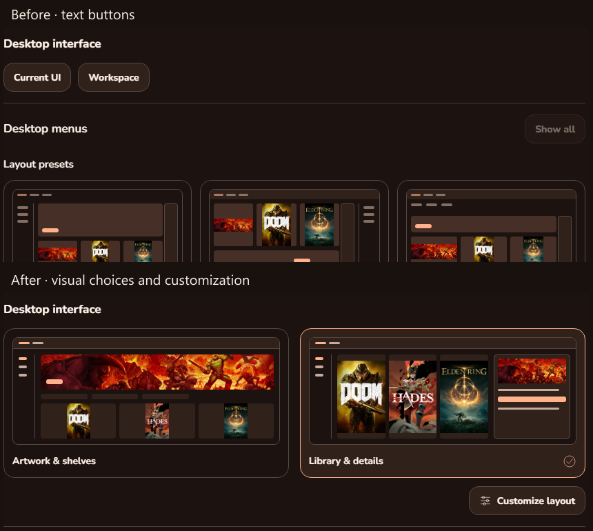
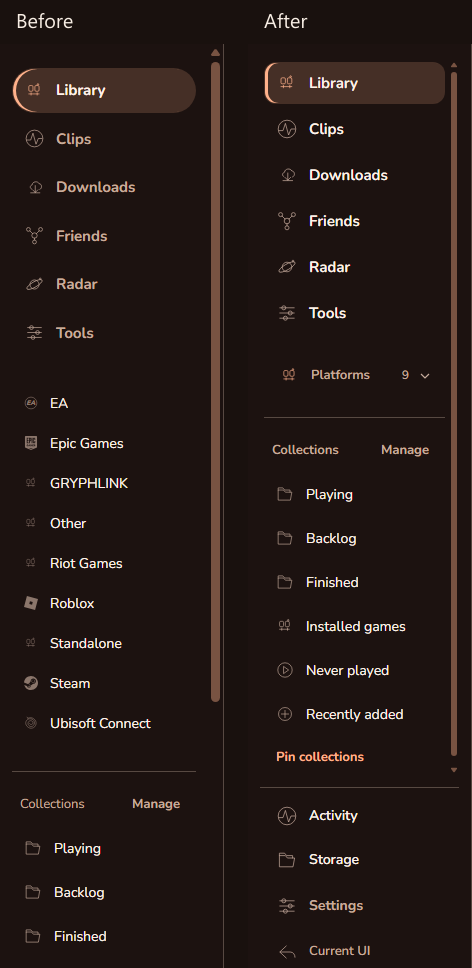

# Visual interface choices and sidebar polish

**Installed 0.3.0-dev.21.** Themes and saved preferences were preserved. Nothing was published.

## Before and after

Before: Current UI and Workspace were two text buttons. After: visual examples show artwork with shelves, or a game grid beside a details panel. Both use existing library artwork. Selecting a preview changes the real interface; Customize layout opens its existing layout controls and focuses the navigation choice. Workspace Appearance uses the same chooser.

Before: nine platform filters made the sidebar long and pushed Settings below the visible area. After: Platforms is an expandable group that remembers its state. Primary pages, collection shortcuts and utilities have clearer spacing. Settings remains reachable while the list scrolls. Platform rows and the collapsed heading identify the selected filter; clicking it again clears that filter. The platform dropdown updates the same state.

These are actual hidden-app screenshots with sample games, nine sample platform labels and the built-in Ember theme. They do not expose or change the user's library for the visual checks.

## Passed

- 822 unit tests; two opt-in tests skipped.
- 99 packaged checks for settings, navigation, popup fit and transitions.
- 41 packaged Workspace checks, including its pages, bulk Undo, clip playback cleanup and saved-state reload.
- 40 targeted checks for visual choices, real customization routing, remembered expansion, selected filters and widths from 360 to 1440 pixels, including 125% scaling.
- Isolated UI checks showed and focused no native windows; no real recording was started.
- All 368 packaged source files, installer checksum and update manifest match. Visible Setup exited successfully; installed files match the tested candidate.
- The normal loader retained the selected custom theme, all seven custom themes, Afterglow startup, artwork, interface and other saved choices after the quiet reopen. Both profile locations were checked; no separate dev profile was present.

This pass changes UI and a remembered sidebar choice. It makes no RAM/CPU improvement claim. Game-launch, authorization, Windows sign-in and headset checks were not repeated; the broader 0.3.0 release still needs its live recording/VR confirmation described in the previous review.

Detailed evidence: `work/workspace021-unit.log`, `work/workspace021-release-suites.json`, `outputs/workspace021-ui-packaged/workspace-report.json`, `outputs/workspace021-layout-packaged/layout-report.json`, `work/workspace021-package.json`, `work/workspace021-installation.json` and `work/workspace021-preservation/final.json`. Previous broad review: [0.3.0-dev.20](VALIDATION-0.3.0-dev.20.md).
