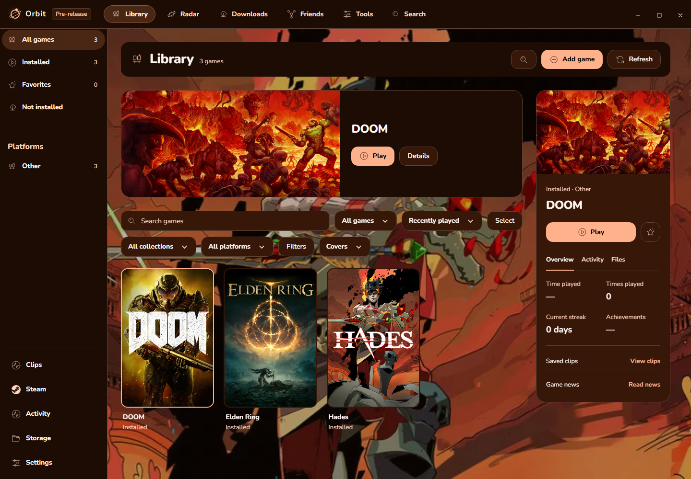
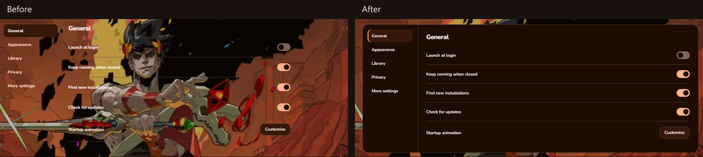
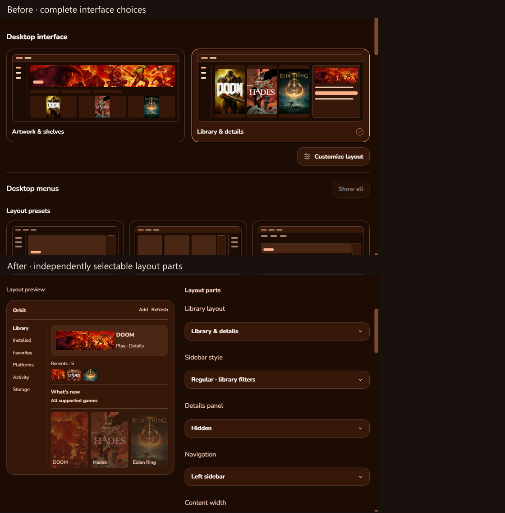

# Mixed layouts and readable Settings

**Installed 0.3.0-dev.22.** Themes and saved choices were preserved. Nothing was published.

Layout components can now be chosen independently. **Settings → Appearance → Layout → Customize layout** opens the controls directly.

- Use either library with either sidebar. Example: Regular filters with the new library and details panel.
- Move the details panel left or right, or hide it.
- Choose visible page shortcuts; keep Library and Settings reachable.
- Save the combination as a named layout. Existing choices stay unchanged until edited.

## Before and after

Before: Settings labels sat directly over the photo background. After: a solid theme surface keeps them readable without changing the wallpaper.

Before: the interface picker offered complete compositions. After: Customize layout lets the library, sidebar and details panel differ independently, with an updated preview.

These are actual hidden-app screenshots using sample games and a local photo-theme fixture. They are examples, not the user's library.

## Findings fixed

- Advanced Settings no longer leaves a duplicate Settings page visible underneath. Closing the popup restores the page.
- With the regular sidebar and new library, top-bar clicks now route to the visible interface instead of the hidden original page.
- Small preview navigation labels no longer break across several lines.
- Page visibility applies to both sidebar styles, including the original Clips shortcut.

## Validation

- 824 unit tests passed; two opt-in tests skipped.
- 596 packaged regression checks passed, covering Settings, navigation, popups, clipping, audio controls, VR dashboard fixtures and transitions.
- 41 Workspace checks and 42 mixed-layout checks passed. These cover all four sidebar/library combinations, saved reloads, details placement, page visibility, navigation positions and widths of 360–1440 pixels, including 125% scaling.
- Hidden UI checks showed and focused no native windows. No real capture started.
- All 369 packaged source files, installer checksum and updater manifest matched. Visible Setup completed successfully; installed files matched the tested package.
- Normal and dev profile locations were checked. The normal loader retained the active custom theme, all seven custom themes, Afterglow startup, artwork, remembered connections and saved choices. No separate dev profile was present.

The first reused Workspace fixture retained a previous Clips page, causing an invalid fresh-start assertion. Resetting only that isolated fixture made the check pass; real profiles were untouched.

Live game launches, account authorization, Windows sign-in and headset interaction were not repeated. This UI pass makes no RAM/CPU performance claim.

Detailed evidence: `work/workspace022-unit.log`, `work/workspace022-release-suites.json`, `outputs/workspace022-ui-packaged/workspace-report.json`, `outputs/workspace022-layout-packaged/layout-report.json`, `work/workspace022-package.json` and `work/workspace022-preservation/`.
