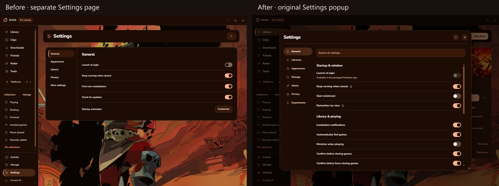
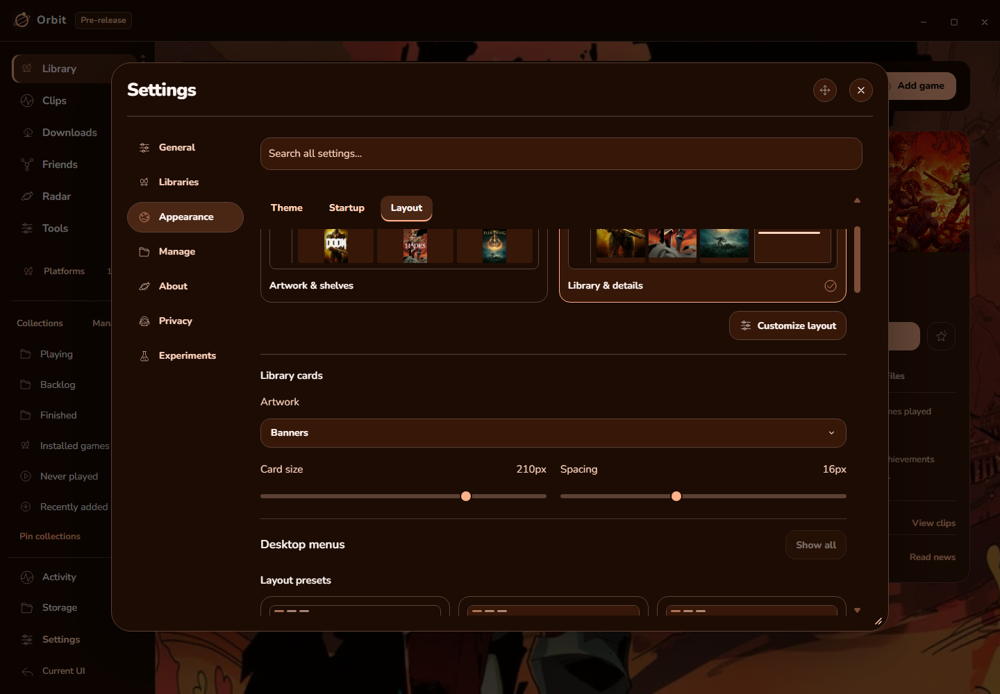

# One Settings popup

Both Desktop layouts now open the original Settings popup. The separate Workspace Settings page and its duplicate controls were removed.

**Installed 0.3.0-dev.23.** Saved settings and themes were preserved. Nothing was published.

Before: choosing Settings opened a second, simplified page. After: the same complete Settings popup opens over the current page. Closing it restores the page, selection, scroll and keyboard focus.

Workspace artwork, card size and spacing remain available in **Appearance → Layout → Library cards**. Existing mixed-layout choices remain intact.

These are actual hidden-app screenshots with sample games and a local photo-theme fixture. The normal user's library and theme were not used for screenshots.

The narrow-window check found category labels clipping at 360 pixels. Two columns and a separate row for the search field correct that without shrinking text.

## Validation

- 825 unit tests passed; two opt-in tests skipped.
- 135 packaged checks passed for Settings, navigation, popup size/fit and transitions.
- 41 Workspace regression checks and 22 targeted popup checks passed. These cover both sidebars, full Settings categories/search, preserving the underlying page and focus, display preferences, reloads and widths from 360–1440 pixels, including 125% scaling.
- Hidden UI checks showed and focused no native windows, and started no real recording.
- All 370 source files matched the packaged app. The installer and update manifest matched; visible Setup completed and installed the tested files.
- The normal loader retained the active theme, all seven custom themes, Afterglow startup, artwork, remembered connections and saved choices after installation and a quiet reopen. Both normal/dev profile locations were checked; no separate dev profile was present.

This pass does not measure performance gains or repeat live game, account, startup or headset checks.

Detailed records: `work/workspace023-unit.log`, `work/workspace023-release-suites.json`, `outputs/workspace023-ui-packaged/workspace-report.json`, `outputs/workspace023-layout-packaged/layout-report.json`, `work/workspace023-package.json` and `work/workspace023-preservation/`.
