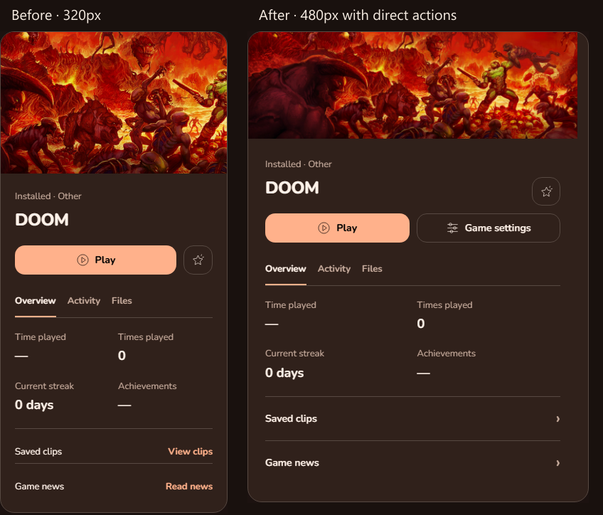

# Larger game card and direct access

**Installed 0.3.0-dev.24.** Saved settings and themes were preserved. Nothing was published.

- The selected-game card scales with the window, reaching 480 pixels wide on a large Desktop window. Narrow layouts still wrap or stack.
- **Game settings** sits beside Play and opens the selected game's options already expanded.
- Clicking the artwork opens full details. Saved clips and news are full-row buttons.
- **Customize** beside the library view controls opens Appearance's library controls directly.

## Before and after

Before: the card stayed 320 pixels wide in a 1920-pixel window, cropped the banner and hid game settings in Files. After: it uses 480 pixels, contains the banner and exposes Game settings beside Play. Favorite remains a separate utility by the title.

These are actual hidden-app screenshots using the same sample games, Ember theme and window size. They do not show the normal user's library.

## Additional fix

Closing details could drop keyboard focus onto the page background when the selected-game card refreshed. It now restores the corresponding card button. A controlled long-content fixture also confirms the page stays at its previous scroll position.

## Validation

- 825 unit tests passed; two opt-in tests skipped.
- 135 packaged checks passed for Settings, navigation, popup sizing/fit and transitions.
- 41 Workspace regression checks and 31 targeted card/action checks passed, including left/right details at 360–2559 pixels, 125% scaling, short windows, correct game identity, direct routes and focus restoration.
- Hidden UI checks showed and focused no native windows, and started no real recording.
- All 370 source files matched the package. Installer checksum and updater manifest matched. Visible Setup finished, and installed files matched the tested candidate.
- Normal and dev profile locations were checked. The normal loader retained the active custom theme, seven custom themes, Afterglow startup, artwork, remembered connections and saved layout/density choices. No separate dev profile was present.
- The running VRChat and Roblox processes remained running through installation.

This UI pass does not measure performance gains or repeat live game launches, account authorization, Windows sign-in or headset checks.

Evidence: `work/workspace024-unit.log`, `work/workspace024-release-suites.json`, `outputs/workspace024-ui-packaged/workspace-report.json`, `outputs/workspace024-layout-packaged/layout-report.json`, `work/workspace024-package.json`, `work/workspace024-installation.json` and `work/workspace024-preservation/`.
