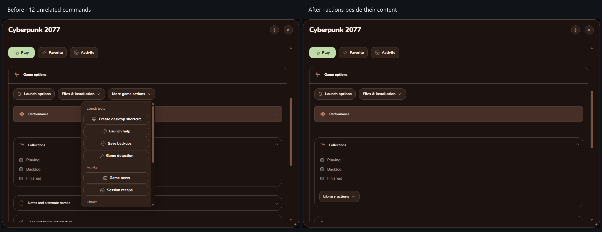
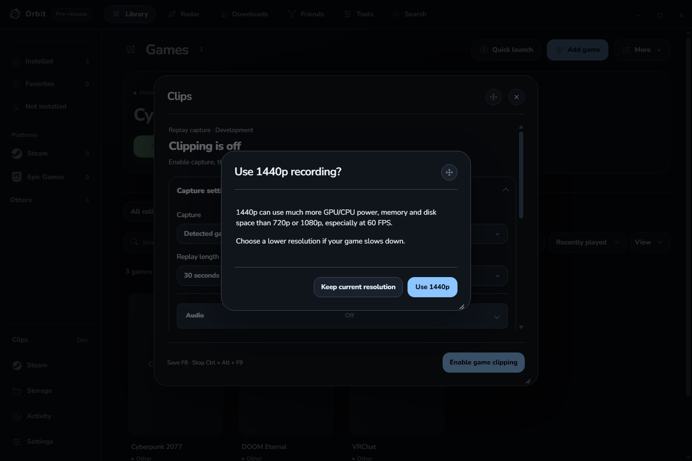
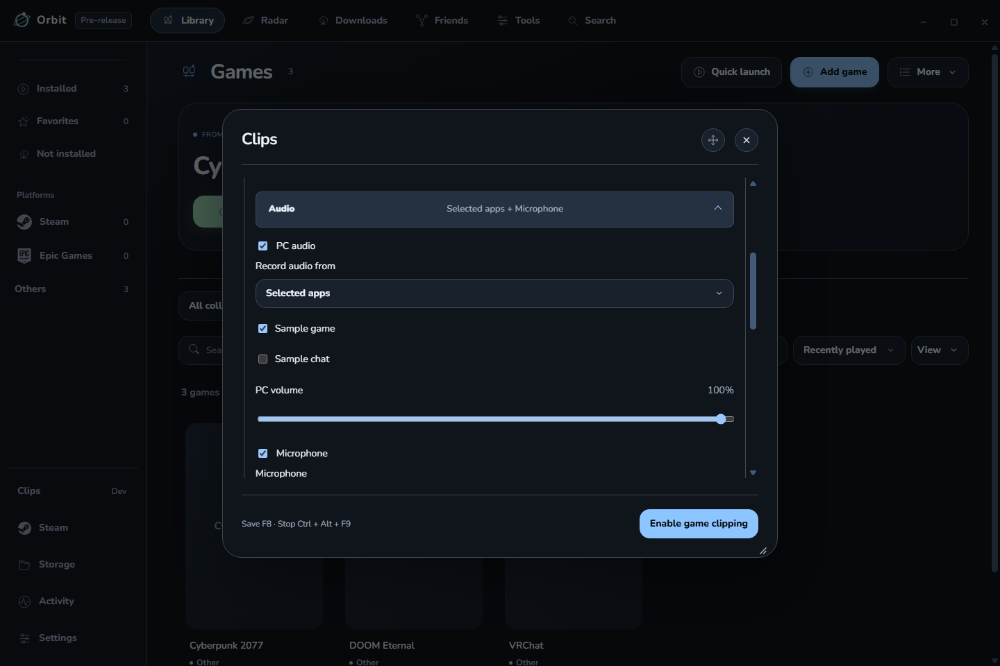

# 0.3.0-dev.3 validation

Game actions now live beside their related content. Clipping gains 1440p recording with a resource warning, optional microphone recording and specific audio-source choices. This is an unpublished development build.

## Before and after

Before: More game actions contained 12 unrelated commands. After: Graphics is under Performance, Library actions sits inside Collections, and Artwork and Troubleshooting have their own small sections. News and recaps are reached through Activity. The remaining menus have at most five related actions; Library has three, Artwork two and Troubleshooting three. Save still appears after an edit.

Before: 720p and 1080p were available. After: choosing 1440p shows the power, memory and storage warning before applying it. Cancel keeps the previous setting. A generated-video check saved a real 2560×1440 H.264 file; it is not footage from a game.

Before: one system-audio checkbox. After: PC audio and microphone have independent choices and recording volumes. Users can select the default output, the captured app, specific running apps or output devices. Both audio toggles default off. Selected sources do not fall back to recording everything. Audio is mixed into one stereo AAC track.

## Fixes found during the work

- A selected microphone or app list could be cleared by an unrelated setting change before device discovery finished. Those choices are now retained and checked through reloads.
- Repeated grouping must not continually move sections or duplicate controls. The new placement checks cover repeated updates, Controller restoration and narrow menus.
- A recorder shutdown check exceeded its deadline. Stop now finishes an existing save, releases audio and bounds renderer shutdown before removing the temporary buffer. A deliberately stalled-renderer fixture checks this cleanup path.

## Checks and limits

- Passed **772 unit checks**, **873 packaged regression checks**, **26 clipping UI checks**, **22 shared-action checks** and **16 game-action placement checks**. Two opt-in native checks were skipped.
- The final package saved synthetic H.264/AAC clips for microphone-only, mixed audio and **2560×1440** recording. Independent generated PC/mic levels matched the selected 90%/40% gains. Workers and audio helpers exited; the current temporary buffers were empty afterward.
- A deliberately stalled recorder renderer also exited and cleaned its buffer. The broad review assertion was updated from two resolutions to the actual 720p/1080p/1440p choices, retaining both default-audio-off checks.
- Installed **0.3.0-dev.3** quietly. Installed application files and all **33 unpacked native resources** match the validated package. Orbit reopened in the background, with recording off and no audio helper running. Nothing was published.
- Normal and dev settings, custom themes, artwork, startup choices, remembered connections, clipping preferences and history are preserved through the normal loaders. All **115 normal-profile** and **2 dev-profile** session records remain, including their recorded play totals.

Detailed local records: [packaged checks](../../../work/menu030-final-suites.json), [installation](../../../work/menu030-install.json), [preservation](../../../work/menu030-preservation/final.json), [synthetic native-audio check](../../../work/audio030-native-report.json), and [1440p recorder result](../../audio030-recorder-1440/report.json).

Generated video and tones test encoding, source-selection routing, independent volume levels and cleanup without recording the real desktop, microphone or PC audio. Windows device/app discovery is read-only. The native process-audio API probe targets only the helper's own process.

Physical microphones, output devices, real-game/process-tree compatibility, audio synchronization and gameplay overhead still need playtesting. No CPU, RAM, GPU or FPS improvement is claimed. See [Clipping](CLIPPING.md) and [menu paths](MENUS-0.3.md).

Windows audio uses endpoint loopback and process-loopback capture, following Microsoft's [loopback documentation](https://learn.microsoft.com/en-us/windows/win32/coreaudio/loopback-recording) and [process-loopback sample](https://learn.microsoft.com/en-us/samples/microsoft/windows-classic-samples/applicationloopbackaudio-sample/). The read-only app picker uses [audio-session enumeration](https://learn.microsoft.com/en-us/windows/win32/api/audiopolicy/nn-audiopolicy-iaudiosessionmanager2).
