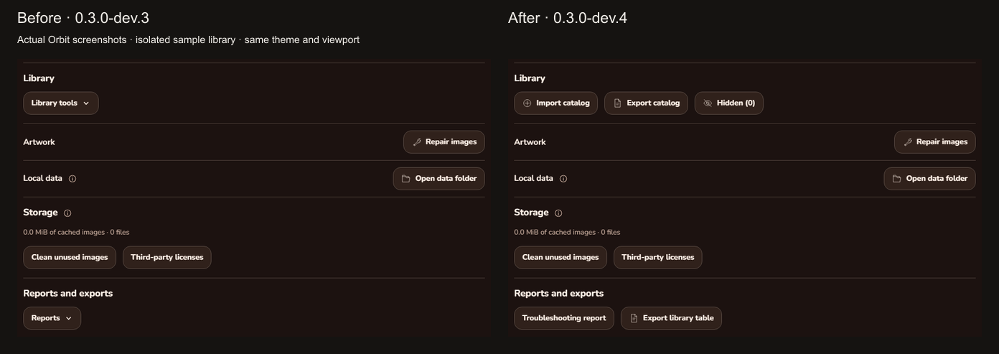
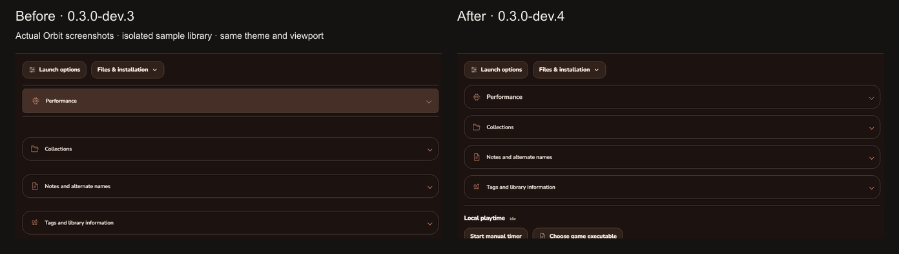
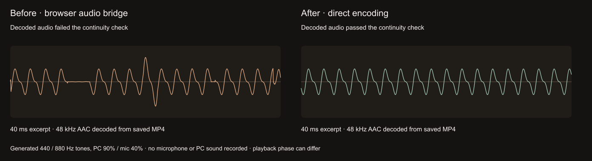

# 0.3.0-dev.4 validation

Installed quietly. Short button rows are visible again, Game options sections match, and a reproduced clip-audio fault is fixed. This build is unpublished.

## Buttons and sections

Before: Library and Reports hid two or three useful buttons in dropdowns. After: those buttons share a direct row, wrapping at narrow widths. Backup, theme-file, collection and VR actions also retain their short rows. Files & installation keeps its longer, related menu.

Before: Performance used a different surface, and invisible button rows left oversized gaps. After: Performance, Artwork and Troubleshooting share the existing rounded section style, with matching spacing and distinct icons. Original controls and confirmation steps remain available; Controller restores its existing controls.

## Clip audio

Before: clean generated tones developed sharp interruptions in saved MP4 audio. After: Windows audio is mixed with a short packet buffer and sent directly to the encoder. Removing the browser playback bridge removes its extra clock and conversion stage. Audio timestamps use the capture clock and sample count, with the mixer delay accounted for.

The retained dev.3 build reproduces the saved-audio fault. The final dev.4 package passes decoded-audio checks for microphone-only, mixed PC/mic and 1440p recordings, including volume and continuity. A two-minute synthetic mixer test also covers uneven packet delivery and separate source clocks. These are generated signals, **not recordings of the user's microphone or PC sound**.

## What passed

- **775 unit checks**, **873 packaged app checks**, **13 section/row checks**, **22 shared-action checks**, **15 game-action checks** and **26 clipping UI checks**. Two opt-in native checks were skipped.
- Synthetic H.264/AAC saves, decoded sound, 2560×1440 output, worker exit and temporary-buffer cleanup. A deliberately stalled renderer also shuts down and cleans its buffer.
- The installed application and all **33 unpacked native resources** match the validated package. Orbit reopened in the background; recording, audio helpers and VR helpers are off. No games were launched or closed.
- The current profile retains its selected custom theme, all **seven custom themes**, Afterglow startup, saved preferences, artwork, connections, clipping choices and **108 session records**, including recorded play totals. A fresh backup was made immediately before installation. No separate `Orbit-Dev` folder was present; archived profiles were not merged into the live profile.

## Still needs a playtest

**User playtest update, November 5:** the user confirmed that microphone and PC audio are good now. This is evidence for their chosen devices and sources. Game/audio synchronization and other hardware still need playtesting. Existing recordings are unchanged. Recording still produces one mixed stereo audio track.

No CPU/RAM savings are claimed: this pass removed an unnecessary audio bridge, but did not collect comparable whole-app usage measurements.

## Detailed evidence

- [Packaged review](../../../work/audio031-final-suites.json), [section checks](../../../outputs/audio031-style/action-style-report.json), [clipping UI](../../../outputs/audio031-clips-ui/clips-report.json).
- [Native generated-audio checks](../../../work/audio031-native-report.json), [retained dev.3 reproduction](../../../outputs/audio031-recorder-baseline/report.json), [final mixed recording](../../../outputs/audio031-recorder-mixed/report.json), [mic-only](../../../outputs/audio031-recorder-mic/report.json), [1440p](../../../outputs/audio031-recorder-1440/report.json).
- [Installed-file verification](../../../work/audio031-install.json), [settings verification](../../../work/audio031-preservation/final.json), [history verification](../../../work/audio031-preservation/after-live-history.json).
- Windows packet-handling reference: [Microsoft: Capturing a Stream](https://learn.microsoft.com/en-us/windows/win32/coreaudio/capturing-a-stream). The documentation informs the capture design; the linked fixture results are the evidence for this repair.
