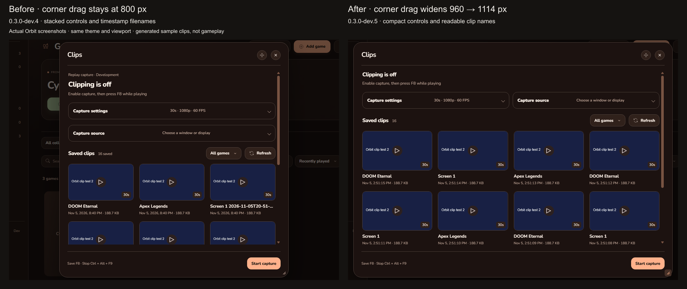
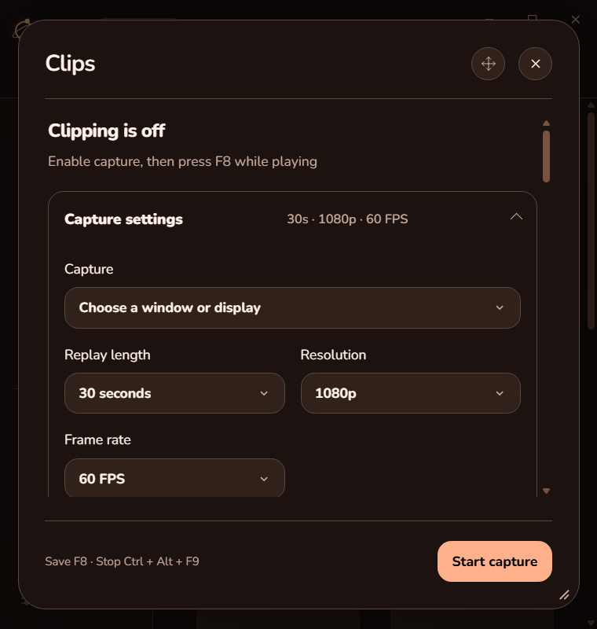
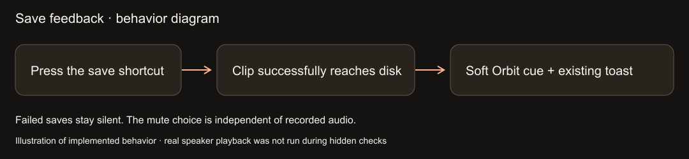

# 0.3.0-dev.5 validation

Installed quietly and unpublished. Corner dragging works again, Clips is easier to scan, and successful saves have a short Orbit sound with a separate mute choice.

## Before and after

**Before:** corner dragging changed a saved size while Clips stayed 800 px wide. Reopening replaced its controls without restoring usable drag handles. **After:** the same pointer check widens Clips from 960 to 1114 px; reopening, shrinking and switching between popups retain exactly one move and resize handle. A conflicting Desktop width rule and detached handles caused these faults.

Capture controls now share a row when they fit and stack at narrow widths. Names use the game or source; the date includes seconds instead of repeating long filenames. The gallery can reveal all saved clips, fixing an inaccessible tail after the first 12. Offscreen thumbnail sources are released, with near-visible previews loaded as needed. Existing files are not renamed.

The narrow fixture keeps settings inside the frame and the primary action reachable. Settings, game details, shared/separate sizing, restored sizes and the 1440p confirmation also pass their sizing checks.

## Save sound

The original two-note cue is soft and glassy, about half a second long. It runs after a successful save, including when the main renderer is unloaded in the tray. Failed saves stay silent. **Capture settings → Play a sound when a clip is saved** remembers the mute choice independently of recorded audio.

Generated-waveform, native parser and mocked playback checks passed. Automated checks did **not** play the sound through the user's speakers. [Listen to the generated cue](../../../outputs/clips032-after/clip-saved.wav). If its output is being recorded, the cue can appear in a later replay.

## What passed

- 779 unit checks; 2 opt-in native-window checks skipped. 873 packaged app checks, 13 new popup/Clips checks, 50 shared sizing checks, 26 clipping UI checks, and the existing action/section checks passed.
- Generated mic-only, mixed-audio and 1440p H.264/AAC recordings passed decoded audio, volume, continuity, worker-exit and buffer-cleanup checks. No real microphone or desktop was captured. The user already confirmed dev.4 microphone and PC audio sound good; that working path is preserved.
- The installed app matches the validated package, including all 33 unpacked native resources and updater configuration. Orbit reopened in the background. Recording, audio and VR helpers are off; the running VRChat process was not targeted.
- The normal loader retains the current theme, all seven custom themes, Afterglow startup, saved preferences, artwork, connections, capture choices and all 111 history records with recorded play totals. A fresh backup preceded installation. No separate Orbit-Dev folder was present; archived profiles were not merged.

The first restricted unit attempt encountered environment permissions; the final permitted run passed. Installation completed, then its verification script encountered an unavailable legacy-shell path function. The corrected verification resumed against the original backup without reinstalling, and passed.

## Limits

Actual speaker playback of the save cue still needs listening during normal use. Other physical audio devices, game/audio synchronization and gameplay performance are not established by generated fixtures. No CPU/RAM percentage gains are claimed; thumbnail cleanup was implemented without a comparable whole-app benchmark. No game launch, focus or account-authorization playtests were repeated.

## Detailed evidence

- [Packaged checks](../../../work/clips032-final-suites.json), [unit log](../../../work/clips032-unit-final.log), [package verification](../../../work/clips032-package-verification.json).
- [Retained dev.4 reproduction](../../../outputs/clips032-before/clips-polish-report.json), [new pointer/reopen checks](../../../outputs/clips032-after/clips-polish-report.json), [shared sizing](../../../work/clips032-popup-regression.json), [clipping UI](../../../outputs/clips032-clips-ui/clips-report.json).
- [Native generated audio](../../../work/clips032-native-report.json), [mixed recording](../../../outputs/clips032-recorder-mixed/report.json), [mic-only](../../../outputs/clips032-recorder-mic/report.json), [1440p](../../../outputs/clips032-recorder-1440/report.json).
- [Installed files](../../../work/clips032-install.json), [saved settings](../../../work/clips032-preservation/final.json), [history](../../../work/clips032-preservation/after-live-history.json).
